# NAUTILUS runs 1–3: one region, longer training, a fourth region

**Run time tag: 18 October 2026 13:12 – 19 October 2026 00:03 (MareNostrum 5, `acc_bsces`, jobs 47481940, 47481941 and 47481942, run in parallel).** Report written 19 October 2026.

Three runs of the ACC (GPU) full-column model, each changing one thing against the v3 run of 17–18 October:

**Table 1:** The three runs and the question each one answers.

| Run | Experiment | Training regions | Max epochs | Answers |
|---|---|---|---|---|
| 1 | `v3_na1` | North Atlantic only | 60 | Do the gains of v3 come from the extra regions or from the training-loop fixes? |
| 2 | `v3_multi_long` | 3 regions (as v3) | 120 | Does longer training help? |
| 3 | `v4_multi4_long` | 3 regions + South Atlantic | 120 | Does a fourth region help? |

Code in `~/NAUTILUS/ACC_NAUTILUS/ACC_FULL_COLUMN_v2` on MN5, commit `6547f9a`.

## Summary

- **Generalization comes from training on several regions, not from the bug fixes.**
    - Run 1 is trained on the North Atlantic alone with the fixed code. It fits its own box as well as v3 does: RMSE ratio 0.804 against 0.801.
    - Elsewhere it is no better than "no change": the median over the unseen random boxes is 0.988, and only 25 of 41 boxes beat "no change".
    - v3, with three regions, has 0.637 and all 41 boxes better. v3 beats run 1 in every one of the 41 boxes.
- **Longer training does not help.** Run 2 trained until it converged: early stopping at epoch 93, best epoch 83. Its validation loss is lower than v3's (0.351 against 0.362). On unseen boxes it is the same as v3: median 0.638 against 0.637, and it is better in only 15 of 41 boxes.
- **The fourth region helps.** Run 3 adds a South Atlantic box.
    - On the 37 random boxes that no model has seen, the median ratio improves from 0.638 (run 2) to **0.565**, and every depth band improves.
    - The gain is largest in the Indian Ocean, a basin that is still not trained on: 6 of 7 boxes improve, and the median goes from 0.533 to 0.388. It is also large at mid-latitudes of the Southern Ocean.
    - Some boxes get slightly worse: near Antarctica, in the North Pacific, and the named Tropical and North Pacific boxes (by 0.01–0.02).
- **Run 3 is the best model so far.** All 37 unseen random boxes beat "no change", with a median skill of 0.62 (normalized units). The South Atlantic training box itself reaches 0.42.
- **Still weak:**
    - the surface layer of a few subtropical gyre boxes, especially R03 (27°S, eastern Indian Ocean) down to about 400 m;
    - 600–2000 m in the old North Atlantic box;
    - below 4000 m: 28 of 37 boxes beat "no change", with a median ratio of 0.88.
- **The prediction step is now 2–5 times faster.** Per-level metrics are computed only at 10 selected depths. The step now takes 10–17 minutes instead of 18–46.

## 1. What is implemented

### 1.1 Common to all three runs

**Table 2:** Settings common to all three runs.

| Item | Setting |
|---|---|
| Model | `S323D_FULLCOL6km_GPU`, 1.55 M parameters, with BatchNorm and dropout |
| Inputs and target | 6 channels × 75 levels (tracer, u, v, w, diffusivity, distance to the MLD). 4 input snapshots, forecast 1 step ahead. The target is the change since the last snapshot, scaled per level |
| Ocean mask | 3-D, in the data, the loss, the normalization and all scores |
| Training samples | Random 48 × 48 patches (at least 30 % surface ocean), an equal share from each training region (1 787 windows per region per epoch) |
| Normalization | One set of statistics, pooled over the ocean cells of the training period of all training regions of the model |
| Validation | Each training region as a whole box. The validation loss is the mean over the regions |
| Time split | 70 / 15 / 15 %. The test period has 384 windows, about 12 days |
| Optimizer | Adam, learning rate 1e-4, weight decay 1e-5, gradient clipping 1.0, fp16 with `GradScaler`, `model.train()` every epoch |
| Scheduler and stopping | `ReduceLROnPlateau` (factor 0.5, patience 6, floor 1e-6). Stop after 10 epochs without a better validation loss, or at the epoch limit |
| Evaluation | Same 50 random 24 × 24 boxes as v2c and v3, plus the named and training boxes, test period. Random boxes that overlap a training box of the model are marked "seen" |
| Prediction dashboards | First 10 test steps; RMSE and MAE in % of mean tracer; skill, SSIM of the change field and R²; MLD map as MLD − depth (red above, blue below the MLD); grey coastline; colorbars at frame height |

### 1.2 New in these runs

- **Run 3's fourth training box, `South_Atlantic`:**
    - x 240–318, y 80–128, about 45.4–6.9°S and 47.5°W–29.5°E, 78 × 48 columns, 81 % ocean, with the South American and African coasts;
    - it contains the South Atlantic subtropical gyre and the Atlantic intermediate and deep waters;
    - the Indian Ocean north of the Southern Ocean stays unseen by every model.
- **Faster prediction step.** Per-level metrics are computed only for the dashboard depths plus `predict.dashboard.metric_depths_m` = 5, 50, 100, 200, 500, 1000, 2000, 3000, 4000 and 5000 m: 10 of 75 levels. The global evaluation still scores all 75 levels.
- **Dashboards:**
    - the "Tracer Mass" panel now sums the plotted level only, not the whole water column, so it differs between depths;
    - the MLD colour scale is clipped at the 98th percentile, so a few very deep winter mixed layers no longer wash out the rest of the box.

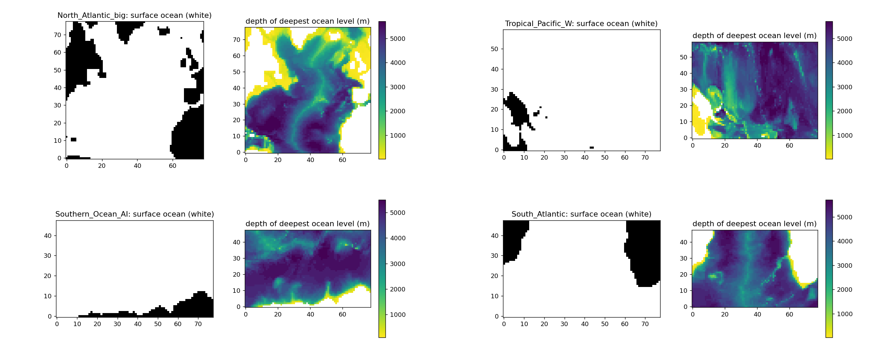

*Figure 1: 3-D ocean masks of the four training boxes. Left of each pair: surface ocean (white) and land (black). Right: depth of the deepest ocean level in each water column; deeper water is darker. Order: North Atlantic, Tropical Pacific W (top), Southern Ocean, South Atlantic (bottom).*

- **North Atlantic:** the Mid-Atlantic Ridge runs through the middle of the box, with the deep basins on either side and the American and European/African coasts at the edges.
- **Tropical Pacific W:** New Guinea and the island chains east of it lie in the west of the box, with shallow plateaus and ridges between deep basins.
- **Southern Ocean:** the Antarctic coast and shelf lie along the southern edge, and ridges cross the deep basins further north.
- **South Atlantic (new in run 3):** the Mid-Atlantic Ridge runs north–south through the middle, with a shallow rise in the western basin (the Rio Grande Rise) and a ridge running diagonally towards Africa (the Walvis Ridge). The continental margins of South America and Africa lie at the edges.

Runs 2 and 3 use the first three boxes; run 3 adds the South Atlantic box; run 1 uses only the North Atlantic box.

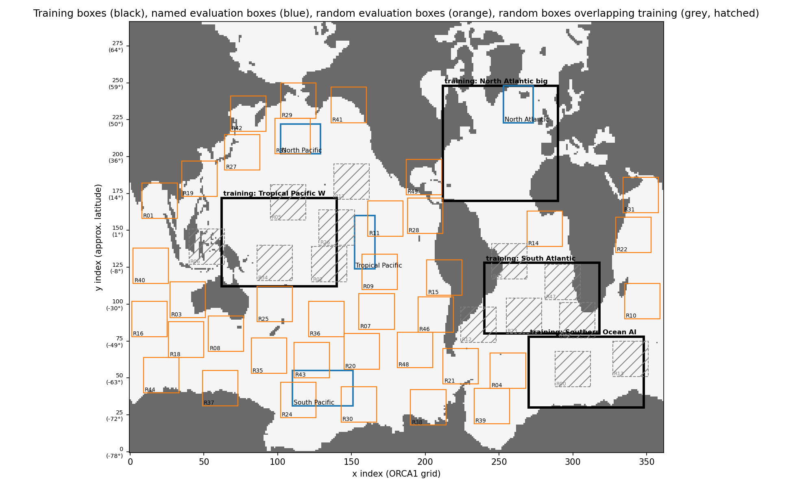

*Figure 2: Boxes of the evaluation for run 3 on the ORCA1 grid: training boxes (black), named boxes (blue), unseen random boxes (orange) and random boxes that overlap a training box (grey, hatched).*

### 1.3 Which random boxes are unseen

**Table 3:** Random boxes that overlap the training boxes of each model, and the number of unseen random boxes.

| Model | Random boxes overlapping its training boxes ("seen") | Unseen random boxes |
|---|---|---|
| Run 1 | none | 50 |
| v3, run 2 | R00, R02, R05, R06, R13, R17, R26, R32, R34 | 41 |
| Run 3 | as v3, plus R12, R23, R45, R47 (inside the South Atlantic box) | 37 |

Comparisons between models use only boxes unseen by both: 41 boxes for run 1 against v3 and for run 2 against v3, 37 boxes for run 3 against run 2.

## 2. Runs

**Table 4:** Run times, stopping and memory.

| Run | Job | Training | Epochs (best) | Stop reason | Final learning rate | Prediction step | Total | Peak memory |
|---|---|---|---|---|---|---|---|---|
| 1 `v3_na1` | 47481940 | 2 h 13 min | 60 (55) | epoch limit | 1e-4 | 9.5 min | 2 h 39 min | – |
| 2 `v3_multi_long` | 47481941 | 9 h 32 min | 93 (83) | 10 epochs without improvement | 1.25e-5 | 13 min | 10 h 03 min | 86 GB |
| 3 `v4_multi4_long` | 47481942 | 10 h 16 min | 76 (66) | 10 epochs without improvement | 1.25e-5 | 17 min | 10 h 52 min | 98 GB |

All three jobs completed without errors. Runs 2 and 3 converged by the stopping rule. Run 1 still improved slowly at the epoch limit, but its validation loss had flattened. The results were copied to `/gpfs/scratch/bsc32/bsc032196/nautilus/ACC_FULL_COLUMN_v2/<experiment>/`.

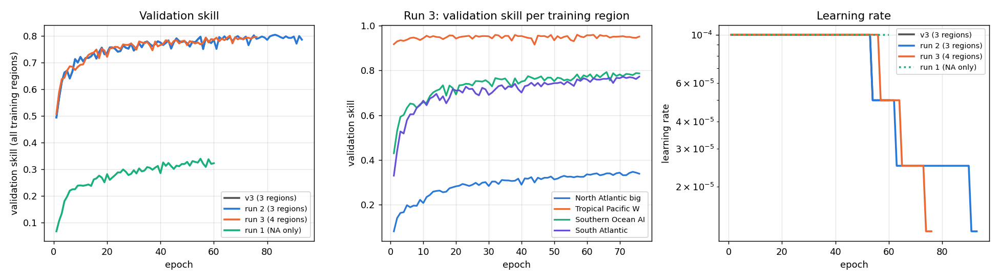

*Figure 3: Training of runs 1–3 and v3. Left: validation skill over all training regions of each model. Middle: validation skill per training region in run 3. Right: learning rate.*

- **Left panel, validation skill over all training regions.** Run 2 follows v3 until epoch 60 and then gains only a little more. Run 3 reaches a similar level. Run 1 has a lower skill, because its validation is the North Atlantic box alone, the hardest region.
- **Middle panel, run 3's skill per region.** The South Atlantic box (skill about 0.8) is learned about as fast as the Southern Ocean box. The North Atlantic stays the hardest region, at about 0.3.

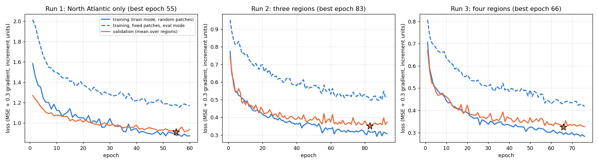

*Figure 4: Loss curves of runs 1–3: training loss (train mode, random patches), training loss on fixed patches with the model in evaluation mode, and validation loss (mean over the training regions). The star marks the best validation epoch.*

- **All three runs train smoothly.** The training loss (solid blue), the loss on fixed training patches with the model in evaluation mode (dashed blue) and the validation loss (orange) all fall over the whole run. None of them rises at the end, as the training loss did in v2c.
- **The validation loss flattens before the training loss.** In runs 2 and 3 it changes little after about epoch 50. The scheduler then lowers the learning rate, and the stopping rule ends the run.
- **The levels differ between runs.** The loss values cannot be compared between run 1 and runs 2–3. They are in the units of each model's own normalization, and run 1's validation is the North Atlantic box alone.
- **The fixed-patch loss lies above the training loss.** It is measured on 16 fixed patches per region, which include some of the most variable areas of the boxes. The training loss is an average over all random patches of an epoch.

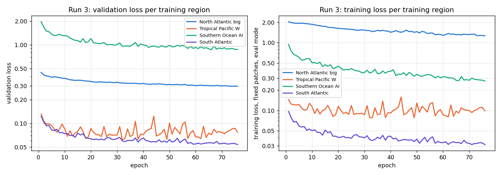

*Figure 5: Run 3, loss per training region (log scale). Left: validation loss. Right: training loss on fixed patches, evaluation mode.*

- **The regions have very different loss levels** (log scale). The North Atlantic and the Southern Ocean have the largest changes from step to step, and the tropical Pacific W and the South Atlantic the smallest.
- **Each region keeps improving at its own pace.** The South Atlantic and Southern Ocean losses fall the most. The North Atlantic training loss falls slowly over the whole run, while its validation loss hardly changes after about epoch 40.

## 3. Results

### 3.1 Overview

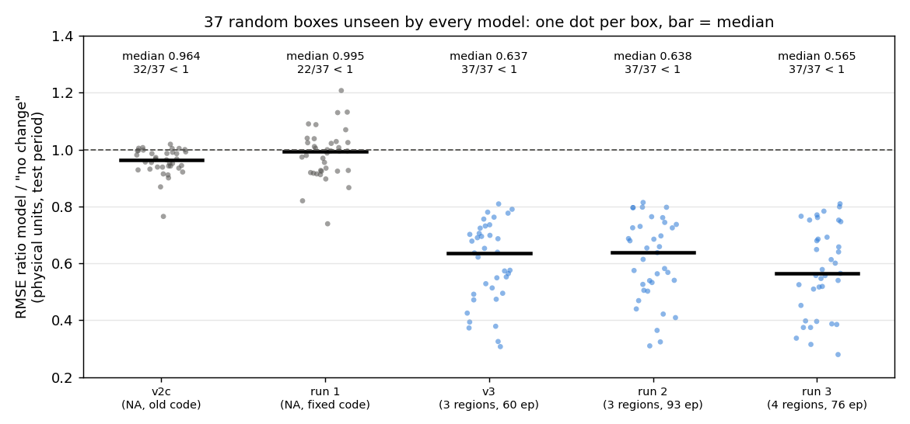

*Figure 6: RMSE ratio model / "no change" (physical units, test period) of every model on the 37 random boxes that no model has seen. One dot per box; the bar marks the median. Below the dashed line the model beats "no change".*

RMSE ratio model / "no change" in physical units on the test period, median over the random boxes unseen by every model (37), with the number of boxes better than "no change":

**Table 5:** Median RMSE ratio model / "no change" (physical units, test period) over the 37 random boxes unseen by every model.

| Model | Median ratio | Better than "no change" | Median SSIM of the change field |
|---|---|---|---|
| v2c (North Atlantic, old code) | 0.964 | 32 of 37 | 0.11 |
| Run 1 (North Atlantic, fixed code) | 0.995 | 22 of 37 | 0.15 |
| v3 (3 regions, 60 epochs) | 0.637 | 37 of 37 | 0.50 |
| Run 2 (3 regions, converged) | 0.638 | 37 of 37 | 0.50 |
| **Run 3 (4 regions, converged)** | **0.565** | **37 of 37** | **0.52** |

In normalized units, which is how the evaluation scores each box, run 3 has a median of 0.615. That is a skill of 0.62.

### 3.2 Per box

RMSE ratio in physical units:

**Table 6:** RMSE ratio model / "no change" per training and named box (physical units, test period).

| Box | v2c | Run 1 | v3 | Run 2 | Run 3 |
|---|---|---|---|---|---|
| North Atlantic big (training in all) | 0.925 | 0.804 | 0.801 | 0.794 | 0.793 |
| Tropical Pacific W | – | 0.928 | 0.203 | 0.200 | 0.209 |
| Southern Ocean AI | – | 1.004 | 0.462 | 0.449 | 0.458 |
| South Atlantic (training only in run 3) | – | – | – | – | **0.422** |
| North Atlantic (old box, inside training box) | 1.005 | 0.909 | 0.914 | 0.916 | 0.902 |
| South Pacific (unseen) | 1.012 | 1.005 | 0.609 | 0.596 | 0.585 |
| North Pacific (unseen) | 0.899 | 0.853 | 0.481 | 0.489 | 0.502 |
| Tropical Pacific (unseen) | 0.963 | 0.941 | 0.317 | 0.328 | 0.342 |

The Tropical Pacific W and Southern Ocean boxes are unseen by run 1, and so are the South Atlantic box and the North and South Pacific for every model.

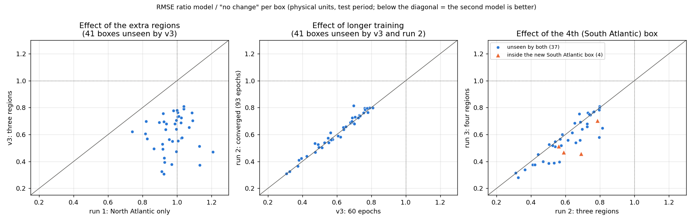

*Figure 7: Per-box comparisons of the RMSE ratio (physical units). Left: run 1 against v3 (effect of the extra regions). Middle: v3 against run 2 (effect of longer training). Right: run 2 against run 3 (effect of the fourth region); triangles mark the four random boxes inside the new South Atlantic box. Below the diagonal the model on the y-axis is better.*

### 3.3 Effect of the extra regions (run 1 against v3)

- **Same fit in the North Atlantic.** Run 1 and v3 have the same skill in the North Atlantic training box (0.804 and 0.801). Both are much better than v2c (0.925), which shows the effect of the training-loop fixes.
- **No generalization from one region.** Outside the North Atlantic, run 1 is about as good as "no change": median 0.988 over v3's 41 unseen boxes, 25 better. It is even a little worse than v2c there (0.955, 36 better). The better-trained model fits the North Atlantic more closely and transfers less. It fails most in the deep ocean, as the table below shows.
- **v3 beats run 1 in all 41 boxes.**

Median RMSE ratio (normalized) over the 41 boxes unseen by v3, per depth band (boxes better than "no change" in brackets):

**Table 7:** Run 1 against v3: median RMSE ratio (normalized) over the 41 random boxes unseen by v3, per depth band; boxes better than "no change" in brackets.

| Band | Run 1 | v3 |
|---|---|---|
| 0–200 m | 0.994 (26) | 0.778 (36) |
| 200–1000 m | 0.919 (31) | 0.444 (41) |
| 1000–2000 m | 1.130 (8) | 0.439 (38) |
| 2000–4000 m | 1.180 (5) | 0.534 (41) |
| 4000–6500 m | 3.008 (3) | 0.878 (32) |

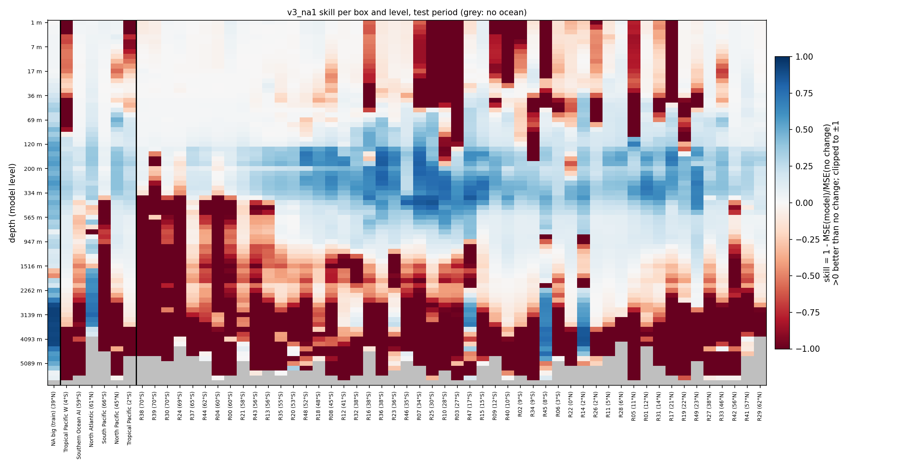

*Figure 8: Run 1 (North Atlantic only): skill 1 − MSE/MSE(no change) per box and model level, test period. Blue is better than "no change", red worse, grey no ocean.*

### 3.4 Effect of longer training (run 2 against v3)

- **Training converged.** Run 2 lowered the learning rate three times (to 1.25e-5) and stopped by itself at epoch 93. Its validation loss is 3 % lower than v3's.
- **The training boxes improve by 1–3 %:** North Atlantic 0.801 → 0.794, Southern Ocean 0.462 → 0.449.
- **Unseen boxes stay the same:** median 0.637 → 0.638, run 2 better in 15 of 41 boxes. The unseen named Pacific boxes get slightly worse (by 0.01).
- **v3 at 60 epochs had already captured almost all of the generalization.** More epochs mainly fit the training regions more closely.

### 3.5 Effect of the fourth region (run 3 against run 2)

On the 37 random boxes unseen by both:

- **The median improves** from 0.638 to 0.565. Run 3 is better in 22 of 37 boxes; the improvements are large and the losses small.
- **Gains by basin:**

  **Table 8:** Run 3 against run 2 per ocean basin, on the 37 random boxes unseen by both.

  | Basin | Boxes | Better in run 3 | Median, run 2 → run 3 |
  |---|---|---|---|
  | Indian Ocean | 7 | 6 | 0.533 → 0.388 |
  | Pacific (with the South China Sea) | 14 | 8 | 0.533 → 0.513 |
  | Southern Ocean (south of 45°S) | 14 | 7 | 0.711 → 0.660 |
  | Atlantic (R14 at the equator, R49 in the Gulf of Mexico region) | 2 | 1 | 0.698 → 0.625 |

  Only two Atlantic boxes are still unseen; the others now overlap training boxes.
- **Largest gains:** R08 (45°S, south of Australia) 0.80 → 0.58, R36 (38°S, South Pacific) 0.56 → 0.40, R49 (23°N, Gulf of Mexico region) 0.81 → 0.65, R10 (28°S, Indian Ocean) 0.53 → 0.39.
- **Losses:** R39 and R30 near Antarctica (70°S, +0.07 and +0.02), the North Pacific (R41, R33, +0.02 to +0.03), R03 (27°S, eastern Indian Ocean, +0.03), and the named North and Tropical Pacific boxes (+0.01 each).
- **The four random boxes inside the new South Atlantic box** improve strongly, as expected, now that they are training area. R23, for example, goes from 0.69 to 0.46.

Median RMSE ratio (normalized) over the 37 boxes unseen by every model, per depth band (boxes better than "no change" in brackets):

**Table 9:** Median RMSE ratio (normalized) over the 37 random boxes unseen by every model, per depth band; boxes better than "no change" in brackets.

| Band | v3 | Run 2 | Run 3 |
|---|---|---|---|
| 0–200 m | 0.767 (32) | 0.774 (33) | **0.741 (35)** |
| 200–1000 m | 0.428 (37) | 0.440 (37) | **0.417 (37)** |
| 1000–2000 m | 0.424 (36) | 0.473 (35) | **0.401 (36)** |
| 2000–4000 m | 0.534 (37) | 0.519 (37) | **0.509 (37)** |
| 4000–6500 m | 0.921 (28) | 0.905 (27) | **0.884 (28)** |

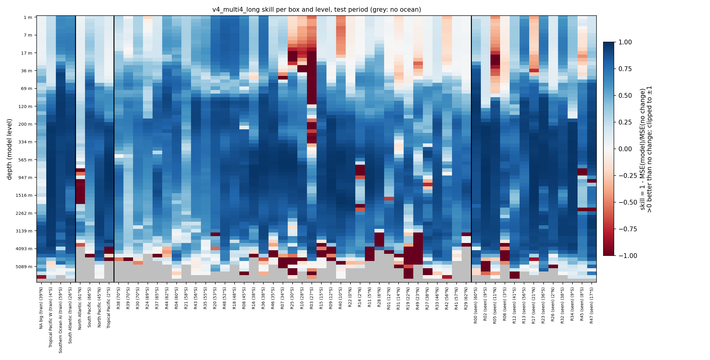

*Figure 9: Run 3 (four regions): skill per box and model level, test period. Columns: training boxes, named boxes, unseen random boxes (south to north), and random boxes that overlap a training box ("seen").*

In the run 3 heatmap:

- **Skill from about 50 m to about 4000 m almost everywhere.**
- **The surface failures in the subtropical gyres are smaller than in v3** (R10, R25), but R03 (27°S) is still worse than "no change" from 17 to about 400 m.
- **The old North Atlantic box** is still worse than "no change" at about 600–2000 m.
- **Below about 4000 m** many boxes are near "no change".

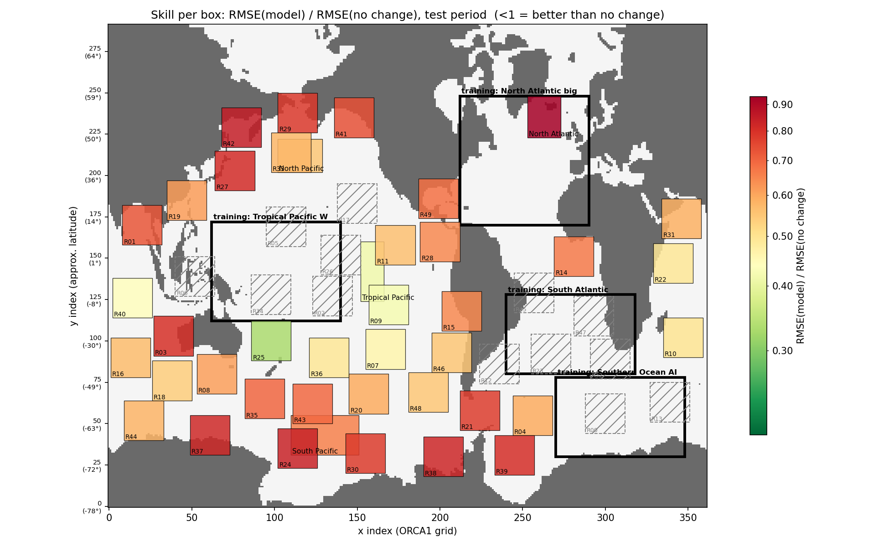

*Figure 10: Run 3: RMSE ratio model / "no change" per box on the map (normalized units, test period). Green is better than "no change"; hatched boxes overlap a training box.*

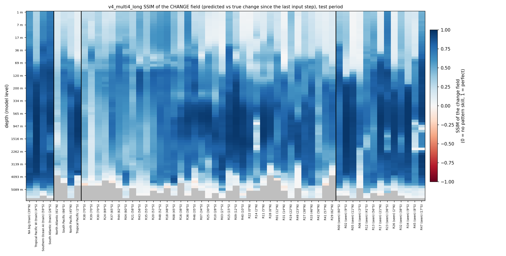

*Figure 11: Run 3: SSIM of the change field (predicted against true change since the last input) per box and model level, test period.*

### 3.6 Prediction dashboards (run 3)

**Table 10:** Scores of the run 3 dashboard shown below (whole test period).

| Box, depth | RMSE (% of mean tracer) | "No change" | Ratio | Skill | SSIM of the change field |
|---|---|---|---|---|---|
| North Atlantic big (training), 97 m | 0.035 % | 0.049 % | 0.705 | 0.35 | 0.84 |

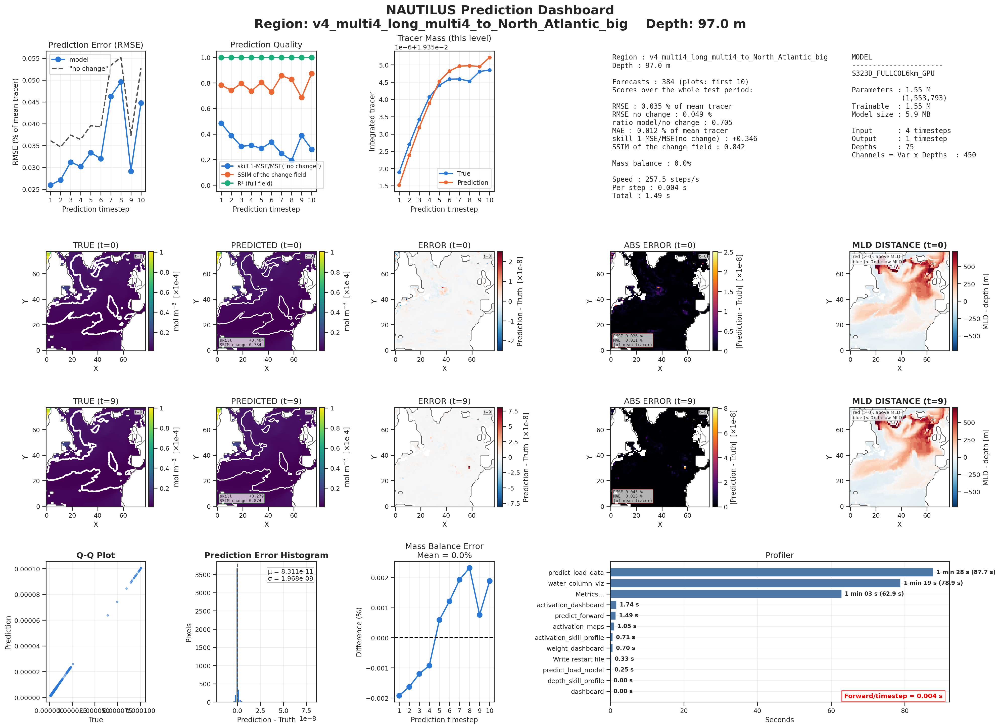

*Figure 12: Run 3 prediction dashboard, North Atlantic training box, 97 m, first 10 test steps.*

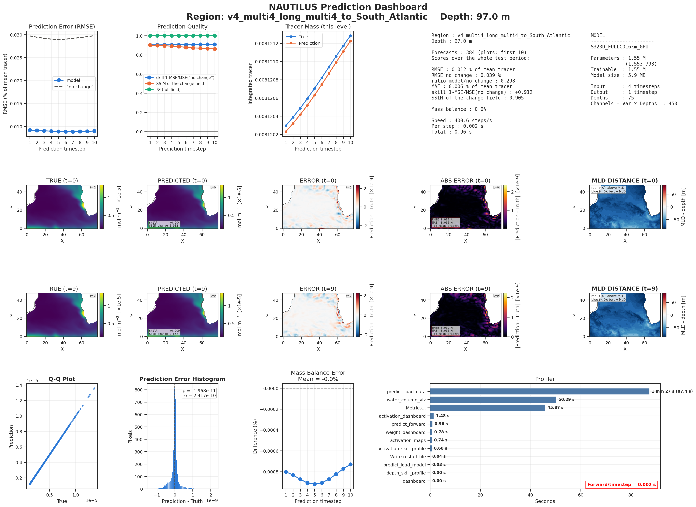

*Figure 13: Run 3 prediction dashboard, South Atlantic training box, 97 m, first 10 test steps.*

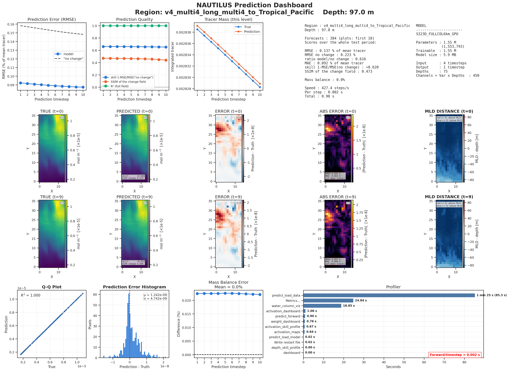

*Figure 14: Run 3 prediction dashboard, Tropical Pacific (never trained on), 97 m, first 10 test steps.*

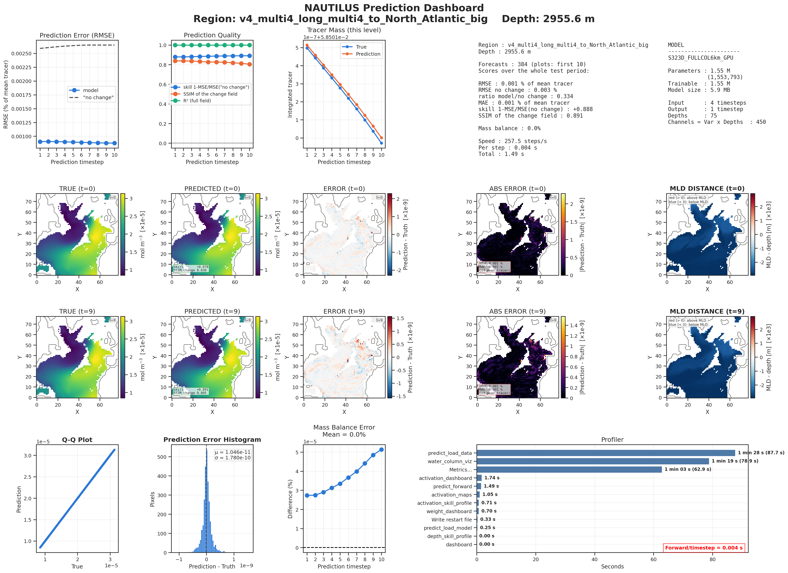

*Figure 15: Run 3 prediction dashboard, North Atlantic training box, 2956 m. White areas inside the grey coastline are sea floor shallower than this level.*

With the clipped colour scale, the MLD map at 97 m in the North Atlantic now shows the structure: red where the winter mixed layer reaches below 97 m (subpolar gyre, Labrador and Irminger Seas), blue in the subtropics. The Tracer Mass panel now follows the plotted level.

## 4. Interpretation

- **The model learns transferable dynamics only from varied training data.** One region, even trained well, does not transfer. Three regions transfer to all basins, and a fourth region helps further, mainly in a basin it does not contain (the Indian Ocean). More epochs on the same regions do not.
- **The model is limited by data, not by training time.** The next gains should come from more, or more varied, training regions, or from the model itself (inputs, size), not from longer runs.
- **The North Atlantic stays the hardest region.** Its skill hardly changes across v3, run 2 and run 3 (0.79–0.80). Its 600–2000 m water (the old North Atlantic box) is predicted worse than "no change" by every model.

## 5. Suggested next steps

1. **Use run 3 as the new reference model** (`v4_multi4_long`, `checkpoints/v4_multi4_long_multi4_best_model.pt`). It is the best on unseen boxes and needs no more epochs.
2. **Test the effect of more regions further.** For example, add a North Pacific box and keep the Indian Ocean unseen, or add an Indian Ocean box and keep the North Pacific unseen. The aim is to see whether the trend continues. With 5 boxes the run needs about 125 GB of memory, so request 30 CPUs.
3. **Look into the North Atlantic at 600–2000 m.** This is the depth of the Mediterranean outflow and Labrador Sea water. Possible steps:
    - a separate validation score for this band;
    - more North Atlantic patches per epoch (a larger sampling weight);
    - checking the inputs there, for example whether the vertical velocity and diffusivity carry the signal.
4. **Deep levels below 4000 m:** try a per-depth loss weight, or accept "no change" there as a hard baseline.

## 6. Files

On MN5, in `~/NAUTILUS/ACC_NAUTILUS/ACC_FULL_COLUMN_v2`:

**Table 11:** Files of the three runs on MN5.

| What | Run 1 | Run 2 | Run 3 |
|---|---|---|---|
| Config | `config/nautilus_v3_na1.yaml` | `config/nautilus_v3_multi_long.yaml` | `config/nautilus_v4_multi4_long.yaml` |
| Checkpoint | `checkpoints/v3_na1_North_Atlantic_big_best_model.pt` | `checkpoints/v3_multi_long_multi3_best_model.pt` | `checkpoints/v4_multi4_long_multi4_best_model.pt` |
| Logs | `logs/v3_na1/` | `logs/v3_multi_long/` | `logs/v4_multi4_long/` |
| Global evaluation | `eval_global_v3_na1/` | `eval_global_v3_multi_long/` | `eval_global_v4_multi4_long/` |
| Dashboards | `artifacts/dashboard/prediction/v3_na1/` | `.../v3_multi_long/` | `.../v4_multi4_long/` |
| Job output | `server/v2_47481940.out` | `server/v2_47481941.out` | `server/v2_47481942.out` |
| Copy on scratch | `/gpfs/scratch/bsc32/bsc032196/nautilus/ACC_FULL_COLUMN_v2/v3_na1/` | `.../v3_multi_long/` | `.../v4_multi4_long/` |

Locally: this report (`.md` and `.pdf`) and its figures in `~/ClaudeX/19-Oct-2026/Reports/`.
