# NAUTILUS v2: North Atlantic training with a 3-D ocean mask, evaluated globally

Experiment `v2_NA_mask3d`, ACC (GPU) full-column model. Code in `~/NAUTILUS/ACC_NAUTILUS/ACC_FULL_COLUMN_v2` on MareNostrum 5 (git repository; baseline commit `d26e37a`, v2 changes in commit `5462ae1`).
Written 15 October 2026; section 9 (runs `v2b_inc_mask6` and `v2b_inc_mask7`, predicting the change instead of the full field) added 16 October 2026.

> **Update 16 October.** Predicting the change from the last snapshot (section 9) brings the model from about 1 700 times worse than "no change" to slightly better than it: RMSE ratio 0.936 in the training box, a median of 0.966 over the 50 random boxes, and 44 of 50 random boxes better than "no change". The skill is modest and lies mainly in the tropical and subtropical thermocline and in the deep training box. Giving the ocean mask as an extra input channel does not help (mask6 vs mask7, section 9.6).

## Summary

- **The ocean-bottom problem is fixed.** Cells below the sea floor are now excluded from training, normalization, scores and plots. Profiles stop at the sea floor with real tracer values, and the Hovmöller sections show the bathymetry blank instead of fake zeros.
- **The model is still far from usable.** On the test period it is about 1 700 times worse than predicting "no change" inside the North Atlantic training box, and 1 700 to 19 000 times worse (median 9 700) in the 50 random boxes elsewhere. No box beats "no change".
- **Training stopped early.** The best epoch was 3; validation loss then rose, and early stopping ended the run at epoch 8 (27 minutes). The training loss also stopped falling after epoch 3.
- **Outside the North Atlantic the inputs leave the trained range.** With the North Atlantic scaling, a median of 41 % of the true tracer values in a random box lie outside 0–1, the range the model saw in training. Errors are largest between 1000 and 4000 m.
- **Most likely next step:** the target. With 45-minute snapshots the tracer changes by about 1/25 000 of its normalized range per step in the training box, while the model's error is about 1/15 of it. Predicting the change from the last snapshot instead of the full field (or adding the last snapshot to the model output) is in my view the change most likely to help; section 7 lists it with the other options.

---

## 1. Why a new run

The ocean expert pointed out wrong profiles and wrong predicted pixels near the ocean bottom in the profile and Hovmöller plots of the earlier ACC full-column runs. The cause, found in the training code:

- **NEMO marks the sea floor correctly.** In the tracer file, cells below the sea floor (and land) hold the fill value `1e20`, and real ocean cells are never exactly zero.
- **The old data loader turned the fill value into 0** (`src/data.py`, `safe_load_and_slice`).
- **The old land mask was 2-D**, taken from the surface layer only. Every water column counted as ocean from the surface to 6000 m.

So below the sea floor the model was trained on, normalized with and scored on fake zero tracer. In the old North Atlantic box 42 % of the cells at 1500 m and 94 % at 3100 m are below the sea floor, and 100 % below about 4000 m. This also explains why levels 66–75 showed up as "constant" (minimum = maximum = 0) in every earlier run.

The expert also asked for:

- a larger North Atlantic training box that includes the continental boundaries and reaches further south;
- training on the North Atlantic only;
- inference on randomly chosen regions over the globe, to see how well the model generalizes.

## 2. Decisions

| Question | Decision |
|---|---|
| Training box | x 212–290, y 170–248 on the ORCA1 grid: about 10–68°N, 81°W–10°E, with the American and European/African coasts |
| Ocean mask as model input | Yes, as a 7th input channel |
| Target | Full tracer field, as before (not the increment) |
| Evaluation regions | 50 random boxes plus 5 named boxes, test period only |
| Time split | 70 / 15 / 15 % (train / validation / test), was 80 / 19 / 1 % |
| Where | New folder `ACC_FULL_COLUMN_v2`; `ACC_FULL_COLUMN` is untouched |

## 3. The boxes

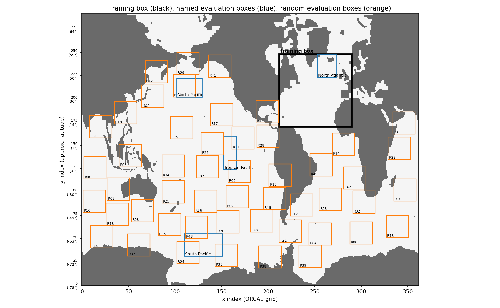

- **Training box** (black): 78 × 78 grid columns, 77 % surface ocean, ocean on 74 of the 75 model levels.
- **Named boxes** (blue): the four boxes of the earlier runs (old North Atlantic, South Pacific, North Pacific, Tropical Pacific). The old North Atlantic box lies inside the new training box, so for it only the time is unseen.
- **Random boxes** (orange): 50 boxes of 24 × 24 columns, drawn with a fixed seed (2026). Each has at least 50 % surface ocean, none overlaps the training box or another random box, and none touches the rows next to the ORCA north fold (y < 270). The list with latitudes and longitudes is in `eval_global/regions.csv`.

The suggested size was 32 × 32; only 39 such boxes fit under these rules (45 at 28 × 28), so 24 × 24 was used to reach 50.

## 4. What changed in the code

All changes are in `ACC_FULL_COLUMN_v2` and can be listed with `git diff d26e37a 5462ae1`.

### 4.1 New data pipeline: `src/data_v2.py`

| | Before (`src/data.py`) | Now (`src/data_v2.py`) |
|---|---|---|
| Ocean mask | 2-D, surface only | 3-D (depth × y × x), from the fill values of the first time step (the NEMO z-grid does not change in time) |
| Cells below the sea floor | Tracer 0, counted as ocean | Excluded from loss, normalization, scores and plots |
| Tracer normalization | Per-depth min/max including the fake zeros | Per-depth min/max over ocean cells of the training period only. A level with no ocean takes the values of the nearest level above |
| u, v, w, dif, MLD distance normalization | Mean/std including land zeros | Mean/std over ocean cells of the training period only |
| Model input | 6 channels | 7 channels: tracer, u, v, w, dif, MLD distance, **ocean mask**. Non-ocean cells are 0 in every channel |
| Reading | Each of train, val and test read the full timeline separately, in double precision, with extra copies | Read once in single precision and shared by the three splits |
| Training samples | The whole box | Random 48 × 48 patches of the box with at least 30 % surface ocean, a new patch every time |
| Time split | 80 / 19 / 1 % | 70 / 15 / 15 % (`data.split` in the config) |
| Norms file | `norms/norm_stats_<region>.npz` | `norms/<experiment>_norm_stats_<region>.npz`, so the earlier runs' files are not overwritten |

Random patches keep the GPU memory the same as before despite a 12 times larger box. The model is fully convolutional, so the trained network runs on any box size, which the global evaluation relies on.

### 4.2 Training: `src/train.py`

- Trains only the regions listed in `data.training_regions` (here `North_Atlantic_big`). Before, it trained every region in `data.regions`.
- **Gradient loss:** a horizontal gradient now counts only when both neighbouring cells are ocean. Before, one ocean cell was enough, so gradients across the coast and across the sea floor were trained.
- Training batches are shuffled (before: in time order).
- The best checkpoint is chosen on validation loss alone (before: training and validation loss both had to improve).
- `depth_training` is `all`: the 3-D mask now removes cells below the sea floor, so no depth cut-off is needed.
- Saves a picture of the 3-D mask (`artifacts/ocean_mask3d_North_Atlantic_big.png`).

### 4.3 New evaluation: `src/evaluate_global.py`

- Draws the random boxes and the map (`--map-only` draws just the map).
- Reads the test period once for all boxes (the NEMO files are stored as one full 3-D field per time step, so reading full fields is much faster than reading boxes).
- Normalizes every box with the **training region's** statistics, because those are what the model learned. A box elsewhere has its own tracer range, so its normalized values can lie outside 0–1; the share of such cells is reported.
- Scores every box against the NEMO truth and against the "no change" forecast (the newest input snapshot), over ocean cells only, overall, per depth band and per model level.
- Draws profile and section figures with the sea floor blank, a skill map, and an RMSE-per-level plot.

`src/predict.py` and the dashboards of the earlier runs were not adapted to the 7-channel model and the new data pipeline, and were not run.

### 4.4 Config and job

- `config/nautilus_v2_NA_mask3d.yaml`: the run described here. Changes against the old GPU config are marked `v2`.
- `config/nautilus_v2_smoketest.yaml`: 1 epoch and 3 random boxes, for testing.
- `sbatch_v2_train_eval.job`: trains, then runs the global evaluation. `SKIP_TRAIN=1` repeats only the evaluation.

| Setting | Value |
|---|---|
| Model | Same architecture as before (Conv2D-LSTM, ±2 neighbouring levels), 7 input channels |
| Epochs | up to 50, early stopping after 5 epochs without improvement |
| Batch | 4 patches of 48 × 48; validation on the whole 78 × 78 box |
| Learning rate | 1e-4, halved after 3 epochs without improvement |
| Loss | Masked MSE + 0.3 × masked gradient loss |

## 5. Runs

| Job | Queue | What | Result |
|---|---|---|---|
| 47325393 | `acc_debug` | Smoke test: 1 epoch, 5 boxes | Completed in 13 min 42 s. Reading the training box took 6 min, one epoch about 2.5 min |
| 47325877 | `acc_bsces` | Full run: training, then evaluation on 55 boxes | Completed in 36 min 47 s, exit code 0: training 27 min, evaluation about 8 min |

Training data: 1 787 training windows, 383 validation windows and 384 test windows. Each window is 4 input snapshots and the snapshot that follows, 45 minutes apart, between 1 January and 21 March 1971. The test period covers the last 384 windows (about 12 days, from 9 March).

### Training

| Epoch | Training loss | Validation loss |
|---|---|---|
| 1 | 0.0597 | 0.0178 |
| 2 | 0.0061 | 0.0057 |
| 3 | 0.0056 | **0.0049** (best, saved) |
| 4–7 | not printed | no improvement |
| 8 | 0.0059 | 0.0068 (early stop) |

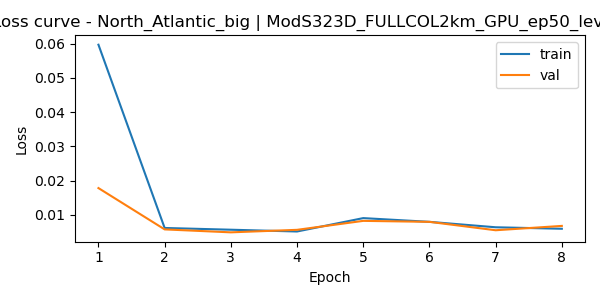

The 3-D mask of the training box (left: surface ocean; right: depth of the deepest ocean level, showing the Mid-Atlantic Ridge):

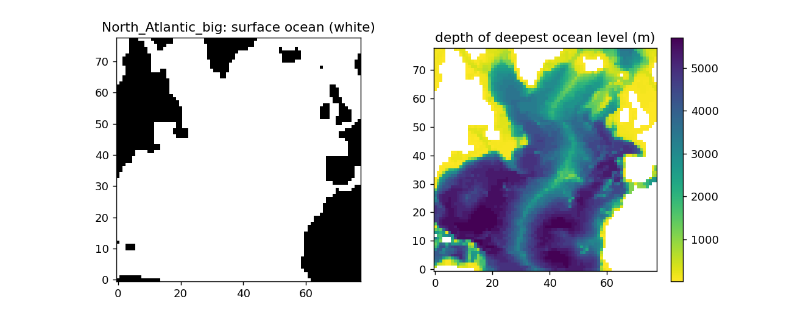

## 6. Results

All scores are over ocean cells only and over all 384 test windows. RMSE is in normalized tracer units, using the training box's scaling for every box. "Ratio" is RMSE(model) / RMSE(no change): below 1 would mean better than "no change".

### 6.1 Per box

| Box | Where | RMSE model | RMSE no change | Ratio | True values outside 0–1 |
|---|---|---|---|---|---|
| North_Atlantic_big (training box, unseen period) | 10–68°N, 81°W–10°E | 0.066 | 0.00004 | 1 679 | 0 % |
| North_Atlantic (old box, inside the training box) | 53–68°N, 38–12°W | 0.071 | 0.00004 | 1 856 | 0 % |
| South_Pacific | 70–61°S | 1.94 | 0.00016 | 11 755 | 85 % |
| North_Pacific | 38–52°N | 1.43 | 0.00027 | 5 349 | 49 % |
| Tropical_Pacific | 9°S–4°N | 1.17 | 0.00056 | 2 091 | 44 % |
| 50 random boxes, median | global | 1.15 | – | 9 724 | 41 % |
| 50 random boxes, range | | 0.15 – 2.02 | | 1 723 – 18 910 | |

- **Best random boxes:** R14 (equatorial Atlantic, 2°S–6°N, ratio 1 723), R28 (eastern tropical Pacific off Central America, ratio 2 291) and R26 (central equatorial Pacific, ratio 2 421). The tropics come out relatively best.
- **Worst random boxes:** R39 (Weddell Sea, 74–66°S, ratio 18 910), R13 (Southern Indian Ocean, ratio 17 422) and R07 (South Pacific, ratio 16 753). The Southern Ocean comes out worst.
- The full table with latitudes and longitudes is `eval_global/metrics_per_region.csv`.

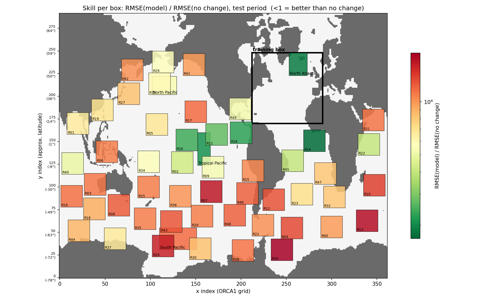

The colours are on a log scale and every box is worse than "no change": green marks the least bad boxes, not good ones. The training box itself is drawn only as an outline.

### 6.2 Per depth

| Depth band | Training box: model | Training box: no change | Random boxes, median: model | Random boxes, median: no change |
|---|---|---|---|---|
| 0–200 m | 0.058 | 0.00004 | 0.070 | 0.00006 |
| 200–1000 m | 0.073 | 0.00005 | 0.50 | 0.00012 |
| 1000–2000 m | 0.053 | 0.00004 | 2.21 | 0.00015 |
| 2000–4000 m | 0.077 | 0.00004 | 2.03 | 0.00008 |
| 4000–6500 m | 0.118 | 0.00001 | 1.14 | 0.00001 |

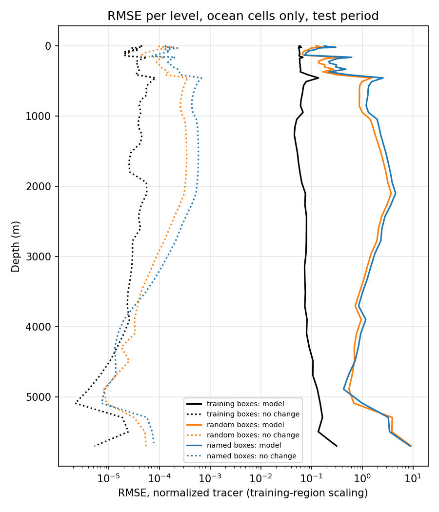

- **In the training box** the error is about the same at all depths down to 4000 m and grows below it.
- **Elsewhere** the near-surface error (0–200 m) is close to the training box's, but below 200 m it is 10 to 40 times larger. This is where the tracer values of other regions fall furthest outside the North Atlantic range.
- Across the random boxes the model's RMSE rises with the share of values outside 0–1 (rank correlation 0.46), but the ratio to "no change" barely does (0.1), because the "no change" error also differs from box to box.

### 6.3 Profiles and sections

Each figure shows one test window (window 2362, 15 March 1971) with the sea floor blank.

**North Atlantic training box:** the profiles stop at the sea floor, the sections follow the bathymetry, and no fake zeros remain. The prediction is noisy in the upper 500 m and goes negative in places, which a tracer concentration cannot be.

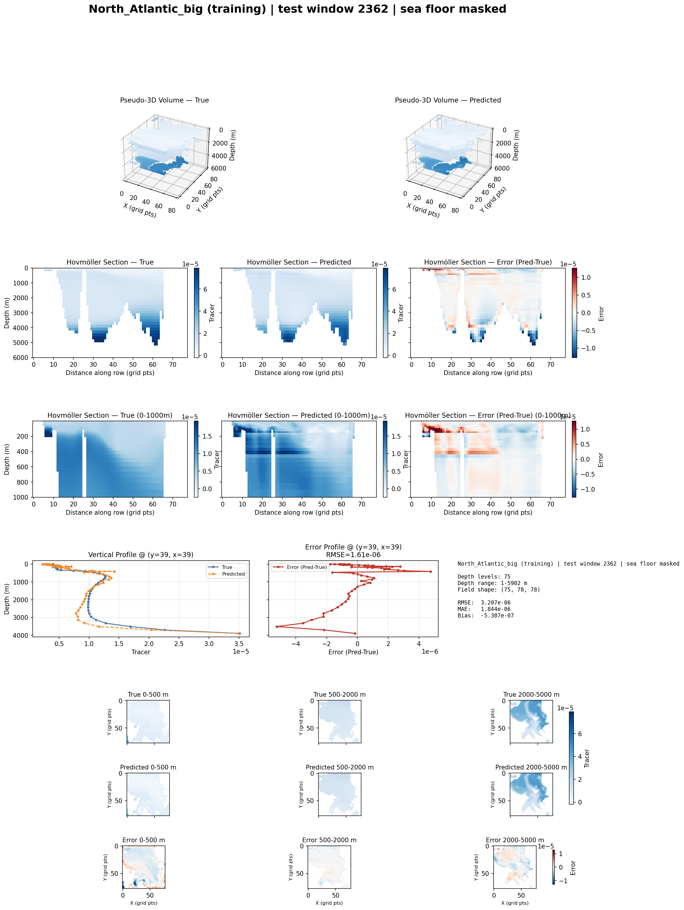

**Old North Atlantic box** (inside the training box):

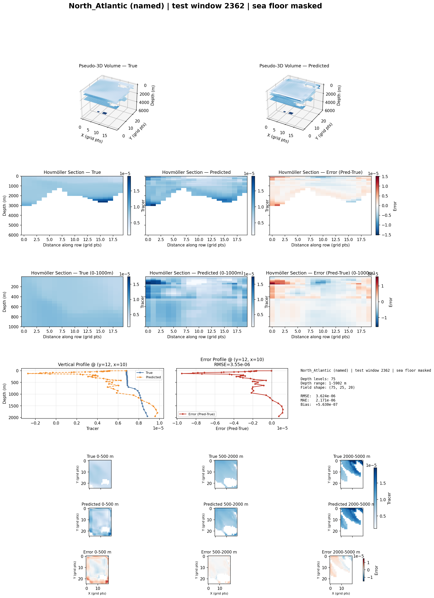

**Tropical Pacific** (not seen in training):

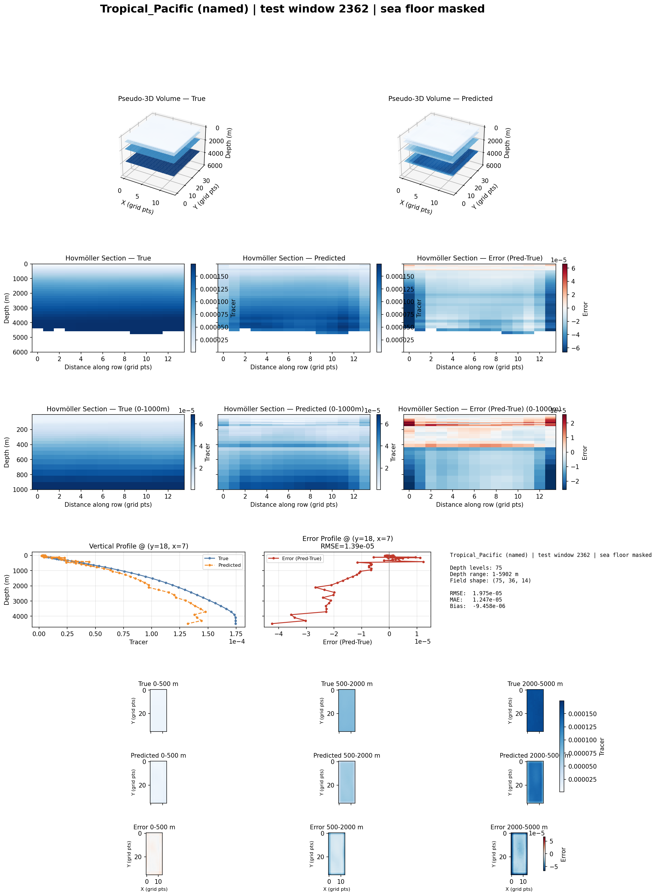

**Random box R01** (Bay of Bengal, 4–20°N):

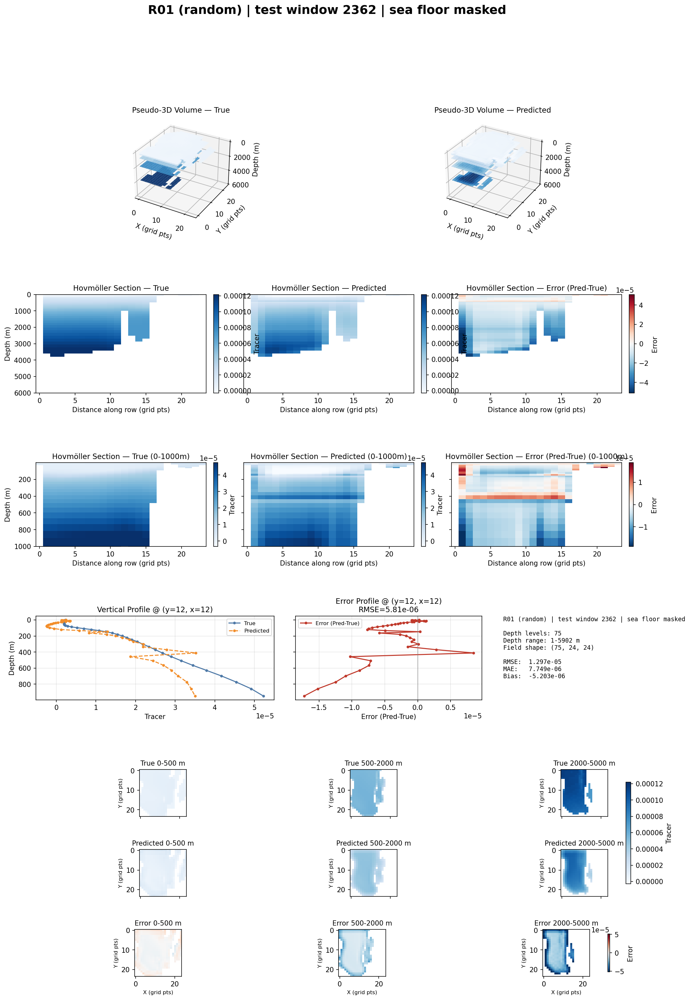

### 6.4 Compared with the earlier runs

The earlier ACC North Atlantic model was about 450 times worse than "no change" (RMSE 0.049 against 0.00011). Its score came from a single test sample, over 0–2000 m, with the seabed zeros included and the old box's scaling. These numbers come from 384 windows, ocean cells only, all depths and the larger box's scaling, so the two are not directly comparable. Either way, the new run is not better at forecasting; what it fixes is the bottom artefact, and the evaluation is now much more thorough.

## 7. Suggested next steps

1. **Predict the change, not the full field.** *Done in section 9.* The model's error is about 1 500 times larger than one time step's change, so it cannot even reproduce its own input closely enough. Training on the increment (next snapshot minus the last one), or adding the last snapshot to the network output, lets "no change" be the starting point and the network learn only the correction. You chose the full field for this run; this would be a separate, small code change.
2. **Train longer and more steadily.** Training stopped after 3 useful epochs. A patience of 10, or the learning-rate reduction earlier (patience 1–2), would show whether more epochs help. A training loss that stops falling after epoch 3 also suggests trying a lower learning rate.
3. **Scaling for other regions.** Using the North Atlantic min–max per level puts 40 % or more of other regions' values outside the trained range. Options:
   - a fixed scaling for the whole globe (computed from all ocean cells, or a log transform),
   - per-column scaling,
   - or training on several basins.

   This is a question for the ocean expert.
4. **No negative concentrations.** A non-negative output layer (for example softplus) on the physical tracer.
5. **Longer data.** The data covers only 80 winter days of 1971. A longer period would give a test set with other seasons.

## 8. Files

On MN5 in `~/NAUTILUS/ACC_NAUTILUS/ACC_FULL_COLUMN_v2`:

| File | Contents |
|---|---|
| `checkpoints/v2_NA_mask3d_North_Atlantic_big_best_model.pt` | Trained model |
| `norms/v2_NA_mask3d_norm_stats_North_Atlantic_big.npz` | Normalization statistics |
| `eval_global/regions.csv` | All boxes with indices, latitude, longitude, ocean fraction |
| `eval_global/metrics_per_region.csv` | Scores per box |
| `eval_global/metrics_per_depthband.csv` | Scores per box and depth band |
| `eval_global/rmse_by_level.csv` | Scores per model level |
| `eval_global/*.png`, `eval_global/watercolumn/` | Maps, RMSE profile, water-column figures |
| `logs/train_v2_<job>.log`, `logs/eval_v2_<job>.log`, `server/v2_<job>.out` | Logs |

## 9. v2b: predicting the change (16 October 2026)

Two new runs follow suggestion 1 of section 7: the model now predicts the change from the last input snapshot instead of the full field. They differ only in how the ocean mask is used:

| Run | Job | Ocean mask | Input channels |
|---|---|---|---|
| `v2b_inc_mask6` | 47333076 | In the data, loss, normalization and scores | 6, the same as the runs before v2: tracer, u, v, w, dif, MLD distance |
| `v2b_inc_mask7` | 47333077 | The same, and also given to the model as a 7th input channel | 7, as in v2 |

Both ran on `acc_bsces` on 16 October from 03:41: training took 45 minutes, the global evaluation 14, and the prediction dashboards 10–12. Both completed without errors (1 h 12 min and 1 h 9 min in total). Code: commits `5a41eb1`, `f6d0161`, `3022e92` and `6a2290b`.

### 9.1 Summary

- **The model now beats "no change" in most places.** Over the test period it is better than "no change" in the training box (RMSE ratio 0.936), in 44 of the 50 random boxes (median ratio 0.966) and in 3 of the 4 named boxes. In the full-field v2 run the ratio was about 1 700.
- **The gain is small.** In the median random box the forecast error is 3 % smaller than "no change", which removes about 7 % of the squared error (skill 0.07). The best box is the equatorial Atlantic, R14, at 0.76 (skill 0.42).
- **The skill comes from specific depths and places:**
    - the thermocline, 100–600 m, in the tropics and subtropics everywhere;
    - 2500–4500 m inside the training box (skill up to 0.9).
- **It fails in other places:**
    - the surface mixed layer in several tropical boxes;
    - the Southern Ocean;
    - below 4000 m outside the training box;
    - the subpolar old North Atlantic box, although it lies inside the training box.
- **The mask channel does not help.** mask6 is better than mask7 in 46 of the 55 boxes and wins on every summary number. The mask is better kept in the data only, which also keeps the input the same as in the runs before v2.
- **Training is unstable.** The best validation epoch is 3–4, after which the training loss itself goes up. The learning rate looks too high for the increment target.

### 9.2 What changed

| | v2 (section 4) | v2b |
|---|---|---|
| Target | Full tracer field at the next step | Change since the last input snapshot, divided by its per-level RMS over training ocean cells (`data.target: increment`). Predicting 0 is the "no change" forecast. The full field is rebuilt as last snapshot + prediction × RMS |
| Ocean mask | Also a 7th input channel | `data.mask_channel: false` (mask6) or `true` (mask7) |
| Early stopping | Patience 5 | Patience 10, and never before epoch 15 (`training.min_epochs`) |
| Metrics printed during training | SSIM and R² on training patches, land and sea-floor cells included, arguments of R² swapped | Removed. Each epoch prints the validation RMSE of the model and of "no change" over ocean cells, and the skill. Written to `logs/<experiment>/val_metrics_<region>.csv` |
| `predict.py` and dashboards | Not run for v2 | Adapted to the v2 data. Runs on the named boxes, test period only. Dashboards at 4 depths (5, 97, 1046 and 2956 m), with a "no change" RMSE line |
| Per-depth folders of the prediction step (`frames/`, `movies/`, `statistics/`) | One folder per level, 75 levels | Only for the 4 dashboard depths |
| Global evaluation | Per-box and per-band scores, skill map | Also heatmaps of depth × box for skill, RMSE ratio per band, RMSE and SSIM, and `metrics_per_level_per_region.csv` |
| SSIM in the evaluation | None | Masked SSIM on each 2-D level, over ocean cells only: of the full field, of the "no change" field, and of the **change field** (predicted change vs true change since the last input) |

Everything else is as in v2: same box, same patches, same 70/15/15 split, same loss (MSE + 0.3 × gradient, now on the scaled change), and learning rate 1e-4 halved after 3 epochs without improvement.

**Skill** in this section is 1 − MSE(model) / MSE(no change). It is 0 for "no change", 1 for a perfect forecast and negative when the model is worse. It equals 1 − ratio², so a ratio of 0.95 is a skill of 0.10. For the change it is the same as R² of the predicted change.

### 9.3 Training

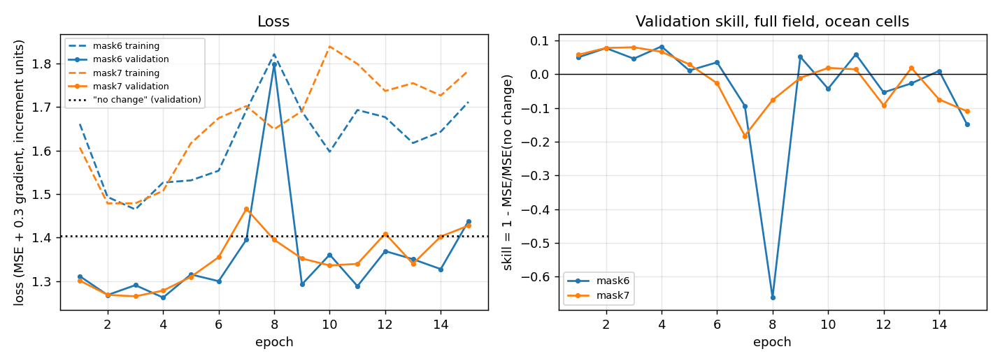

| | mask6 | mask7 |
|---|---|---|
| Validation loss of "no change" | 1.404 | 1.404 |
| Best epoch, validation loss | 4, 1.262 | 3, 1.265 |
| Best validation skill, full field | 0.082 | 0.080 |
| Epochs run | 15 (stopped at `min_epochs`) | 15 |
| Learning rate | 1e-4, halved at epochs 8 and 12 | the same |

- Both runs reach their best epoch early. After that the **training loss rises** (mask6 from 1.46 at epoch 3 to 1.82 at epoch 8), and validation skill swings between +0.08 and −0.66.
- When training loss goes up at a fixed learning rate, the steps are too large. A learning rate of 3e-5, or gradient clipping, is the obvious next try.
- The skill is small but real. "No change" has a validation loss of 1.404, and the best model reaches 1.262.

### 9.4 Results per box

All scores are over ocean cells and over the 384 test windows, as in section 6. A ratio below 1 means the model is better than "no change".

| Box | Ratio mask6 | Ratio mask7 | Skill mask6 | SSIM of the change, mask6 | v2 (full field) ratio |
|---|---|---|---|---|---|
| North_Atlantic_big (training box, test period) | **0.936** | 0.937 | 0.12 | 0.68 | 1 679 |
| North_Atlantic (old box, inside the training box) | 1.008 | 1.002 | −0.02 | 0.19 | 1 856 |
| South_Pacific | 1.009 | 1.018 | −0.02 | 0.07 | 11 755 |
| North_Pacific | **0.945** | 0.972 | 0.11 | 0.16 | 5 349 |
| Tropical_Pacific | **0.984** | 0.981 | 0.03 | 0.07 | 2 091 |
| 50 random boxes, median | **0.966** | 0.979 | 0.07 | 0.15 | 9 724 |
| 50 random boxes, range | 0.761 – 1.019 | 0.768 – 1.028 | −0.04 – 0.42 | 0.04 – 0.39 | 1 723 – 18 910 |
| Random boxes better than "no change" | **44 / 50** | 39 / 50 | | | 0 / 50 |

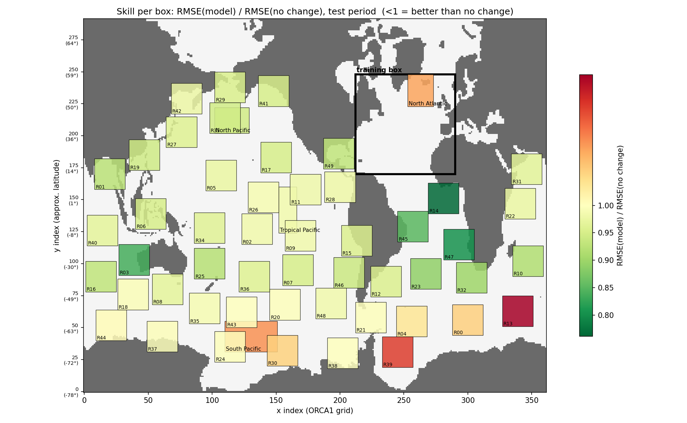

**Best random boxes** (mask6):

| Box | Location | Ratio |
|---|---|---|
| R14 | Equatorial Atlantic, 2°S–6°N | 0.76 |
| R47 | Angola Basin, 27–7°S | 0.80 |
| R03 | Off Western Australia | 0.84 |
| R45 | Tropical Atlantic off Brazil | 0.85 |

The tropical and subtropical Atlantic, nearest to the training box, comes out best.

**Worst random boxes:** all in the Southern Ocean, with ratios of 1.00–1.02:

| Box | Location |
|---|---|
| R13 | South-western Indian Ocean, 62–49°S |
| R39 | Weddell Sea |
| R00 | South Atlantic, 65–54°S |
| R30 | Amundsen Sea |

**What predicts a box's score** (rank correlations over the 50 random boxes):

- Share of its true values outside the training range 0–1: 0.68. In v2 this was 0.1.
- Latitude: 0.52. Boxes further from the equator are worse.
- So the scaling issue of section 7, item 3 now shows directly in the skill.

**Comparison with v2:** the change of target removed the 1 000- to 19 000-fold error. The model no longer has to reproduce the whole field. It only adds a correction to the last snapshot.

### 9.5 Results per depth and box

The heatmaps below have one column per box and one row per model level:

- training box first, then the named boxes, then the random boxes;
- random boxes sorted from south to north;
- grey: no ocean at that level.

The same figures for mask7 are in `eval_global_v2b_inc_mask7/`.

**Skill per level** (mask6), clipped to ±1:

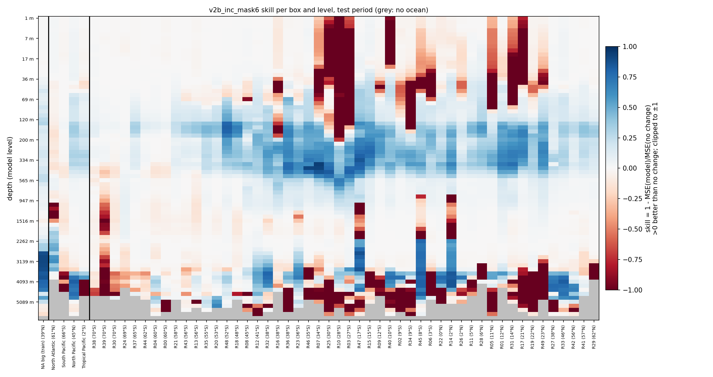

- **Thermocline (about 100–600 m):** positive skill in almost every box between about 40°S and 40°N. Up to 0.8 in the subtropical boxes (R07, R25, R10, R03, R47, R15).
- **Training box below 2000 m:** skill 0.9 at 3000 m and 0.8 at 4000 m. The deep tracer changes smoothly and steadily there, and the model has learned to continue that trend.
    - My guess is that a simple linear extrapolation of the last two snapshots would capture much of this too. That is worth checking (see 9.8).
    - The same deep skill appears in a few boxes outside, all in the Atlantic: R47, R45 and R14.
- **Surface layer, 0–100 m:** about 0 in most boxes. Strongly negative in a group of tropical and subtropical boxes, in the Indian Ocean and the Pacific (R07, R25, R10, R03, R40, R34, R05, R31, R17). Their mixed-layer changes are much larger than in the North Atlantic winter the model was trained on.
- **Below 4000 m outside the training box:** often negative. The largest failure is R49 (Gulf of Mexico / Caribbean edge, 23°N): ratio 57 in the 4000–6500 m band (see the next figure).
- **Southern Ocean boxes (left):** close to 0 at all depths.
- **Old North Atlantic box:** negative around 1000–1500 m. This is where the subpolar deep convection mixes the tracer down, which a 4-snapshot window cannot predict well.

**RMSE ratio per depth band** (mask6), with numbers in the cells:

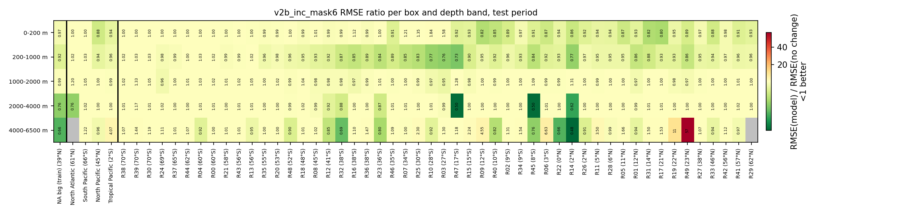

The colour scale is stretched by R49's outlier of 57 in the deepest band. The numbers in the cells are the reliable reading.

Medians over the 50 random boxes, by depth band:

| Depth band | Training box ratio, mask6 | Training box SSIM of the change, mask6 | Random median ratio, mask6 | Random median ratio, mask7 | Random boxes better than "no change", mask6 / mask7 |
|---|---|---|---|---|---|
| 0–200 m | 0.973 | 0.63 | 0.981 | 0.981 | 39 / 33 |
| 200–1000 m | 0.918 | 0.75 | **0.943** | 0.978 | 43 / 40 |
| 1000–2000 m | 0.991 | 0.63 | 0.998 | 0.986 | 30 / 33 |
| 2000–4000 m | **0.755** | 0.89 | 1.001 | 1.018 | 18 / 10 |
| 4000–6500 m | **0.664** | 0.50 | 1.020 | 1.068 | 19 / 14 |

**SSIM of the change field** (mask6):

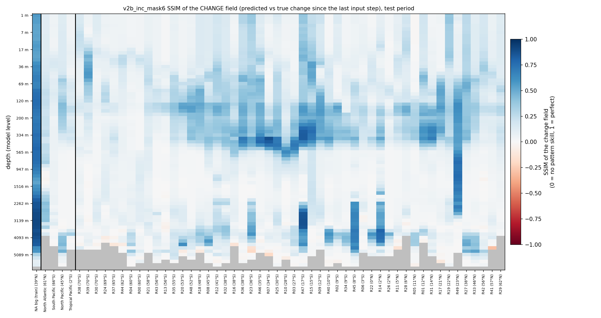

- **How to read it:**
    - 0 means the predicted change has no spatial resemblance to the true change; 1 means the same pattern.
    - "No change" predicts a change of 0 everywhere, so it has no SSIM of the change. The model's SSIM shows how much of the pattern the model captures on top of it.
- **What it shows:** the same picture as the skill.
    - High in the training box at all depths (0.68 on average).
    - 0.2–0.8 in the subtropical thermocline.
    - Near 0 in the Southern Ocean.
    - R49 is an exception: 0.4–0.8 between 100 and 2500 m, although its RMSE skill is low there.
- **Why it can be higher than the skill:** SSIM rewards getting the pattern right even when the amplitude is off, while the RMSE punishes the amplitude too. This is why the training box has an SSIM of the change of 0.68 but a skill of only 0.12.

**SSIM of the full field** is 0.99992–1.00000 in every box, band and run, for the model and for "no change" alike. In 45 minutes the tracer field barely changes, so its structure is always almost perfectly preserved and this SSIM cannot tell forecasts apart. The heatmap (`v2b_mask6_heatmap_ssim_full_depth_region.png`) and an RMSE heatmap (`v2b_mask6_heatmap_rmse_depth_region.png`) are in the figure folder but not reproduced here.

The SSIM shown on the `predict.py` dashboards (1.0000) is still the old whole-patch SSIM without the ocean mask, and the R² there is computed on the full field. Neither is informative. Use the "ratio model/no change" line on the dashboards and the SSIM of the change from the evaluation instead.

### 9.6 mask6 or mask7

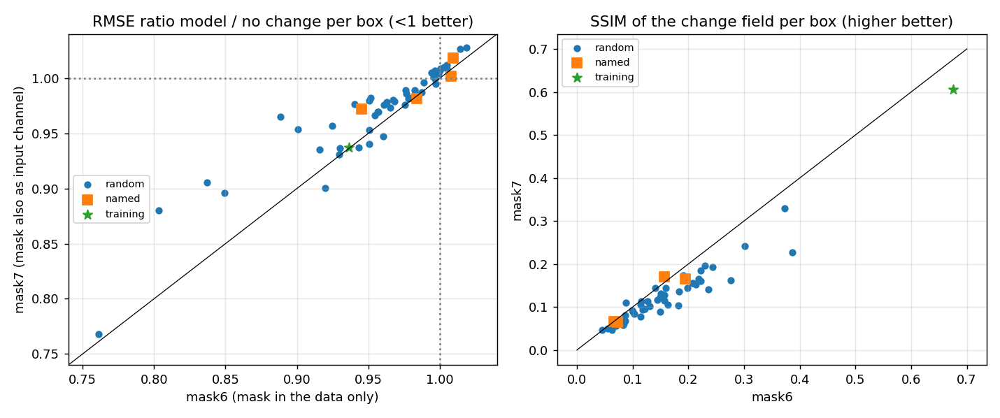

| | mask6 | mask7 |
|---|---|---|
| Training box ratio | 0.936 | 0.937 |
| Random boxes, median ratio | **0.966** | 0.979 |
| Random boxes better than "no change" | **44** | 39 |
| Random boxes, median SSIM of the change | **0.147** | 0.113 |
| Boxes where it has the lower ratio (of 55) | **46** | 9 |
| Boxes where it has the higher SSIM of the change (of 55) | **49** | 6 |

- Inside the training box the two are equal. Outside it, mask6 is better almost everywhere, most clearly below 2000 m.
- The mask channel gives the model nothing it needs: non-ocean cells are already 0 in every channel and are excluded from the loss. The extra channel may even help the model fit North Atlantic bathymetry patterns that do not carry over to other basins.
- I'd keep **mask6**. It also uses the same 6 inputs as all runs before v2, so the runs stay comparable.

### 9.7 Prediction dashboards

`predict.py` ran for the training box and the 4 named boxes over the test period, at 4 depths. The ratios below are averaged over levels in physical units, so they differ slightly from the evaluation's ratios.

| Box | Ratio mask6 | Ratio mask7 |
|---|---|---|
| North_Atlantic_big | 0.854 | 0.861 |
| North_Atlantic | 1.033 | 1.024 |
| South_Pacific | 1.011 | 1.017 |
| North_Pacific | 0.904 | 0.922 |
| Tropical_Pacific | 0.957 | 0.968 |

Each dashboard shows over the 384 test windows:

- the error of the model and of "no change" (dashed);
- maps of truth, prediction and error at the first and last window;
- the error histogram and Q–Q plot;
- the mass-balance error.

Three examples for mask6 follow. All 40 dashboards are in `artifacts/dashboard/prediction/v2b_inc_mask6/` and `.../v2b_inc_mask7/`.

**Training box, 97 m:** the model (blue) lies below "no change" (black, dashed) most of the time (ratio 0.88 at this level). The mass-balance error stays below 0.001 %.

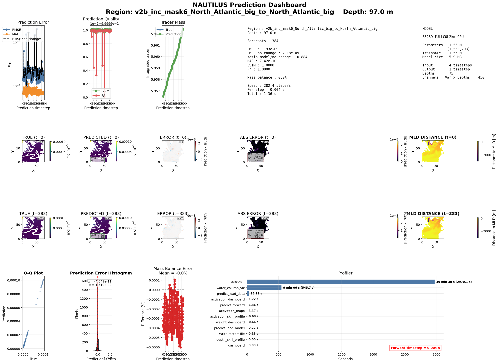

**Training box, 2956 m:** the depth with the highest skill.

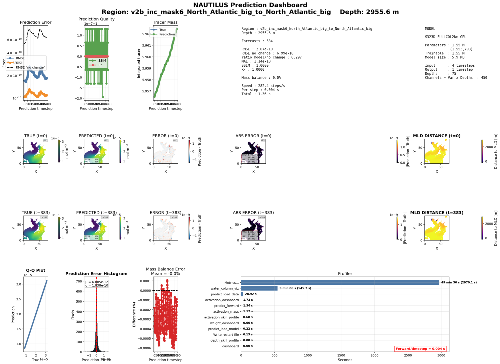

**Tropical Pacific, 97 m** (not seen in training):

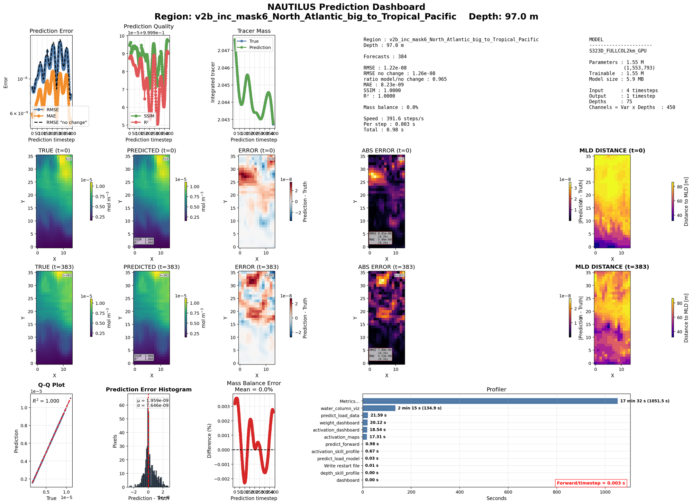

### 9.8 Next steps

1. **Check against a simple trend.** Extrapolate linearly from the last two snapshots: last + (last − previous). If this baseline matches the deep skill in the training box, the model has learned mostly the trend there. Changing the "no change" reference to this baseline would make the skill numbers more demanding.
2. **Steadier training.** Try a learning rate of 3e-5, or gradient clipping. The training loss going up after epoch 3 points at too large steps. With a stable run, a longer patience would matter again.
3. **Scaling for other regions.** This is item 3 of section 7. The skill now falls with the share of out-of-range values (rank correlation 0.68). A global scaling or per-column scaling should help the Southern Ocean and the deep levels outside the training box.
4. **Several training regions.** For example, North Atlantic and one Southern Ocean box. This targets the two regions where the model has no skill, if the experiment's goal allows it.
5. **Forecasts over several steps.** Roll the model forward 4–16 steps (3–12 hours) and compare with "no change". One step of 45 minutes is a hard test of skill because the change is tiny; over several steps small gains add up or errors grow.
6. **Drop the mask channel** (mask6) in the next runs.

### 9.9 Files of the v2b runs

On MN5 in `~/NAUTILUS/ACC_NAUTILUS/ACC_FULL_COLUMN_v2`, for `<exp>` = `v2b_inc_mask6` or `v2b_inc_mask7`:

| File | Contents |
|---|---|
| `config/nautilus_<exp>.yaml` | Config |
| `checkpoints/<exp>_North_Atlantic_big_best_model.pt` | Trained model |
| `logs/<exp>/training_log_*.csv`, `val_metrics_*.csv`, `lr_log_*.csv` | Losses, validation skill and learning rate per epoch |
| `eval_global_<exp>/metrics_per_region.csv`, `metrics_per_depthband.csv`, `metrics_per_level_per_region.csv` | Scores per box, per band, per level (RMSE, ratio, skill, SSIM) |
| `eval_global_<exp>/heatmap_*.png`, `map_skill.png`, `watercolumn/` | Heatmaps, skill map, profiles and sections |
| `artifacts/dashboard/prediction/<exp>/` | 20 prediction dashboards (5 boxes × 4 depths) |
| `predictions/<exp>_North_Atlantic_big_to_<box>/` | Prediction outputs, per-depth folders for the 4 depths only |
| `server/v2_47333076.out`, `server/v2_47333077.out`, `logs/predict_v2_<job>.log` | Logs |
