# NAUTILUS v2c: convergence-based training, 70/15/15 and 80/15/5 splits

**Run time tag: 16 October 2026, 21:31–23:12 (MareNostrum 5, `acc_bsces`).** Report written 17 October 2026.

Experiments `v2c_inc_mask6` (split 70/15/15) and `v2c_inc_mask6_s80` (split 80/15/5), ACC (GPU) full-column model. Code in `~/NAUTILUS/ACC_NAUTILUS/ACC_FULL_COLUMN_v2` on MN5, commits `656e8f6`, `8cfbe35` and `eea4709`.

## Summary

- **Neither run trained "until convergence".** Both stopped because the learning rate reached its floor (1e-6) after 25–26 epochs. The convergence condition, a training loss back at its best level, was never met. The best validation epoch was 5 (70/15/15) and 6 (80/15/5), both still at the starting learning rate. None of the five learning-rate reductions after that improved the validation loss.
- **The training loss rose while the learning rate fell.** From epoch 5 to 25 it went up by about 8 % in both runs, while the learning rate dropped 30-fold. Noise from random patches and dropout does not explain a steady rise like this. It needs checking (section 6).
- **The model is slightly better than "no change".** 70/15/15 model, 12-day test period:
    - training box: RMSE ratio 0.934 (skill 0.13);
    - random boxes: median ratio 0.984, and 33 of 50 are better than "no change";
    - named boxes: 3 of 4 are better.
- **The skill sits in the same places as before:**
    - the 200–1000 m thermocline in the tropics and subtropics;
    - 2000–6500 m inside the training box.
- **The model fails in these places:**
    - below 1000 m outside the training box;
    - the surface layer of several tropical boxes;
    - the Southern Ocean.
- **The 80/15/5 split does not help.** Both models were scored on the same last 4 days. The 70/15/15 model has the lower RMSE ratio in 44 of 55 boxes. Random-box median: 0.987 against 0.998. Boxes better than "no change": 31 against 27. The training box is the same for both (0.941 against 0.943).
- **Full-field SSIM and R² are no use for this target.** They show 1.000 for every box and every depth, because the next step is almost the same as the last one. This report uses the RMSE ratio and skill against "no change" and the SSIM of the change field.

> Reference: the previous run with the same split and target but learning rate 1e-4 and no floor (`v2b_inc_mask6`) had a random-box median ratio of 0.966, with 44 of 50 boxes better than "no change". The lower learning rate and the scheduler of v2c did not improve on that.

## 1. What is implemented

### 1.1 Data and target

| Item | Setting |
|---|---|
| Training box | `North_Atlantic_big`: ORCA1 x 212–290, y 170–248, about 10–68°N, 81°W–10°E, 78 × 78 columns, 75 levels. Coasts are included |
| Ocean mask | 3-D, from the NEMO fill value. It is applied in the data, the loss, the normalization and all scores. Cells below the sea floor and on land are excluded everywhere |
| Inputs | 6 channels × 75 levels (450 channels): tracer, u, v, w, diffusivity, distance to the MLD. The mask is **not** an input channel (`mask6`) |
| Time | 4 input snapshots, forecast 1 step ahead. 2 554 windows in total, about 32 per day |
| Target | The change since the last input snapshot, divided by its per-level RMS over training ocean cells. Predicting 0 is the "no change" forecast. The full field is rebuilt as last snapshot + predicted change |
| Training samples | Random 48 × 48 patches of the training box with at least 30 % surface ocean, batch 4. Validation and test use the whole box |
| Loss | MSE + 0.3 × gradient loss on the scaled change, ocean cells only |

### 1.2 Model

`S323D_FULLCOL2km_GPU`, 1.55 M parameters (5.9 MB). Dropout is used in the encoder (`Dropout2d` 0.25) and set to 0.1 in the config.

### 1.3 Training (new in v2c)

| Item | Setting |
|---|---|
| Optimizer | Adam, learning rate **3e-5**, weight decay 1e-5, gradient clipping at norm 1.0 |
| Scheduler | `ReduceLROnPlateau` on the validation loss: factor 0.5, patience 3, **floor 1e-6** |
| Epochs | At most 120 |
| Early stopping | Two conditions must both hold: (a) no better validation loss for 10 epochs, and (b) the mean training loss of the last 5 epochs is at most 1 % above its lowest 5-epoch mean. If (b) fails, training continues, **unless the learning rate is already at its floor** |
| Output | `logs/<experiment>/training_summary_North_Atlantic_big.json`: epochs, best epoch, stop reason, time |

### 1.4 Evaluation and prediction

- **Global evaluation** (`src/evaluate_global.py`), test period only:
    - the training box, the 4 named boxes and 50 random 24 × 24 boxes (fixed seed);
    - per box, per depth band and per level: RMSE of the model and of "no change", their ratio, the skill (1 − MSE/MSE(no change) = 1 − ratio²), and the masked SSIM of the full field and of the change field;
    - heatmaps of depth × box.
- **Prediction** (`src/predict.py`) on the named boxes, with dashboards at 5, 97, 1046 and 2956 m.

**Skill** is 0 for "no change", 1 for a perfect forecast and negative when the model is worse. An RMSE ratio below 1 means the model beats "no change".

## 2. Runs

| Job | Experiment | Split (train/val/test) | Windows (train / val / test) | Run time |
|---|---|---|---|---|
| 47375142 | `v2c_inc_mask6` | 70 / 15 / 15 | 1 787 / 383 / 384 (test ≈ 12 days) | 1 h 30 min (training 69 min) |
| 47381152 | `v2c_inc_mask6_s80` | 80 / 15 / 5 | 2 043 / 383 / 128 (test ≈ 4 days) | 1 h 33 min (training 81 min) |
| 47381156 | `v2c_inc_mask6_last5`: the 70/15/15 model scored on the last 5 % | evaluation only | test = the same 128 windows as the 80/15/5 run | 7 min |

All three jobs completed without errors. The evaluation-only job keeps the 70/15/15 training period, so the model uses its own normalization.

The two splits overlap in time. The 80/15/5 model trains on part of the 70/15/15 validation period, and its validation period is the first two-thirds of the 70/15/15 test period. Their validation losses therefore cover different days and **cannot be compared** (1.26 against 0.77). Only the shared last 4 days give a fair comparison (section 4).

## 3. Training

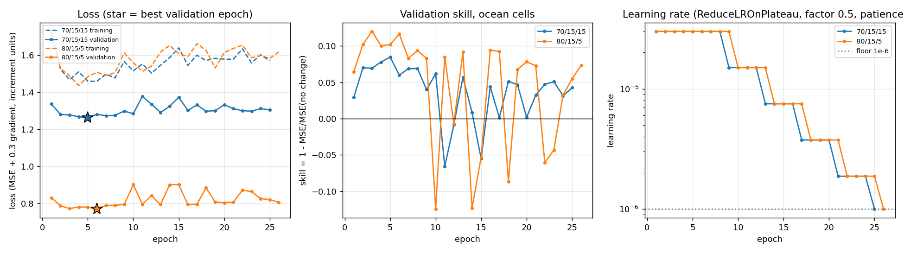

| | 70/15/15 | 80/15/5 |
|---|---|---|
| Epochs run | 25 | 26 |
| Best epoch (validation) | 5 | 6 |
| Best validation loss | 1.262 | 0.771 |
| Validation skill at the best epoch | 0.085 | 0.117 |
| Stop reason | learning rate at its floor 1e-6, no better validation loss for 10 epochs | same |
| Training loss, last 5 epochs vs best 5-epoch mean | +7.4 % | +8.5 % |

What the curves show:

- **The best model comes early.** Both runs reach their best validation loss at epoch 5–6, at the first learning rate. After that the validation loss scatters around a slightly higher level.
- **The scheduler only counts down.** It halved the learning rate after every 4 epochs without improvement: 3e-5 → 1.5e-5 → 7.5e-6 → 3.75e-6 → 1.9e-6 → 1e-6. With patience 3 and the floor 30 times below the start, it reaches the floor after about 20 epochs, whatever the losses do. The convergence condition (training loss back at its best level) never held, so the stop came from the learning-rate floor.
- **The training loss goes up.** It is lowest around epochs 3–6 (1.44–1.46) and then rises to 1.55–1.65, even with a learning rate of 1e-6. The training loss is measured on random patches with dropout on, so it is noisy, but the rise is steady and happens in both runs.
- **The validation skill drops below 0 at several epochs** (epochs 10, 11, 14, 15, 18 and 22–23 in the 80/15/5 run). So the model in training is not stable, even at small learning rates. Only the saved best-epoch checkpoint is used for evaluation.

## 4. Results

### 4.1 70/15/15 model on its 12-day test period

| Box | RMSE ratio (model / no change) | Skill | SSIM of the change field |
|---|---|---|---|
| Training box (NA big) | **0.934** | 0.13 | 0.66 |
| North Atlantic (old box, inside training box) | 0.998 | 0.00 | 0.19 |
| North Pacific | 0.964 | 0.07 | 0.15 |
| Tropical Pacific | 0.981 | 0.04 | 0.06 |
| South Pacific | 1.076 | −0.16 | 0.05 |
| 50 random boxes, median | 0.984 | 0.03 | 0.11 |
| Random boxes better than no change | 33 of 50 | | |
| Best / worst random box | R14 (equatorial Atlantic, 2°N 7°W), 0.778 / R39 (70°S), 1.109 | | |

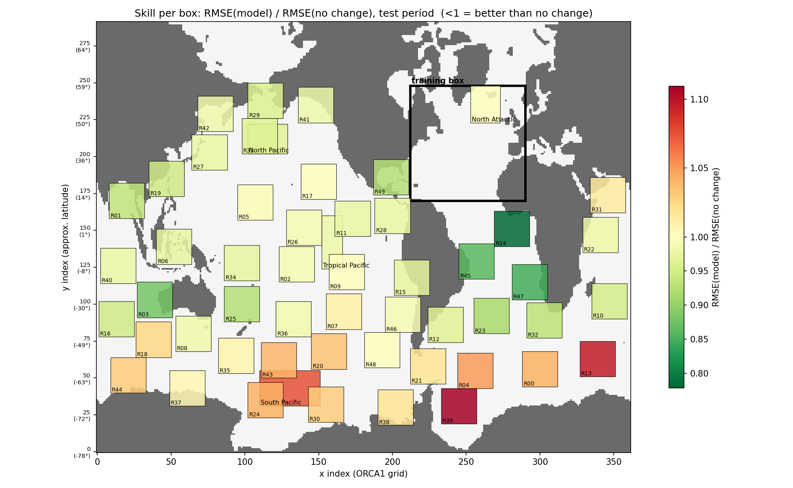

**Per depth band** (training box, and the median and count over the 50 random boxes):

| Band | Training box ratio | Random boxes, median ratio | Random boxes better than no change | Random boxes, median SSIM of change |
|---|---|---|---|---|
| 0–200 m | 0.973 | 0.984 | 37 | 0.13 |
| 200–1000 m | 0.912 | 0.957 | 39 | 0.14 |
| 1000–2000 m | 0.985 | 1.026 | 17 | 0.02 |
| 2000–4000 m | 0.756 | 1.049 | 10 | 0.03 |
| 4000–6500 m | 0.665 | 1.212 | 11 | 0.05 |

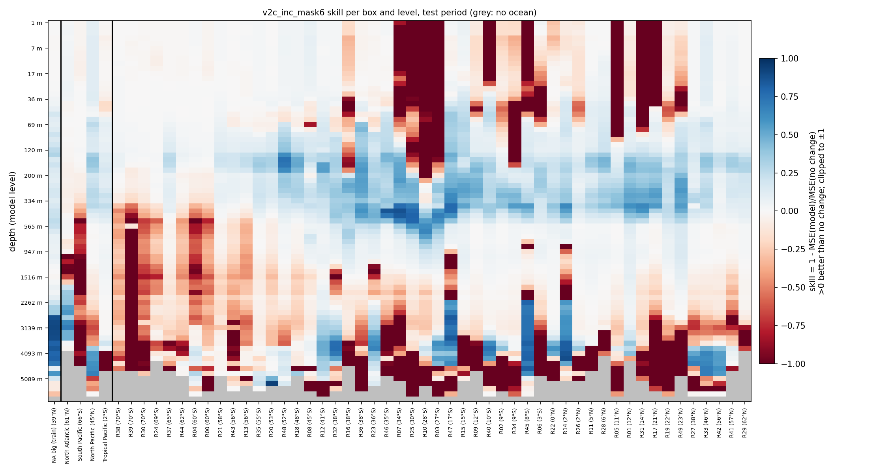

The heatmap shows three patterns:

- **Thermocline (about 100–600 m):** positive skill (blue) in almost every tropical and subtropical box between about 40°S and 45°N. This is where the model adds most outside the training box.
- **Deep training box (2000–4500 m):** skill up to about 0.9. Below 1000 m, in contrast, almost all other boxes are worse than "no change". The best are three tropical and South Atlantic boxes (R14 at 2°N, R45 at 8°S, R47 at 17°S) and some boxes at 36–41°S (R12, R23, R32).
- **Surface failures:** in several boxes, mostly in the subtropical gyres, the model fails from the surface down to 100–500 m. These are the dark red columns of R03, R07, R10 and R25 (27–34°S), R40 and R45 (8–10°S), and R05, R31 and R17 (11–21°N). Here the "no change" error is very small, so any spurious change the model predicts counts heavily.

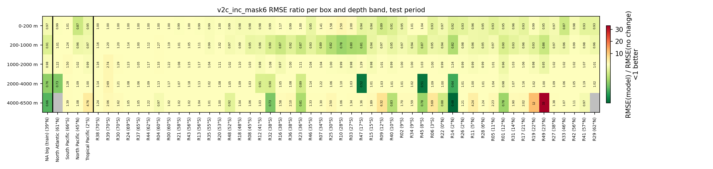

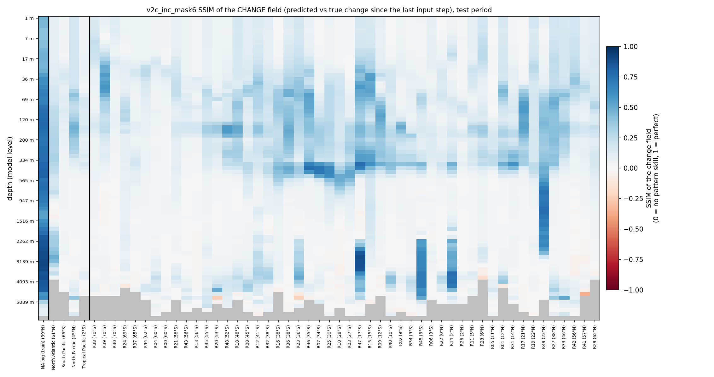

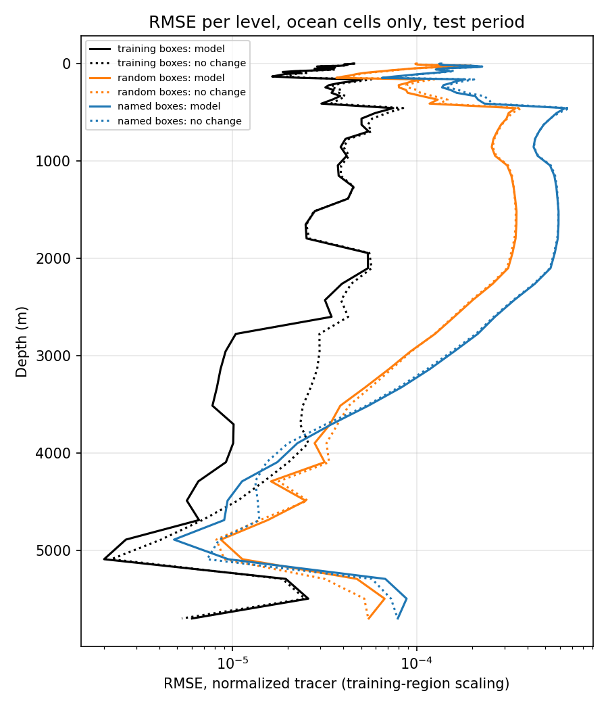

### 4.2 70/15/15 against 80/15/5 on the same last 4 days

Both models were scored on the last 128 windows, which neither of them saw in training.

| | 70/15/15 model | 80/15/5 model |
|---|---|---|
| Training box ratio | **0.941** | 0.943 |
| Random boxes, median ratio | **0.987** | 0.998 |
| Random boxes better than no change | **31** of 50 | 27 of 50 |
| Named boxes better than no change | 2 of 4 | 2 of 4 |
| Boxes where this model has the lower ratio | **44** of 55 | 11 of 55 |
| Boxes where this model has the higher SSIM of change | 26 of 55 | 29 of 55 |

Median RMSE ratio over the random boxes, per depth band (number of boxes better than "no change" in brackets):

| Band | 70/15/15 model | 80/15/5 model |
|---|---|---|
| 0–200 m | 0.990 (33) | 0.988 (33) |
| 200–1000 m | 0.958 (38) | 0.964 (38) |
| 1000–2000 m | 1.019 (17) | 1.035 (4) |
| 2000–4000 m | 1.042 (10) | 1.057 (8) |
| 4000–6500 m | 1.244 (11) | 1.469 (8) |

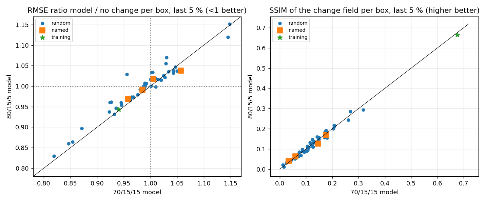

- **Above 1000 m the two models are equal.** In the thermocline, where the skill is, both have the same median and the same count.
- **Below 1000 m the 80/15/5 model is worse.** At 1000–2000 m, only 4 random boxes beat "no change", against 17. Below 4000 m its median ratio is 1.47 against 1.24.
- **Inside the training box the two are the same.** The extra 14 % of training windows does not improve the training box, and generalizes slightly worse to other regions.
- **The test set is small.** 128 windows (4 days) is a short period, so small differences between the two models are within the noise. Only the 44-of-55 count is a clear signal.

The heatmaps for this comparison are in `nautilus_v2c_figures/mask6_last5_*.png` and `mask6_s80_*.png`.

### 4.3 Water column and prediction dashboards

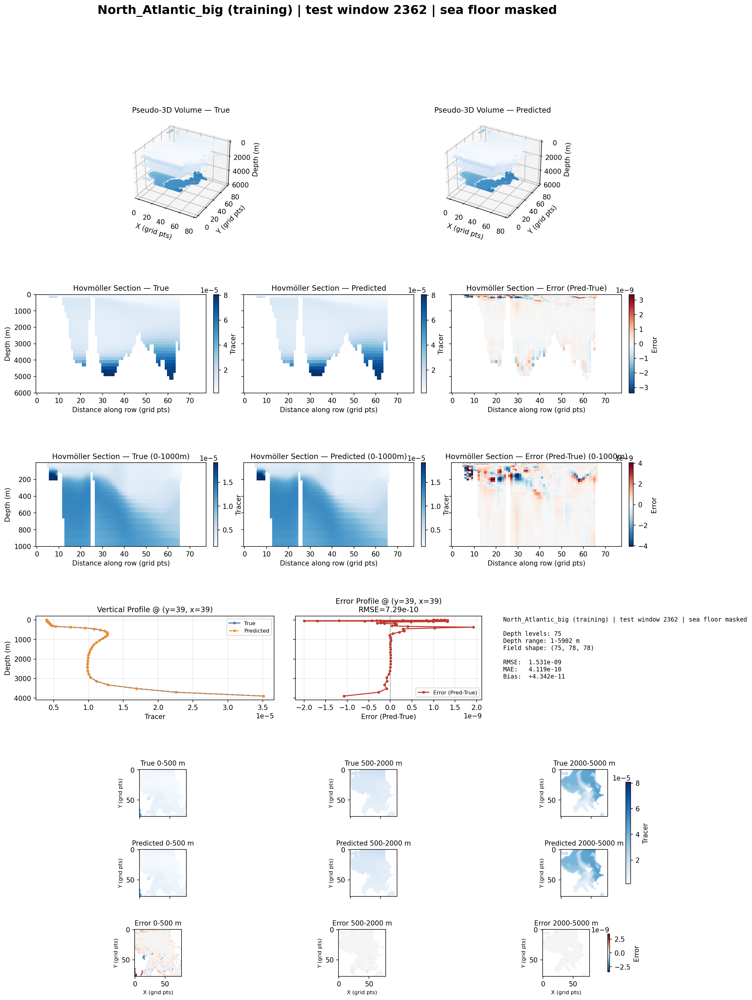

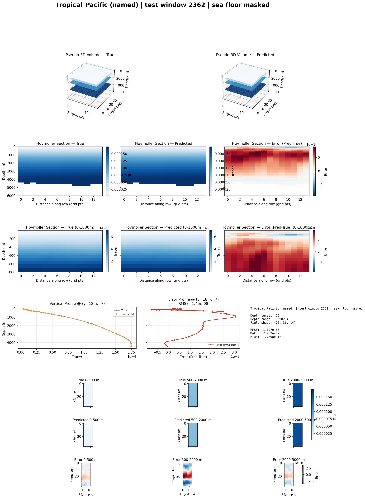

The dashboards show the full field, so their SSIM and R² panels read 1.000 almost everywhere. The useful numbers on them are the RMSE against the dashed "no change" RMSE line and the "ratio model/no change" in the text panel. For example, the training box at 97 m has a ratio of 0.888.

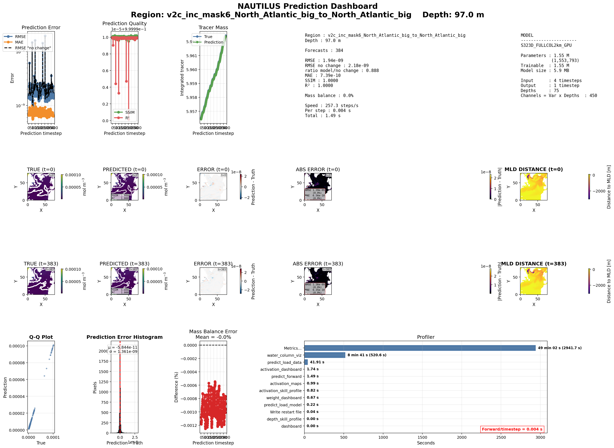

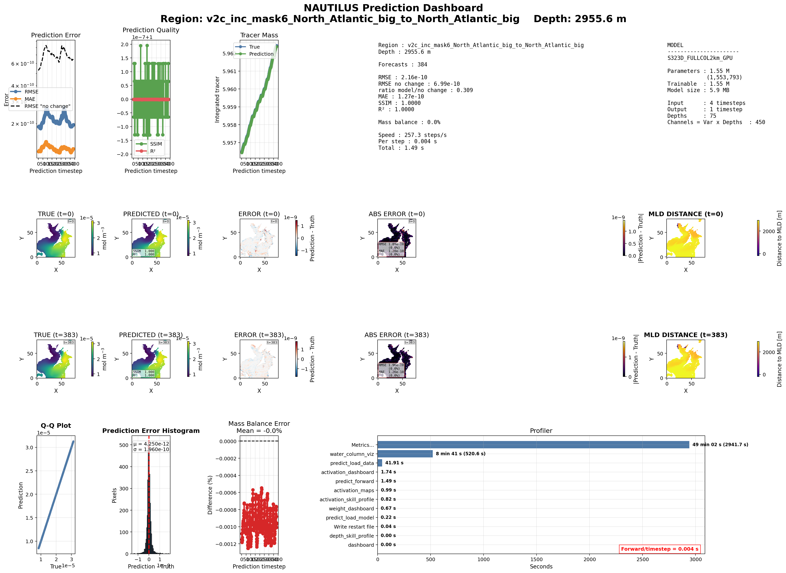

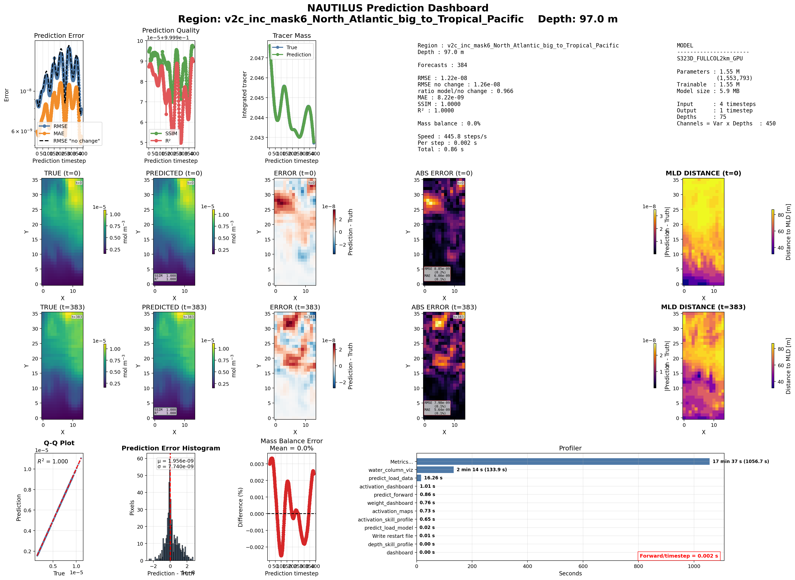

The other depths (5 m, 1046 m) are in `nautilus_v2c_figures/`.

## 5. Interpretation

- **Training length is not the limit.** Every run so far reaches its best validation loss within the first 3–6 epochs. This includes v2b at learning rate 1e-4 and v2c at 3e-5, and both splits. Lower learning rates and more epochs only add epochs without improvement. The model learns the part of the change it can predict very quickly and then stops improving. The limit is more likely what the inputs can explain, or what the model can represent.
- **Generalization fails below 1000 m.** Outside the training box the deep ocean changes very little, so "no change" is a hard baseline there. Whatever deep change the model learned in the North Atlantic transfers badly to other basins.
- **More training data from the same box does not help.** The 80/15/5 model saw 256 more windows from the same box and the same season. It did not improve in the box and was slightly worse elsewhere. More data from other regions is more likely to help than more time from this one.

## 6. Suggested next steps

1. **Check the rising training loss.** Log, each epoch, the training loss on a fixed set of patches with the model in evaluation mode (no dropout). This shows whether the model really gets worse on its training data or whether the logged number is misleading. Check also the interaction between AMP (`GradScaler`), the weight decay and the low learning rate.
2. **Simplify the stopping rule.** The best epoch is always early. Stopping on validation patience alone (10 epochs) gives the same model at less cost. If longer training is still wanted, the scheduler patience should be longer (e.g. 6–8 epochs) so that the learning-rate floor is not reached automatically after about 20 epochs.
3. **Keep the 70/15/15 split.** It is at least as good, and its 12-day test period gives more stable scores than 4 days.
4. **Train on more than one region** (for example the North Atlantic plus a tropical Pacific and a Southern Ocean box), aiming at the deep and Southern Ocean failures.
5. **Remove full-field SSIM and R² from the dashboards and logs,** or replace them with the change-field SSIM and the skill. They are always 1.000 and hide the real performance.

## 7. Files

On MN5, in `~/NAUTILUS/ACC_NAUTILUS/ACC_FULL_COLUMN_v2`:

| What | Where |
|---|---|
| Configs | `config/nautilus_v2c_inc_mask6.yaml`, `nautilus_v2c_inc_mask6_s80.yaml`, `nautilus_v2c_inc_mask6_eval_last5.yaml` |
| Checkpoints | `checkpoints/v2c_inc_mask6_North_Atlantic_big_best_model.pt`, `checkpoints/v2c_inc_mask6_s80_North_Atlantic_big_best_model.pt` |
| Training logs | `logs/v2c_inc_mask6/`, `logs/v2c_inc_mask6_s80/` (loss, learning rate, validation skill, `training_summary_*.json`) |
| Global evaluation | `eval_global_v2c_inc_mask6/`, `eval_global_v2c_inc_mask6_s80/`, `eval_global_v2c_inc_mask6_last5/` |
| Prediction dashboards | `artifacts/dashboard/prediction/v2c_inc_mask6/` (and `_s80`) |
| Job output | `server/v2_47375142.out`, `server/v2_47381152.out`, `server/v2_47381156.out` |

Locally: this report (`.md` and `.pdf`) and its figures in `~/ClaudeX/17-Oct-2026/Reports/`.
