# NAUTILUS v3: one model trained on three regions

**Run time tag: 17 October 2026 22:49 – 18 October 2026 05:38 (MareNostrum 5, `acc_bsces`, job 47449845).** Prediction dashboards re-made on 18 October 2026, 11:39–12:25, with the updated dashboard code (job 47478997). Report written 18 October 2026.

Experiment `v3_multi`, ACC (GPU) full-column model. Code in `~/NAUTILUS/ACC_NAUTILUS/ACC_FULL_COLUMN_v2` on MN5, commits `83005ba`, `ea79bd0` (run) and `194e70c` (dashboards).

## Summary

- **The model now beats "no change" in every box outside training.**
    - All **41 unseen random boxes** are better than "no change", with a median RMSE ratio of **0.714**: the error is 29 % smaller, which is a skill of 0.49.
    - All four named boxes are better too. The three outside the North Atlantic, which the model never saw, reach 0.40–0.68.
    - In physical units, the median over the unseen random boxes is 0.637. The previous run, v2c, which used the same boxes, the same test period and an identical "no change" baseline, had 0.955.
- **The deep ocean outside the training boxes now has skill.** At 1000–2000 m, 38 of 41 unseen random boxes beat "no change", against 14 in v2c. At 2000–4000 m it is all 41, against 9.
- **Each training box scores very differently.**
    - Tropical Pacific W: 0.24.
    - Southern Ocean: 0.51.
    - North Atlantic: 0.87. This box remains the hardest, with a validation skill of only 0.30.
- **Training did not converge yet.** The run used all 60 epochs. The best validation epoch was 55, and the loss on fixed training patches was still falling at epoch 60. The learning rate was halved only once, after epoch 53.
- **The rising training loss of v2c is gone.** Two bugs in the training loop are now fixed:
    - the model trained in evaluation mode from epoch 2 on: dropout was off and BatchNorm was frozen at its epoch-1 statistics;
    - mixed precision ran without loss scaling, so small gradients could underflow to zero.

    Now the training loss falls steadily, from 0.77 to 0.31. The loss on fixed patches with dropout off falls from 0.95 to 0.53.

- **This run cannot say how much of the gain comes from training on three regions and how much from the bug fixes.** Both changed together. A single-region run with the fixed code would separate the two (section 6).
- **These places are still weak:**
    - the surface layer of the subtropical gyres;
    - 600–2000 m in a few tropical Atlantic boxes and in the old North Atlantic box;
    - below 4000 m, where 32 of 41 boxes beat "no change", with a median ratio of 0.88.

## 1. What is implemented

### 1.1 Training regions and data

| Item | Setting |
|---|---|
| Training boxes | 1. `North_Atlantic_big`: x 212–290, y 170–248, about 10–68°N, 81°W–10°E, 78 × 78 columns 2. `Tropical_Pacific_W`: x 62–140, y 112–172, about 18.7°S–10.6°N, 134.5°E–148.5°W, 78 × 60 columns, 96 % ocean 3. `Southern_Ocean_AI`: x 270–348, y 30–78, about 70.5–47.4°S, 17.5°W–59.5°E, 78 × 48 columns, 92 % ocean |
| One model | All three boxes train **one** model (`data.training_group: multi3`) |
| Normalization | One set of statistics, pooled over the ocean cells of the training period of all three boxes |
| Training samples | Random 48 × 48 patches (at least 30 % surface ocean), an equal share from each region: 1 787 training windows per region, 5 361 per epoch |
| Validation | Each region as a whole box. The validation loss is the mean over the three regions, so each region counts equally |
| Ocean mask | 3-D, in the data, the loss, the normalization and all scores (cells below the sea floor and land are excluded). It is not an input channel |
| Inputs and target | 6 channels × 75 levels: tracer, u, v, w, diffusivity, distance to the MLD. 4 input snapshots, forecast 1 step ahead. The target is the change since the last snapshot, scaled per level |
| Time split | 70 / 15 / 15 % (training / validation / test). The test period has 384 windows, about 12 days |
| Loss | MSE + 0.3 × gradient loss on the scaled change, ocean cells only |

### 1.2 The training boxes: 3-D ocean mask

Each figure shows one training box. On the left, the surface ocean is white and land is black. On the right is the depth of the deepest ocean level in each water column. Everything below that level is sea floor and is excluded from training and from every score.

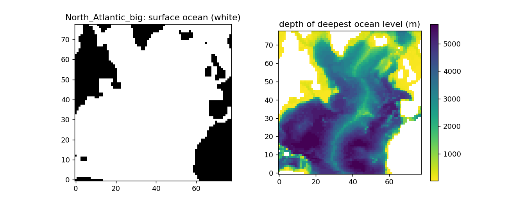

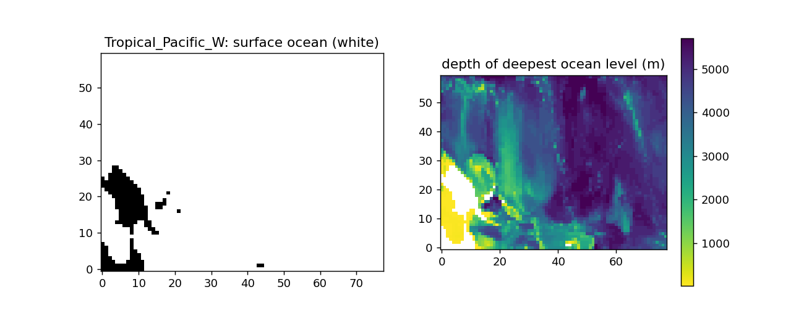

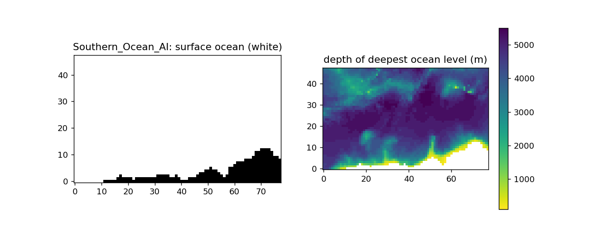

- **North Atlantic:** the Mid-Atlantic Ridge runs through the middle of the box, with the deep basins on either side and the American and European/African coasts at the edges.
- **Tropical Pacific W:** New Guinea and the island chains east of it lie in the west of the box, with shallow plateaus and ridges between deep basins.
- **Southern Ocean:** the Antarctic coast and shelf lie along the southern edge, and ridges cross the deep basins further north.

### 1.3 Model and training

| Item | Setting |
|---|---|
| Model | `S323D_FULLCOL6km_GPU` (label renamed from `S323D_FULLCOL2km_GPU`), 1.55 M parameters, with BatchNorm and dropout |
| Optimizer | Adam, learning rate **1e-4**, weight decay 1e-5, gradient clipping at norm 1.0 |
| Scheduler | `ReduceLROnPlateau` on the validation loss: factor 0.5, **patience 6**, floor 1e-6 |
| Stopping | No better validation loss for 10 epochs, at most 60 epochs. The training-loss convergence rule of v2c is switched off |
| Mixed precision | fp16 autocast with a `GradScaler` (new) |
| Training mode | `model.train()` at the start of every epoch (new) |
| Diagnostics per epoch | Loss on 16 fixed training patches per region with the model in evaluation mode, mean and maximum gradient norm, AMP loss scale, and skipped steps, in `logs/v3_multi/train_diagnostics_multi3.csv` |

### 1.4 Evaluation and prediction

- **Global evaluation** (`src/evaluate_global.py`), test period only:
    - the three training boxes, the four named boxes and the **same 50 random 24 × 24 boxes as v2c**;
    - 9 of the random boxes overlap the new training boxes (R00, R02, R05, R06, R13, R17, R26, R32, R34). They are marked "seen" and kept out of the random-box scores, which leaves **41 unseen random boxes**;
    - per box, band and level: the RMSE ratio of the model against "no change", the skill (1 − MSE/MSE(no change) = 1 − ratio²), and the SSIM of the change field.
- **Prediction dashboards** (`src/predict.py`) for the training and named boxes at 5, 97, 1046 and 2956 m:
    - the time-series panels and the "last forecast" row show the **first 10 test steps**; the summary text covers the whole test period;
    - RMSE and MAE are given in **% of the mean tracer**, and the error panel shows only the RMSE, model against "no change";
    - the "Prediction Quality" panel shows the skill against "no change", the SSIM of the change field and the full-field R²; the full-field SSIM is gone;
    - the MLD distance map shows MLD − depth: red (> 0) is above the MLD, in the mixed layer, and blue (< 0) is below it. The model input itself stays depth − MLD;
    - every map shows the coastline as a thin grey line (the edge of the surface ocean mask), so the continents stay visible at depth, where the white areas are sea floor;
    - the colorbars are as tall as the map and sit next to it; the plots use the seaborn theme.
- **Results are copied to scratch.** At the end of every job, results go to `/gpfs/scratch/bsc32/bsc032196/nautilus/ACC_FULL_COLUMN_v2/<experiment>/output_<date>_<job>/`.

**Skill** is 0 for "no change", 1 for a perfect forecast and negative when the model is worse. An RMSE ratio below 1 means the model beats "no change".

## 2. Run

| Step | Time | Duration |
|---|---|---|
| Training (60 epochs, about 6.2 min each, plus 7 min reading the data) | 22:49 – 05:04 | 6 h 15 min |
| Global evaluation | 05:04 – 05:20 | 16 min |
| Prediction | 05:20 – 05:38 | 18 min |
| Dashboards re-made with the final dashboard code (job 47478997, prediction step only) | 18 Oct 11:39 – 12:25 | 46 min |

Job 47449845 completed without errors in 6 h 49 min, with a peak memory of 73 GB out of 125 GB.

## 3. Training

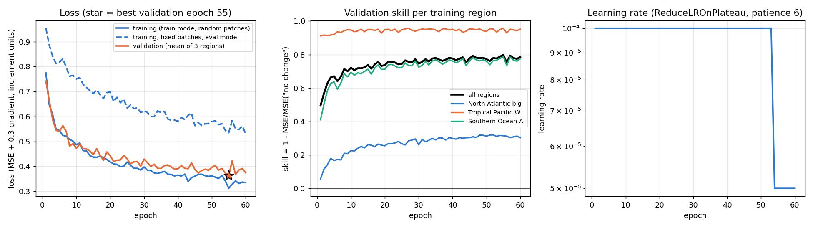

| Epoch | Training loss | Training loss, fixed patches, eval mode | Validation loss | Validation skill: all / North Atlantic / Tropical Pacific W / Southern Ocean |
|---|---|---|---|---|
| 1 | 0.774 | 0.953 | 0.742 | 0.49 / 0.06 / 0.91 / 0.41 |
| 10 | 0.487 | 0.750 | 0.472 | 0.72 / 0.23 / 0.95 / 0.69 |
| 30 | 0.397 | 0.622 | 0.429 | 0.75 / 0.26 / 0.95 / 0.72 |
| **55 (best)** | **0.312** | **0.535** | **0.362** | **0.80 / 0.31 / 0.96 / 0.79** |
| 60 | 0.335 | 0.531 | 0.374 | 0.79 / 0.30 / 0.95 / 0.77 |

What the curves show:

- **Training improves throughout the run.** Both training losses fall steadily over the 60 epochs. In v2c the training loss rose after epoch 5; that was caused by training in evaluation mode, which is now fixed.
- **Validation also keeps improving.** There were 24 new best epochs over the run, the last ones at 45, 46, 54 and 55. The scheduler halved the learning rate only once, after epoch 53, following 7 epochs without improvement; the validation loss then improved again at epochs 54 and 55. The run stopped at the epoch limit, not because it had converged.
- **The North Atlantic box learns slowly.** Its validation skill rises from 0.06 to 0.31; in its fixed patches it has the highest loss of the three regions (1.24 at the end, against 0.07 and 0.28). The tropical Pacific W box is learned almost at once (skill 0.91 after one epoch).
- **Mixed precision behaves normally.** The loss scale stayed between 16 384 and 65 536, and 33 of about 80 000 steps were skipped because of fp16 overflow. That is the expected behaviour of the scaler. The gradient norm averaged about 2.

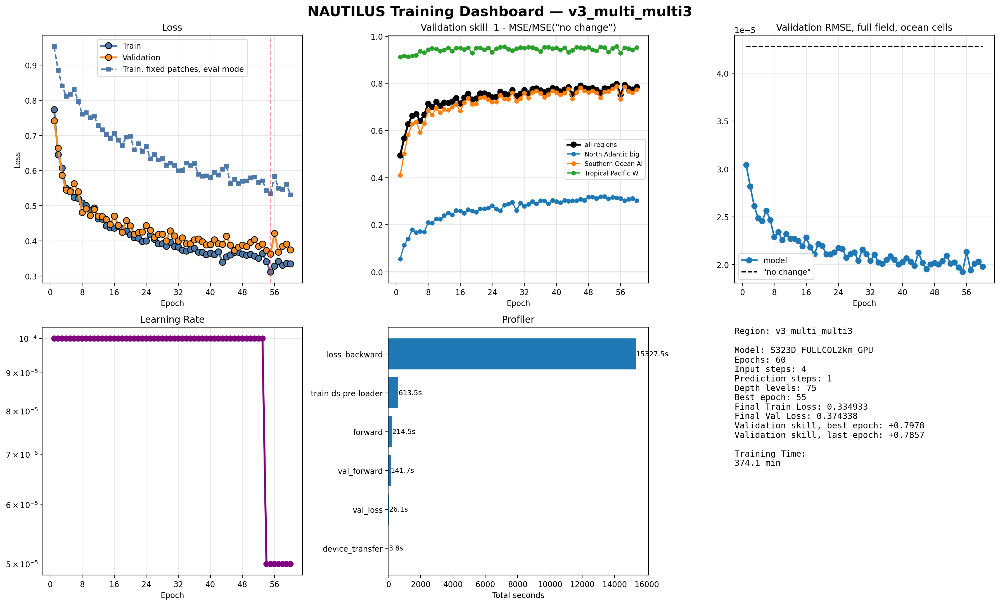

## 4. Results on the test period

### 4.1 Per box

| Box | Kind | RMSE ratio (model / no change) | In physical units | Skill | SSIM of the change field |
|---|---|---|---|---|---|
| North Atlantic big | training | 0.867 | 0.801 | 0.25 | 0.72 |
| Tropical Pacific W | training | **0.243** | 0.203 | 0.94 | 0.69 |
| Southern Ocean AI | training | 0.512 | 0.462 | 0.74 | 0.77 |
| North Atlantic (old box, inside training box 1) | named | 0.943 | 0.914 | 0.11 | 0.26 |
| South Pacific | named, unseen | 0.679 | 0.609 | 0.54 | 0.44 |
| North Pacific | named, unseen | 0.530 | 0.481 | 0.72 | 0.62 |
| Tropical Pacific (east of training box 2) | named, unseen | **0.395** | 0.317 | 0.84 | 0.57 |
| 41 unseen random boxes, median | | **0.714** | 0.637 | 0.49 | 0.50 |
| Unseen random boxes better than no change | | **41 of 41** | | | |
| Best / worst unseen random box | | R25 (30°S at the dateline) 0.422 / R23 (36°S, 21°W) 0.868 | | | |
| 9 "seen" random boxes, median | | 0.382 | 0.336 | | 0.58 |

The column "RMSE ratio" uses normalized units, like all scores of the evaluation. "In physical units" is the ratio in tracer units. Skill = 1 − ratio² (normalized).

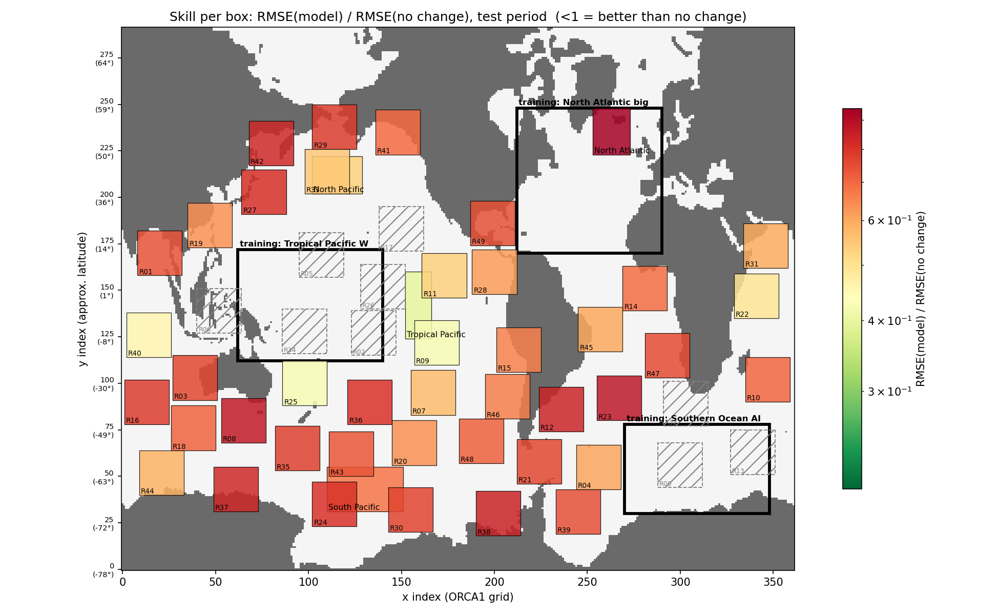

### 4.2 Compared with the previous run (v2c, North Atlantic only)

Both runs use the same 50 random boxes and the same test period, and the "no change" error in physical units is identical in every box (largest relative difference 4e-7). The comparison below uses physical units.

| Unseen random boxes (41) | v2c | v3 |
|---|---|---|
| Median RMSE ratio | 0.955 | **0.637** |
| Boxes better than "no change" | 36 | **41** |
| Median SSIM of the change field | 0.115 | **0.501** |
| Boxes where v3 is better than v2c | | **41 of 41** |

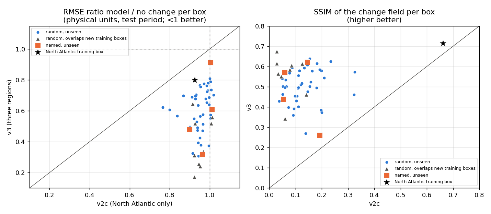

The North Atlantic training box improves too: from 0.925 to 0.801 in physical units. The named boxes improve the most, for example the Tropical Pacific from 0.963 to 0.317 and the North Pacific from 0.899 to 0.481.

**What caused the gain is open.** v3 changed two things at once: training on three regions, and the two training-loop fixes. The gain in the never-seen named boxes, and in the basins next to the new training boxes, points mainly to the extra regions. The gain in the North Atlantic box itself points to the fixes as well.

### 4.3 Per depth

Median RMSE ratio over the 41 unseen random boxes (number of boxes better than "no change" in brackets):

| Band | v2c | v3 | v3 training boxes: North Atlantic / Tropical Pacific W / Southern Ocean |
|---|---|---|---|
| 0–200 m | 0.986 (30) | **0.778 (36)** | 0.878 / 0.410 / 0.515 |
| 200–1000 m | 0.955 (32) | **0.444 (41)** | 0.754 / 0.161 / 0.273 |
| 1000–2000 m | 1.028 (14) | **0.439 (38)** | 0.971 / 0.129 / 0.320 |
| 2000–4000 m | 1.049 (9) | **0.534 (41)** | 0.469 / 0.160 / 0.403 |
| 4000–6500 m | 1.087 (10) | **0.878 (32)** | 0.413 / 0.449 / 0.773 |

The v2c column uses the same 41 boxes.

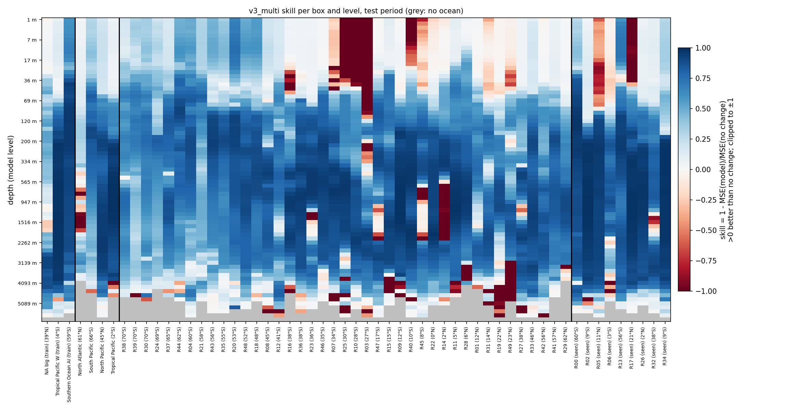

The heatmap (blue = better than "no change") shows:

- **Skill almost everywhere from about 50 m to about 4000 m, at all latitudes.** The best values are in the thermocline and intermediate waters, 200–2000 m, where the median ratio is about 0.44.
- **Surface failures** in a few subtropical gyre boxes: R03, R10 and R25 (27–30°S), R40 (10°S), and the seen box R17 (21°N). There "no change" is very hard to beat because the change near the surface is very small.
- **Mid-depth failures at about 600–2000 m** in some tropical Atlantic boxes (R14, R45, R47), in R23, and in the old North Atlantic box. That box lies inside the North Atlantic training box, which has its weakest band at 1000–2000 m (ratio 0.97).
- **Below about 4000 m** many boxes are still near or worse than "no change". Here the change is tiny, and few training cells are that deep.

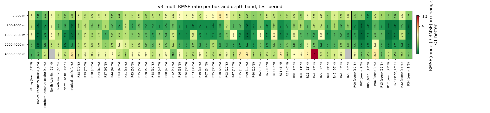

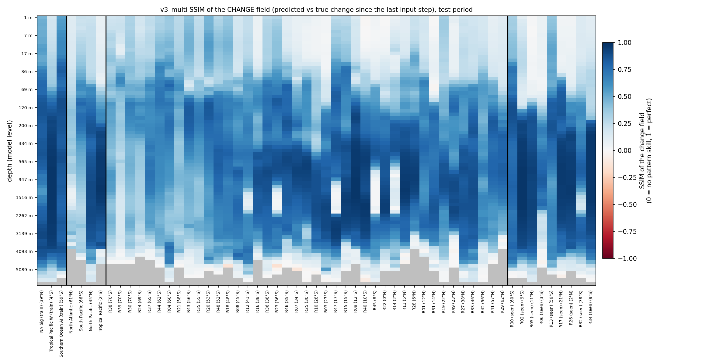

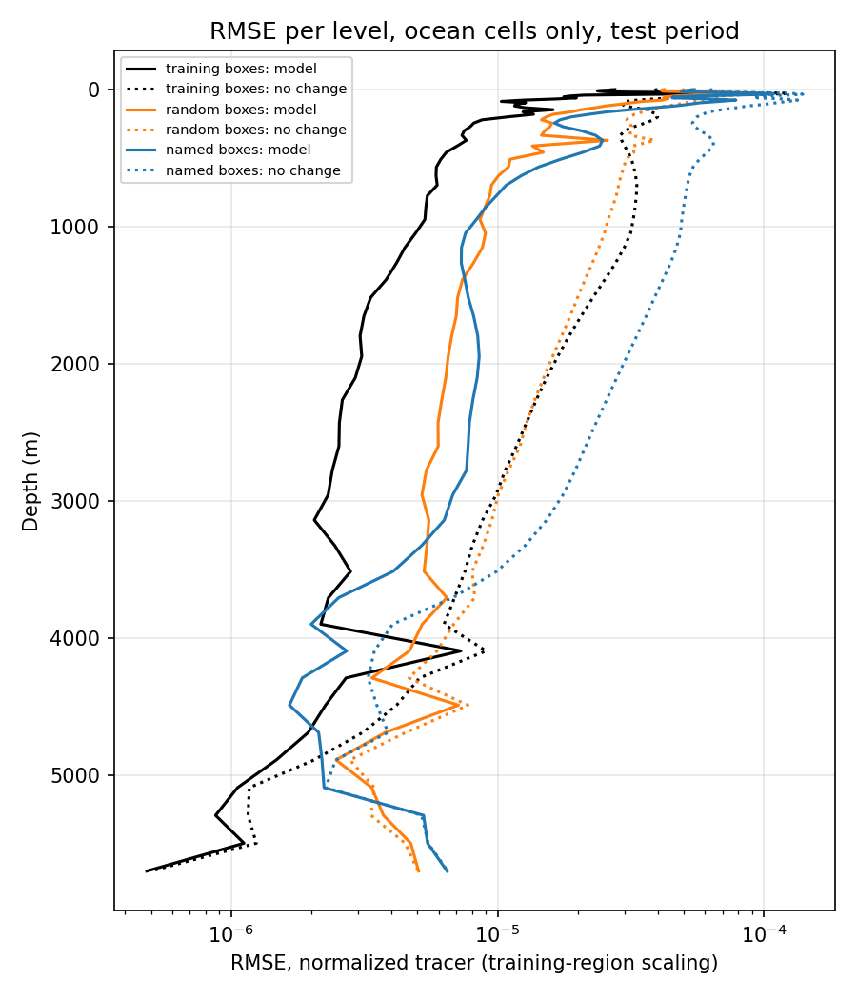

### 4.4 Water column

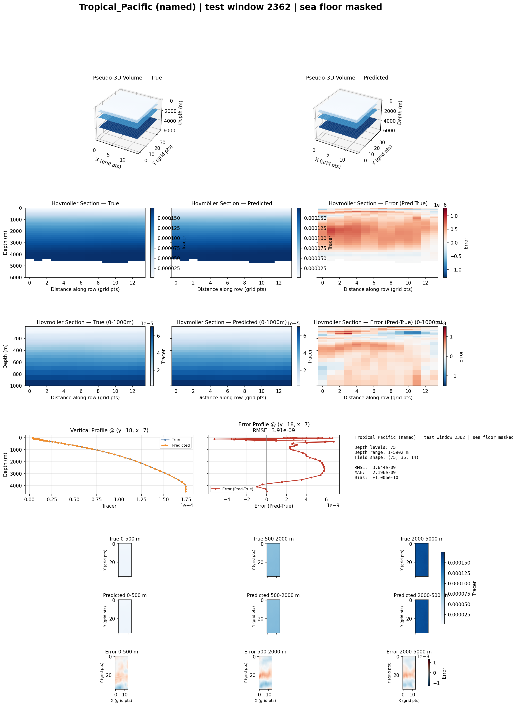

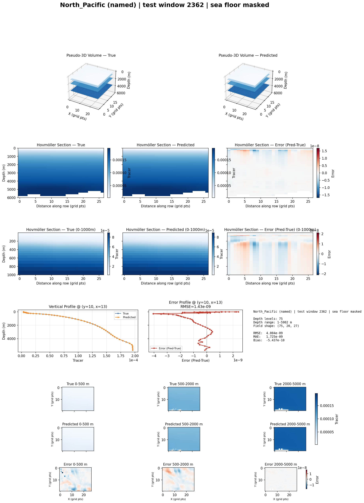

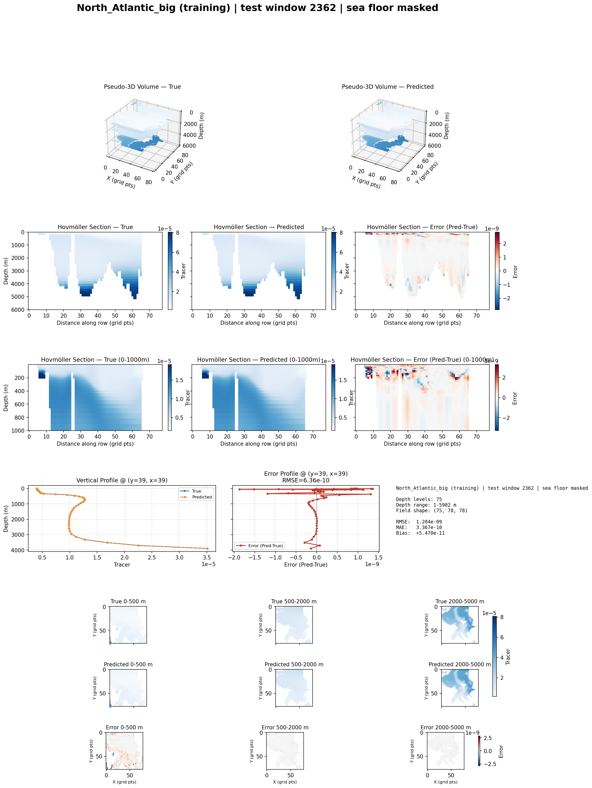

### 4.5 Prediction dashboards

The panels show the first 10 test steps; the text panel gives the scores over all 384 steps. RMSE and MAE are in % of the mean tracer value.

**At depth, white areas inside the grey coastline are sea floor, not land.** At 2956 m, every water column shallower than that depth is blank, so the map shows roughly the 3000 m depth contour: the continental margins, the crest of the Mid-Atlantic Ridge, and basins cut off by ridges, such as the deep basin north of the Greenland–Scotland Ridge and a Caribbean basin. The maps are drawn on the ORCA1 grid (x, y indices), which is distorted in the north, so Greenland and the Labrador Sea look stretched compared with a normal map.

| Box, depth | RMSE (% of mean tracer) | "No change" | Ratio | Skill | SSIM of the change field |
|---|---|---|---|---|---|
| North Atlantic big (training), 97 m | 0.035 % | 0.049 % | 0.711 | 0.34 | 0.84 |
| Tropical Pacific (unseen), 97 m | 0.133 % | 0.223 % | 0.599 | 0.64 | 0.48 |
| North Atlantic big (training), 2956 m | 0.001 % | 0.003 % | 0.293 | 0.91 | 0.89 |

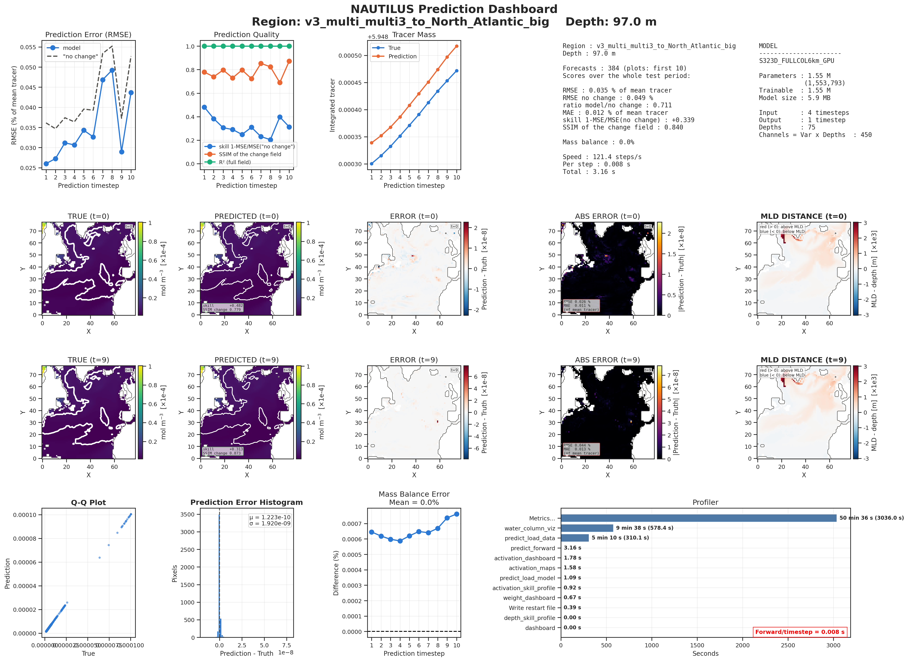

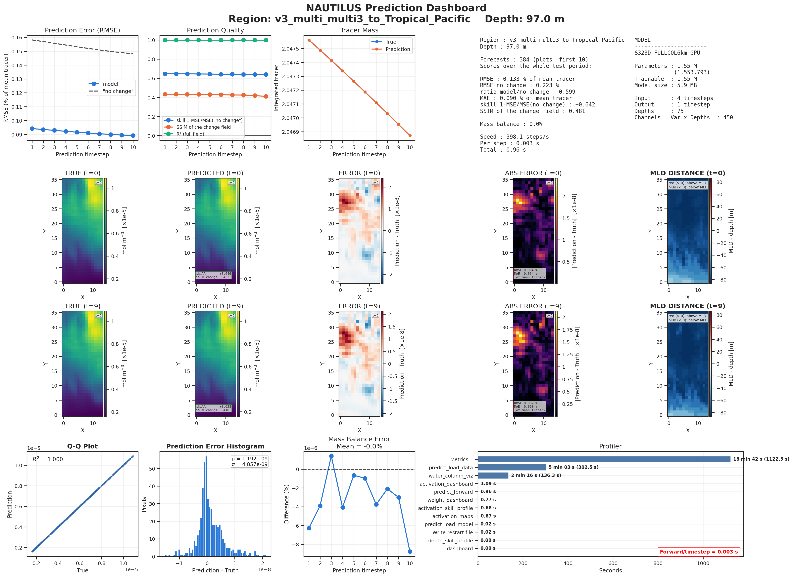

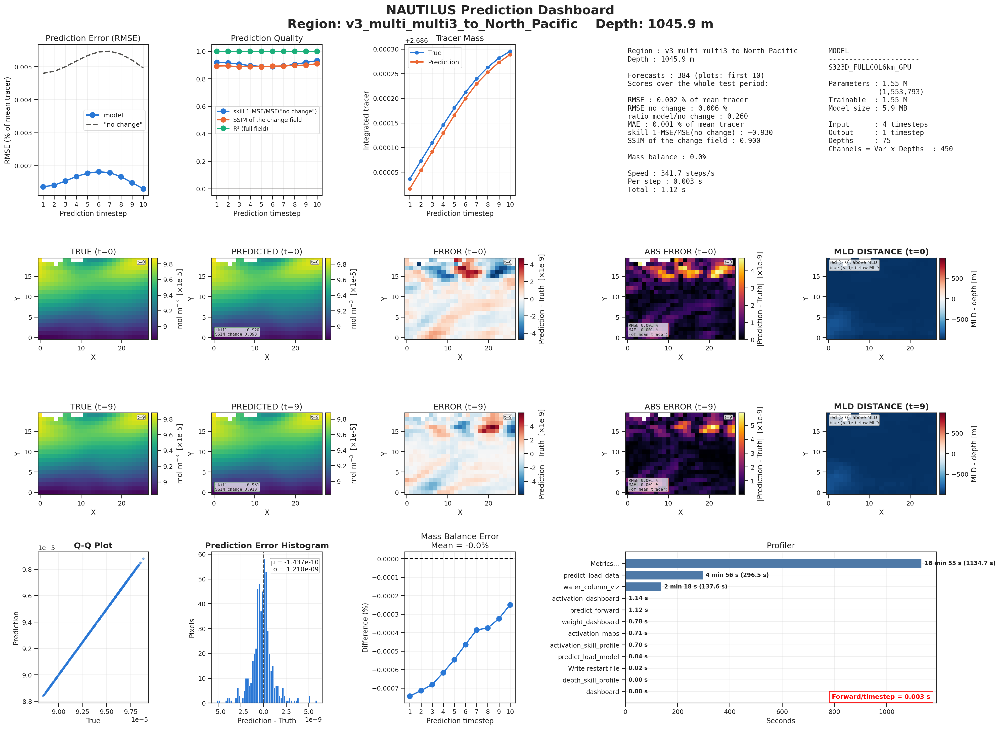

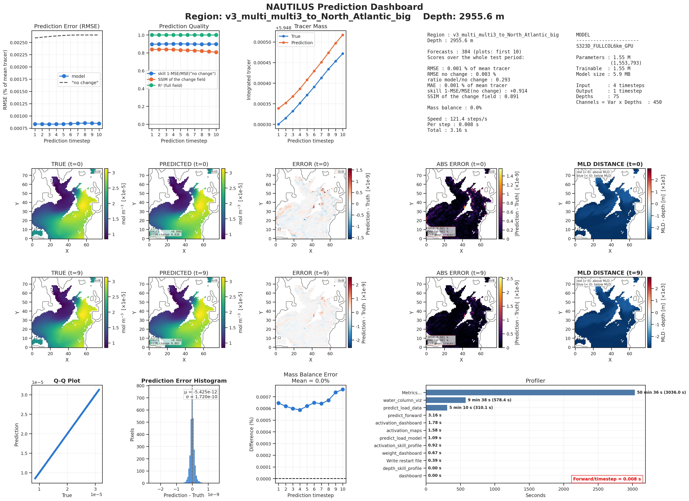

**A display issue for next time:** in the North Atlantic box, the MLD distance map uses a symmetric colour scale up to ±3000 m, set by the deep winter mixed layers in the north. As a result most of the box appears pale. A scale clipped at the 98th percentile would show the structure better.

## 5. Interpretation

- **Training on several regions is the main step towards generalization.** Basins the model never saw now behave like the training regions: the North Pacific, the eastern tropical Pacific, and the Pacific sector of the Southern Ocean. The deep-ocean failure of v2c is largely gone, from 9 to 41 boxes better than "no change" at 2000–4000 m.
- **The North Atlantic is the hardest region.** It has the lowest validation skill of the three, and its 1000–2000 m band is barely better than "no change". The Gulf Stream, deep convection and the overflow waters probably make the one-step change there harder to predict than in the other regions.
- **The model is not trained out yet.** It is still improving at epoch 60, so a longer run should give more skill, especially in the North Atlantic.

## 6. Suggested next steps

1. **Separate the effects of the fixes and of the three regions.** Repeat v2c (North Atlantic only, learning rate 1e-4) with the fixed code. The difference to v3 then shows the effect of the extra regions alone. This takes about 2 hours.
2. **Train longer.** Use at most 120 epochs, keep the same stopping rule (patience 10), and allow a 12-hour job. The scheduler then has time to lower the learning rate further.
3. **Add a box with subtropical gyre and North Atlantic intermediate water,** for example the South Atlantic or the Indian Ocean gyre. Keep at least one basin completely unseen for testing.
4. **Deep levels:** consider weighting the loss per depth so that levels below 4000 m, with very small changes, count more. Alternatively, accept "no change" there as a hard baseline.

## 7. Files

On MN5, in `~/NAUTILUS/ACC_NAUTILUS/ACC_FULL_COLUMN_v2`:

| What | Where |
|---|---|
| Config | `config/nautilus_v3_multi.yaml` (test run: `config/nautilus_v3_smoketest.yaml`) |
| Checkpoint and normalization | `checkpoints/v3_multi_multi3_best_model.pt`, `norms/v3_multi_norm_stats_multi3.npz` |
| Training logs | `logs/v3_multi/` (loss, learning rate, validation per region, `train_diagnostics_multi3.csv`, `training_summary_multi3.json`) |
| Global evaluation | `eval_global_v3_multi/` |
| Prediction dashboards | `artifacts/dashboard/prediction/v3_multi/` (the first version, from the old dashboard code, is in `predictions_v3_multi_first_dashboards/`) |
| Job output | `server/v2_47449845.out` (run), `server/v2_47478997.out` (final dashboards) |
| Copy on scratch | `/gpfs/scratch/bsc32/bsc032196/nautilus/ACC_FULL_COLUMN_v2/v3_multi/` |

Locally: this report (`.md` and `.pdf`) and its figures in `~/ClaudeX/18-Oct-2026/Reports/`.
