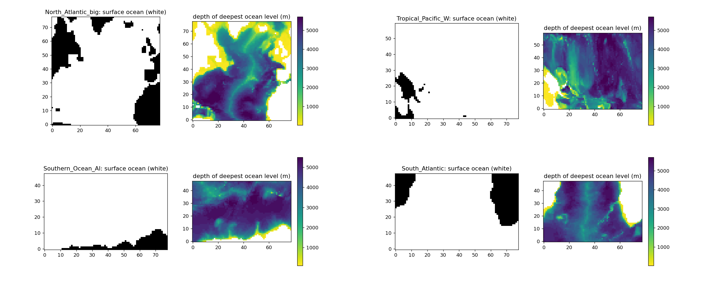
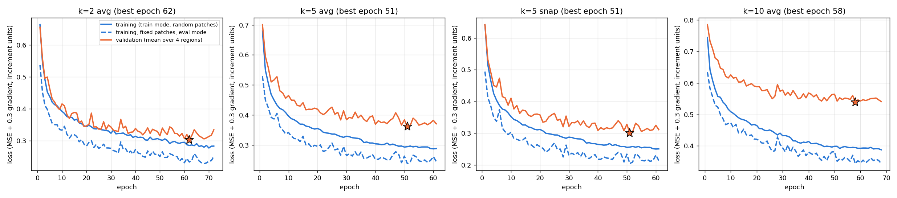
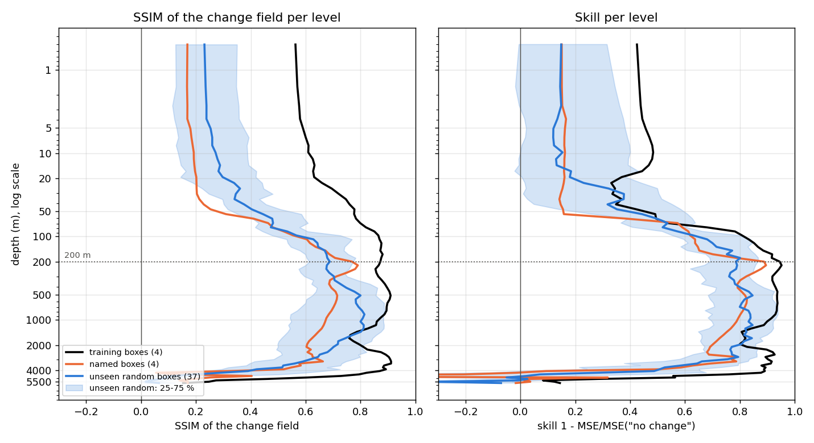
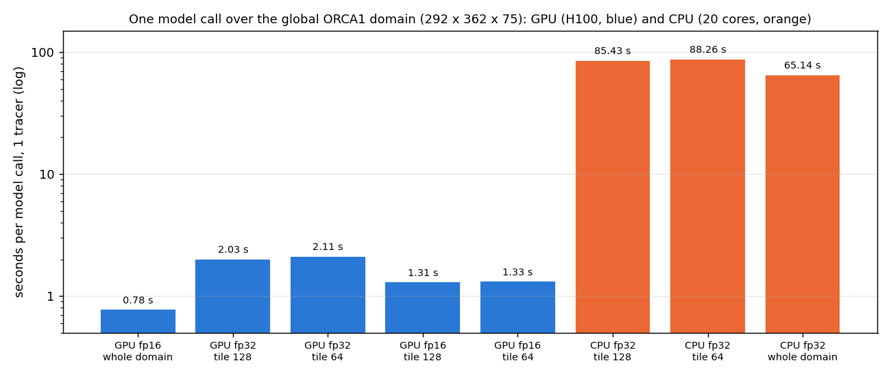
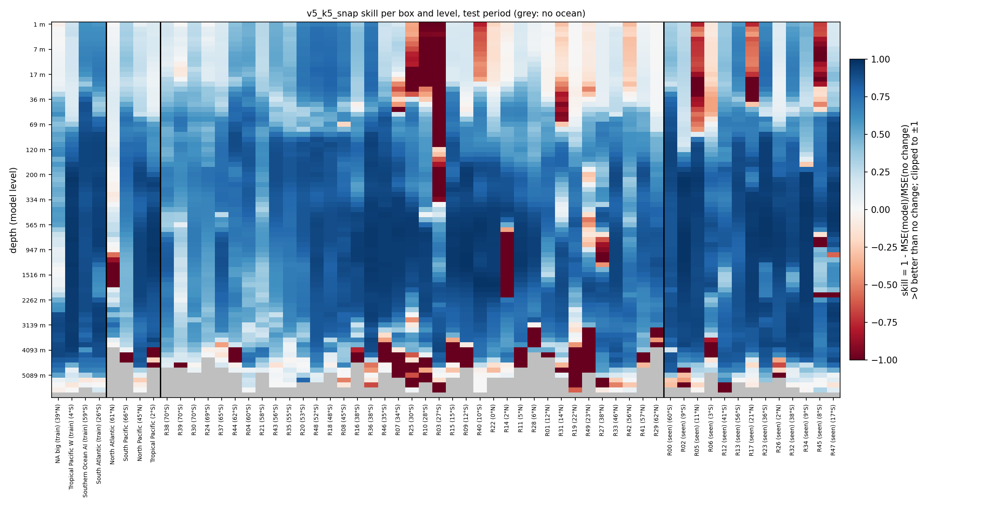
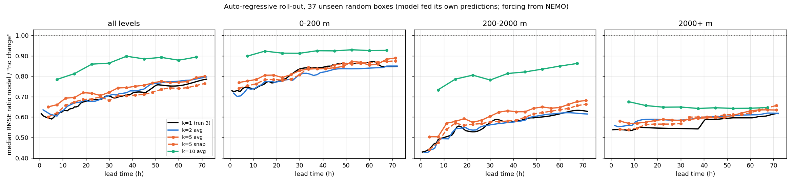
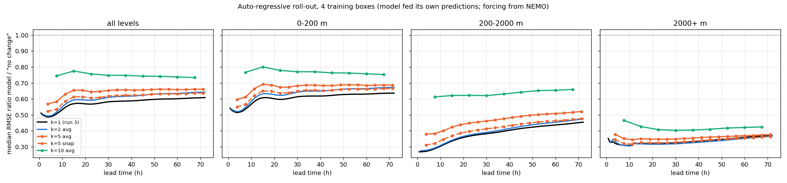
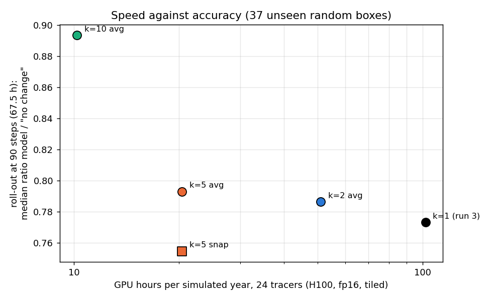
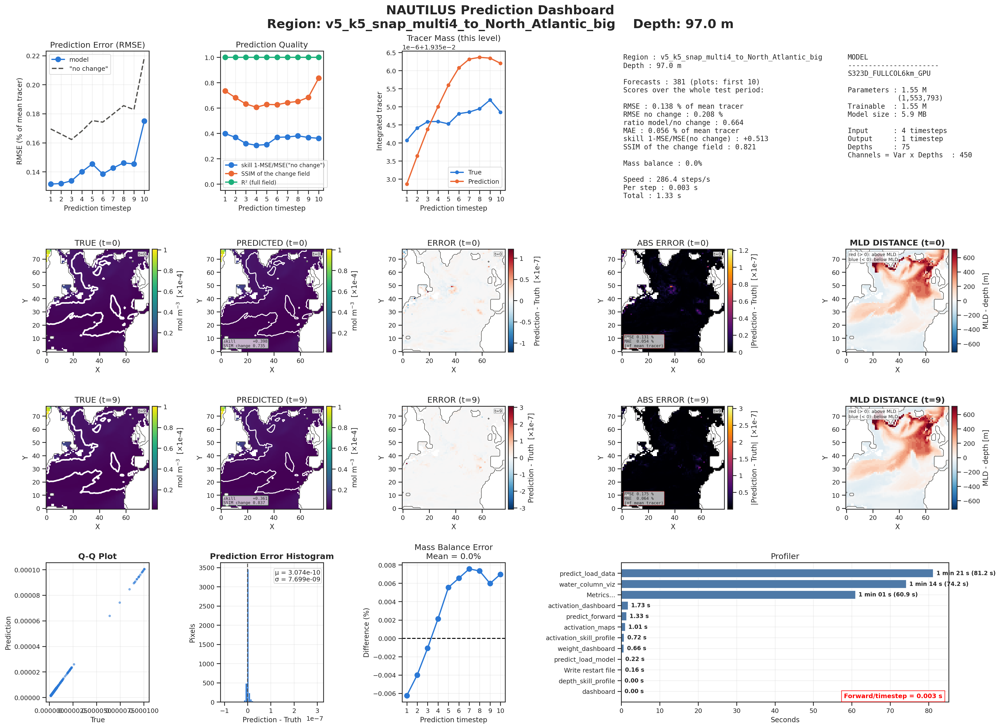

# NAUTILUS v5: lead time, averaged forcing, roll-out, depth skill and inference speed

**Run time tag: 21 October 2026 15:47 – 22 October 2026 02:18 (MareNostrum 5, `acc_bsces`, jobs 47568285–47568288, run in parallel).** The roll-out of the reference model (job 47534687) and the speed benchmark (job 47534880) ran on 19 October 2026. Report written 22 October 2026.

This report answers four questions about the reference model (run 3, `v4_multi4_long`, one model trained on four regions):

*Table 1: The four questions of this report and how each is answered.*

| # | Question | How it is answered |
|---|---|---|
| 1 | Can the model predict 2, 5 or 10 time steps at once, and what does that gain in speed and cost in accuracy? | Four new models with lead time k = 2, 5, 10 (section 4) |
| 2 | How does the similarity index compare between the upper 200 m and the deep ocean? | Per-level SSIM and skill of run 3 (section 3.1) |
| 3 | Does an auto-regressive run work, and does averaging the forcing over the skipped steps help? | Roll-out of all models up to 3 days; k = 5 with averaged forcing against snapshots (sections 4.3, 4.4) |
| 4 | How fast is the model for all 24 tracers at once? | Benchmark on GPU and CPU over the global domain (section 3.2) |

Code in `~/NAUTILUS/ACC_NAUTILUS/ACC_FULL_COLUMN_v2` on MN5, commits `378704a` (lead time, roll-out) and `8b0660c` (benchmark).

## Summary

- **Upper 200 m against the deep ocean (2).**
    - The model is weakest in the upper 200 m. In unseen boxes the median SSIM of the change field is 0.35 there, against 0.75 at 200–2000 m. 35 of 37 boxes score lower at the surface.
    - The top 50 m is the weakest part (SSIM 0.29, skill 0.18).
    - The only band that does worse is below 4000 m (SSIM 0.13, skill 0.03).
    - The SSIM of the change field and the skill agree closely (rank correlation 0.87). The full-field SSIM is 1.000 everywhere and says nothing.
- **Speed (4).**
    - One call over the global domain takes 1.3 s per tracer on one H100 GPU in fp16 with domain tiles, and 85 s on 20 CPU cores. All 24 tracers take 31 s per call on the GPU.
    - With the 1-step model, one simulated year (11 680 steps) costs 102 GPU hours for 24 tracers. On CPU it would cost about 280 days for 24 tracers.
    - The single-tracer model gives no saving per tracer when tracers are run together.
- **Lead time (1).**
    - **k = 5 with snapshot inputs is as accurate as the 1-step model and needs 5 times fewer calls.** At its own lead time the median ratio over the unseen boxes is 0.566, against 0.565 for k = 1. In the 3-day roll-out it is 0.755 against 0.773. 24 tracers then cost about 20 GPU hours per simulated year.
    - k = 2 is as accurate as k = 1 (0.574).
    - k = 10 loses clearly: 0.784 at its own lead time, 0.894 in the roll-out.
- **Averaged forcing (3).** Averaging u, v, w, diffusivity and the MLD distance over the k skipped steps makes the model **worse**. At k = 5, averaged gives 0.611, snapshots 0.566, and averaging is worse in all depth bands and in the roll-out.
- **Roll-out (3).**
    - All models stay stable when fed their own predictions for 3 days (96 steps). The error grows slowly: for k = 1 the median ratio goes from 0.62 at 10 steps to 0.77 at 90 steps. About three quarters of the unseen boxes still beat "no change" after 3 days.
    - The tracer total drifts by at most 0.11 % in any box.

## 1. What is implemented

### 1.1 Reference model and common settings

*Table 2: Settings of the reference model (run 3), common to all models of this report.*

| Item | Setting |
|---|---|
| Model | `S323D_FULLCOL6km_GPU`, 1.55 M parameters. Each of the 75 levels is processed with a window of ±2 levels and 128 hidden channels |
| Training regions | North Atlantic, Tropical Pacific W, Southern Ocean (Atlantic–Indian sector) and South Atlantic. One model, pooled normalization |
| Inputs and target | 6 channels × 75 levels (tracer, u, v, w, diffusivity, distance to the MLD). 4 input times. The target is the change since the last input, scaled per level |
| Time step | 45 min (32 steps per day). Time split 70 / 15 / 15 %; the test period is about 12 days |
| Training | Adam, learning rate 1e-4, fp16 with `GradScaler`, `ReduceLROnPlateau` (patience 6). Stop after 10 epochs without a better validation loss, at most 120 epochs |
| Evaluation | Same 50 random boxes as before. 37 are unseen by the four-region models; 13 overlap a training box ("seen") |

*Figure 1: 3-D ocean masks of the four training boxes (North Atlantic and Tropical Pacific W on top, Southern Ocean and South Atlantic below). In each pair, left: surface ocean (white) and land (black); right: depth of the deepest ocean level, deeper water darker.*

### 1.2 New in this version

- **Lead time k** (`data.lead_steps`):
    - the 4 input snapshots are k steps apart (t, t+k, t+2k, t+3k), and the target is k steps after the last one;
    - the target change is scaled by the RMS of the k-step change;
    - k = 1 gives exactly the earlier windows.
- **Averaged forcing** (`data.forcing_average`). For each input time s, the inputs u, v, w, diffusivity and MLD distance are the mean over the k steps (s−k, s]. Without it they are the snapshots at s. The tracer input is always a snapshot.
- **Auto-regressive roll-out** (`src/rollout_eval.py`):
    - 13 start times in the test period, every 24 steps;
    - from each start the model runs forward on its own predictions for up to 96 steps (3 days): 96 calls for k = 1, 9 calls for k = 10;
    - the tracer input after the start is the model's own output, while u, v, w, diffusivity and MLD come from the NEMO data, as in a coupled run;
    - at every lead time the forecast is compared with the truth and with "no change" from the start time.

  It now runs as the fourth step of every job.
- **Inference benchmark** (`src/benchmark_inference.py`):
    - one model call over the global domain (292 × 362 × 75) on the H100 GPU (fp32 and fp16) and on 20 CPU cores;
    - the domain either in one piece or in tiles of 128 or 64 cells with an 8-cell halo, as a coupled run would split it;
    - for 1 and 24 tracers.

*Table 3: The four new models. All are trained like the reference model; only the lead time and the forcing change.*

| Model | Lead time per call | Forcing inputs | Calls for a 3-day roll-out | Calls per simulated year |
|---|---|---|---|---|
| Run 3 (reference) | 1 step (45 min) | snapshots | 96 | 11 680 |
| `v5_k2_avg` | 2 steps (1.5 h) | mean over 2 steps | 48 | 5 840 |
| `v5_k5_avg` | 5 steps (3.75 h) | mean over 5 steps | 19 | 2 336 |
| `v5_k5_snap` | 5 steps (3.75 h) | snapshots | 19 | 2 336 |
| `v5_k10_avg` | 10 steps (7.5 h) | mean over 10 steps | 9 | 1 168 |

## 2. Runs

*Table 4: Training of the four new models. All stopped by the stopping rule (10 epochs without a better validation loss).*

| Model | Job | Epochs (best) | Training | Total (with evaluation, prediction, roll-out) | Final learning rate | Peak memory |
|---|---|---|---|---|---|---|
| `v5_k2_avg` | 47568285 | 72 (62) | 9 h 54 min | 10 h 30 min | 2.5e-5 | 90 GB |
| `v5_k5_avg` | 47568286 | 61 (51) | 8 h 28 min | 9 h 03 min | 1.25e-5 | 95 GB |
| `v5_k10_avg` | 47568287 | 68 (58) | 9 h 20 min | 9 h 51 min | 1.25e-5 | 97 GB |
| `v5_k5_snap` | 47568288 | 61 (51) | 8 h 22 min | 8 h 55 min | 1.25e-5 | 102 GB |

All four jobs completed without errors. The roll-out step took 4–10 minutes. The results were copied to `/gpfs/scratch/bsc32/bsc032196/nautilus/ACC_FULL_COLUMN_v2/<model>/`.

*Figure 2: Loss curves of the four new models: training loss (train mode, random patches), training loss on fixed patches in evaluation mode, and validation loss (mean over the four regions). The star marks the best validation epoch. Loss values cannot be compared between models, because each is in the units of its own k-step change.*

- **All four train smoothly and converge within 61–72 epochs**, a little faster than the reference model (76).
- **The validation loss flattens after about epoch 40.** The scheduler then lowers the learning rate, and the stopping rule ends the run 10 epochs after the best epoch.

## 3. Reference model: depth and speed

### 3.1 Similarity index by depth (question 2)

*Table 5: Run 3, median over boxes of the per-level SSIM of the change field and skill, per depth band, test period. The full-field SSIM is 1.000 in every band and is not shown.*

| Depth band | SSIM of change, unseen random (37) | Skill, unseen random (37) | SSIM of change, training (4) | Skill, training (4) |
|---|---|---|---|---|
| 0–50 m | **0.29** | **0.18** | 0.62 | 0.37 |
| 50–200 m | 0.60 | 0.66 | 0.85 | 0.83 |
| 200–1000 m | 0.74 | 0.80 | 0.88 | 0.93 |
| 1000–2000 m | **0.76** | **0.82** | 0.81 | 0.89 |
| 2000–4000 m | 0.60 | 0.71 | 0.89 | 0.91 |
| below 4000 m | **0.13** | **0.03** | 0.56 | 0.54 |

*Figure 3: Run 3, SSIM of the change field (left) and skill (right) per model level (log depth axis), median over the training boxes, the named boxes and the unseen random boxes; the shading is the 25–75 % range of the unseen random boxes. The dotted line marks 200 m.*

- **The upper 200 m is clearly weaker than the ocean below, down to 4000 m.** Per box, the median SSIM of the change field is 0.35 in 0–200 m and 0.75 at 200–2000 m. 35 of 37 unseen boxes score lower in the upper 200 m than at 200–2000 m, and 30 of 37 lower than at 2000–4000 m.
- **The top 50 m is the weakest band above 4000 m.** Both SSIM and skill rise steeply from 50 to 200 m, peak in the thermocline and intermediate waters (200–2000 m), and fall again below 2000 m.
- **Below 4000 m** the change from one step to the next is tiny, and 43 % of the levels there are worse than "no change".
- **SSIM and skill agree.** Their rank correlation over all levels of the unseen boxes is 0.87 (0.89 in the upper 200 m). The SSIM of the change field is therefore a useful second measure. The full-field SSIM is not: the next step is almost identical to the last, so it is always 1.000.
- **Training boxes are better at every depth.** The difference is largest in the top 50 m (SSIM 0.62 against 0.29), so the surface layer generalizes worst to new regions. The model has no surface forcing among its inputs (no wind stress, heat or freshwater flux), which probably limits it most near the surface.

### 3.2 Inference speed (question 4)

*Table 6: Time of one model call over the global domain (292 × 362 × 75 levels), run 3 model, per tracer. One H100 GPU (64 GB) or 20 CPU cores of an ACC node. Tiles carry an 8-cell halo on every side.*

| Device, precision | Domain | Per tracer and call | 24 tracers per call | Peak GPU memory |
|---|---|---|---|---|
| GPU, fp32 | whole domain | does not fit | – | > 64 GB |
| GPU, fp16 | whole domain | 0.78 s | 18.7 s | 51.8 GB |
| GPU, fp32 | 9 tiles of 128 (+ halo) | 2.03 s | 48.7 s | 59.9 GB |
| GPU, fp32 | 30 tiles of 64 (+ halo) | 2.11 s | 50.7 s | 32.4 GB |
| GPU, fp16 | 9 tiles of 128 (+ halo) | **1.31 s** | **31.4 s** | 40.6 GB |
| GPU, fp16 | 30 tiles of 64 (+ halo) | 1.33 s | 31.9 s | 47.0 GB |
| CPU, fp32 | whole domain | 65 s | about 26 min | – |
| CPU, fp32 | 9 tiles of 128 (+ halo) | 85 s | about 34 min | – |
| CPU, fp32 | 30 tiles of 64 (+ halo) | 88 s | about 35 min | – |

*Figure 4: Seconds per model call, 1 tracer, global domain (log scale); GPU in blue, CPU in orange.*

- **The time scales linearly with the number of tracers.** 24 tracers take exactly 24 times one tracer. With a single-tracer model, the 24 tracers are 24 independent forecasts, so running them together saves nothing. CPU times for 24 tracers are therefore 24 × the single-tracer time.
- **The GPU is 40–65 times faster than 20 CPU cores.** fp16 is 1.6 times faster than fp32.
- **Tiles cost about 1.7 times more than the whole domain in one piece**, mainly because of the halos. The tile size hardly matters.
- **Memory is the limit.** The whole domain does not fit in fp32, even for 1 tracer, because every level is processed with its ±2-level window and 128 hidden channels. On CPU, a batch of 4 tracers over the whole domain exceeded the 125 GB of the node.

*Table 7: Cost of one simulated year (365 days, 11 680 time steps), GPU fp16 with 128-cell tiles (1.31 s per call and tracer) or CPU fp32 with 128-cell tiles (85 s), for each lead time k.*

| Model | Calls per year | 1 tracer, GPU | 24 tracers, GPU | 1 tracer, CPU | 24 tracers, CPU |
|---|---|---|---|---|---|
| k = 1 (run 3) | 11 680 | 4.3 h | 102 h | 277 h (11.5 days) | 277 days |
| k = 2 | 5 840 | 2.1 h | 51 h | 139 h | 139 days |
| k = 5 | 2 336 | 0.85 h | **20 h** | 55 h | 55 days |
| k = 10 | 1 168 | 0.43 h | 10 h | 28 h | 28 days |

## 4. Lead time and averaged forcing (questions 1 and 3)

### 4.1 Accuracy at the model's own lead time

Each model is scored against "no change" over its own lead time: the change over k steps.

*Table 8: Accuracy at the model's own lead time, 37 unseen random boxes, test period: median RMSE ratio model / "no change" (physical and normalized units), boxes better than "no change", and median SSIM of the change field.*

| Model | Lead time | Median ratio (physical) | Median ratio (normalized) | Better than "no change" | SSIM of change |
|---|---|---|---|---|---|
| k = 1 (run 3) | 45 min | **0.565** | 0.615 | 37 | 0.52 |
| k = 2 averaged | 1.5 h | 0.574 | 0.626 | 37 | 0.51 |
| k = 5 averaged | 3.75 h | 0.611 | 0.637 | 37 | 0.46 |
| **k = 5 snapshots** | 3.75 h | **0.566** | **0.612** | 37 | 0.50 |
| k = 10 averaged | 7.5 h | 0.784 | 0.779 | 35 | 0.33 |

*Table 9: Median RMSE ratio (normalized) at the model's own lead time per depth band, 37 unseen random boxes; boxes better than "no change" in brackets.*

| Band | k = 1 | k = 2 avg | k = 5 avg | k = 5 snap | k = 10 avg |
|---|---|---|---|---|---|
| 0–200 m | 0.741 (35) | **0.737 (35)** | 0.753 (35) | 0.749 (35) | 0.893 (32) |
| 200–1000 m | 0.417 (37) | **0.398 (37)** | 0.497 (37) | 0.421 (37) | 0.725 (35) |
| 1000–2000 m | 0.401 (36) | **0.395 (36)** | 0.480 (36) | 0.423 (35) | 0.709 (34) |
| 2000–4000 m | 0.509 (37) | **0.492 (37)** | 0.573 (37) | 0.527 (37) | 0.661 (37) |
| 4000–6500 m | **0.884 (28)** | 0.885 (27) | 0.899 (23) | 0.889 (24) | 0.953 (23) |

*Table 10: RMSE ratio model / "no change" at the model's own lead time per training and named box (physical units).*

| Box | k = 1 | k = 2 avg | k = 5 avg | k = 5 snap | k = 10 avg |
|---|---|---|---|---|---|
| North Atlantic big (training) | 0.793 | 0.790 | 0.774 | **0.753** | 0.830 |
| Tropical Pacific W (training) | **0.209** | 0.222 | 0.234 | 0.225 | 0.278 |
| Southern Ocean AI (training) | **0.458** | 0.469 | 0.585 | 0.509 | 0.819 |
| South Atlantic (training) | 0.422 | **0.403** | 0.438 | 0.404 | 0.581 |
| North Atlantic (old box) | **0.902** | 0.953 | 0.964 | 0.963 | 0.974 |
| South Pacific (unseen) | **0.585** | 0.604 | 0.712 | 0.653 | 0.898 |
| North Pacific (unseen) | 0.502 | 0.477 | 0.526 | **0.452** | 0.810 |
| Tropical Pacific (unseen) | **0.342** | 0.346 | 0.351 | 0.359 | 0.391 |

- **k = 2 is as good as k = 1** and slightly better at 200–4000 m.
- **k = 5 with snapshots is as good as k = 1.** The median is the same (0.566 against 0.565) and it is better in the North Atlantic and North Pacific. Only the Southern Ocean and South Pacific are slightly worse.
- **k = 10 is clearly worse**, mainly in the ocean interior (200–2000 m: 0.71–0.73 against about 0.40) and in the Southern Ocean.

*Figure 5: Model k = 5 with snapshot forcing: skill per box and model level at its own lead time (3.75 h), test period. Blue is better than "no change", red worse, grey no ocean.*

### 4.2 Averaged forcing against snapshots (k = 5)

- **Averaging the forcing over the 5 skipped steps makes the model worse at every depth.** The median ratio is 0.611 against 0.566. At 200–1000 m it is 0.497 against 0.421, and the SSIM of the change field falls from 0.50 to 0.46.
- **The averaged model is also worse in 7 of the 8 training and named boxes**, most clearly in the Southern Ocean (0.585 against 0.509) and the South Pacific (0.712 against 0.653).
- **A possible reason:** the change over the next 5 steps depends mostly on the flow at the time of the last input. The mean over the past 5 steps blurs exactly that information. The averaged inputs could be useful as additional channels next to the snapshots, not instead of them (section 6).

### 4.3 Auto-regressive roll-out

*Figure 6: Auto-regressive roll-out over the test period, 37 unseen random boxes: median RMSE ratio model / "no change" (from the start time) against lead time, for all levels and for three depth bands. Each model is fed its own predictions; the forcing comes from NEMO. Markers show the calls of the k = 5 and k = 10 models.*

*Figure 7: As Figure 6, for the four training boxes.*

*Table 11: Roll-out, median RMSE ratio model / "no change" (normalized) at 30 steps (22.5 h) and 90 steps (67.5 h), 37 unseen random boxes, with the training boxes and the tracer-total error at the end of the roll-out.*

| Model | All levels, 30 steps | All levels, 90 steps | Better than "no change" at 90 steps | 0–200 m, 90 steps | 200–2000 m, 90 steps | 2000+ m, 90 steps | Training boxes, 90 steps | Tracer total, median / largest error |
|---|---|---|---|---|---|---|---|---|
| k = 1 (run 3) | 0.686 | 0.773 | 28 of 37 | **0.847** | 0.633 | **0.607** | **0.606** | −0.016 % / 0.08 % |
| k = 2 averaged | **0.677** | 0.787 | **30 of 37** | 0.850 | **0.619** | 0.620 | 0.641 | −0.020 % / 0.08 % |
| k = 5 averaged | 0.717 | 0.793 | 30 of 37 | 0.883 | 0.676 | 0.636 | 0.661 | −0.009 % / 0.11 % |
| **k = 5 snapshots** | 0.688 | **0.755** | 29 of 37 | 0.872 | 0.656 | 0.646 | 0.635 | −0.013 % / 0.08 % |
| k = 10 averaged | 0.859 | 0.894 | 28 of 37 | 0.927 | 0.862 | 0.647 | 0.734 | −0.016 % / 0.09 % |

- **All models are stable.** None of the roll-outs blows up. The error relative to "no change" grows slowly and evenly over the 3 days.
- **k = 1, k = 2 and k = 5 with snapshots stay close together throughout.** After 3 days they are at 0.75–0.79 on the unseen boxes, and about three quarters of the boxes still beat "no change". k = 5 with snapshots is slightly the best on the unseen boxes; k = 1 is the best in the training boxes.
- **The longer lead time compensates by needing fewer calls.** At its own lead time k = 5 is about as accurate as k = 1. In the roll-out it reaches 3 days in 19 calls instead of 96, so fewer prediction errors are fed back.
- **The depth bands keep the order of question 2.** 200–2000 m is the best band and the upper 200 m the weakest throughout the roll-out.
- **The tracer total is conserved within 0.1 %** in every box after 3 days, with no systematic drift.

### 4.4 Speed against accuracy

*Figure 8: GPU hours per simulated year for 24 tracers (H100, fp16, 128-cell tiles; log scale) against the roll-out accuracy at 90 steps (67.5 h), median over the 37 unseen random boxes. Lower and further left is better.*

- **k = 5 with snapshots is the best trade-off.** It is 5 times cheaper than k = 1 (about 20 GPU hours per simulated year for 24 tracers instead of 102) and at least as accurate in the 3-day roll-out.
- **k = 10 halves the cost again,** but at a clear loss of accuracy, at least with averaged forcing.

*Figure 9: Prediction dashboard of the k = 5 model with snapshot forcing, North Atlantic training box, 97 m, first 10 test windows (each 5 steps ahead).*

## 5. Interpretation

- **The model can skip time steps.** Predicting 5 steps (3.75 h) ahead in one call is as accurate as predicting one step at a time, and 5 times cheaper. The 3-day roll-out is just as good, probably because fewer calls feed back fewer errors.
- **Instantaneous forcing works better than averaged forcing.** The change over the next steps is driven by the current flow, and averaging removes part of that information.
- **The surface layer is the main weakness** (question 2). It is also the layer the model sees least of: it has no atmospheric forcing among its inputs.
- **The model is too heavy for 24 tracers in a CPU-only coupled run.** On one H100 GPU it is feasible, at about 20 h per simulated year with k = 5. On CPU even k = 5 would take about 55 days per simulated year for 24 tracers. A coupled production run needs the GPU, a lighter model, or both.

## 6. Suggested next steps

1. **Use k = 5 with snapshots** (`v5_k5_snap`) as the candidate for coupling tests.
2. **Test k = 10 with snapshots, and k = 5 with snapshots plus averaged forcing as extra channels.** This checks whether snapshots also rescue k = 10, and whether the averages add anything when the snapshots are kept.
3. **Add surface forcing to the inputs** (wind stress, heat and freshwater flux) to improve the upper 50 m.
4. **A lighter model for speed.** Fewer hidden channels, or one calculation shared across depth instead of one per level, then a new benchmark on GPU and CPU.
5. **Longer roll-outs.** The test period (about 12 days) allows at most about 10-day roll-outs. A longer simulation as test data would show whether the model stays stable for weeks.
6. **24 tracers.** Once the data for the 24 tracers are available, train a model with all tracers as inputs and outputs, and repeat the benchmark with it.

## 7. Files

*Table 12: Files of this report's runs on MN5, in `~/NAUTILUS/ACC_NAUTILUS/ACC_FULL_COLUMN_v2`.*

| What | Where |
|---|---|
| Configs | `config/nautilus_v5_k2_avg.yaml`, `nautilus_v5_k5_avg.yaml`, `nautilus_v5_k10_avg.yaml`, `nautilus_v5_k5_snap.yaml` (reference: `nautilus_v4_multi4_long.yaml`) |
| Checkpoints | `checkpoints/v5_<model>_multi4_best_model.pt` |
| Logs | `logs/v5_<model>/` (loss, learning rate, validation per region, diagnostics) |
| Global evaluation | `eval_global_v5_<model>/` |
| Roll-out | `eval_global_<model>/rollout/` (`rollout_per_lead.csv`, `rollout_summary.json`); reference: `eval_global_v4_multi4_long/rollout/` |
| Dashboards | `artifacts/dashboard/prediction/v5_<model>/` |
| Benchmark | `logs/benchmark_inference_47534880.json` (tiled), `server/bench_47534462.out` (whole domain) |
| Code | `src/data_v2.py` (lead time, averaged forcing), `src/rollout_eval.py`, `src/benchmark_inference.py`, `sbatch_benchmark.job` |
| Copy on scratch | `/gpfs/scratch/bsc32/bsc032196/nautilus/ACC_FULL_COLUMN_v2/v5_<model>/` |

Locally: this report (`.md` and `.pdf`) and its figures in `~/ClaudeX/22-Oct-2026/Reports/`.
