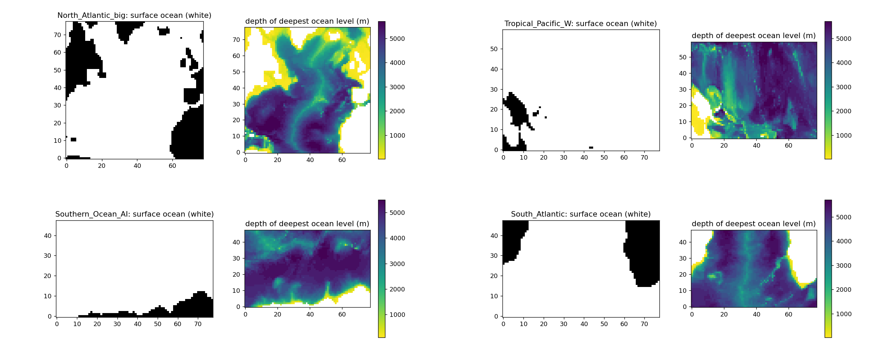
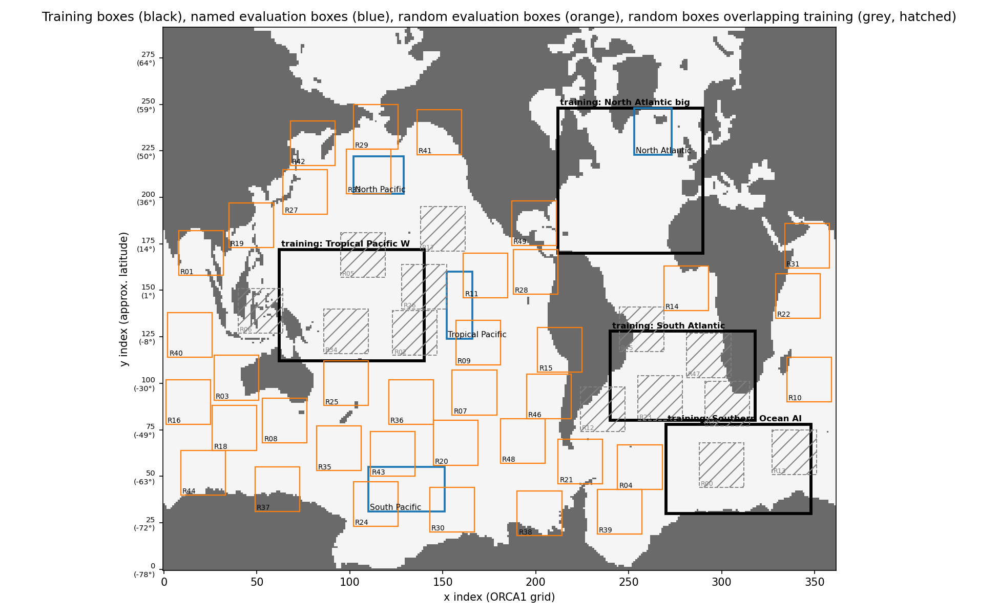
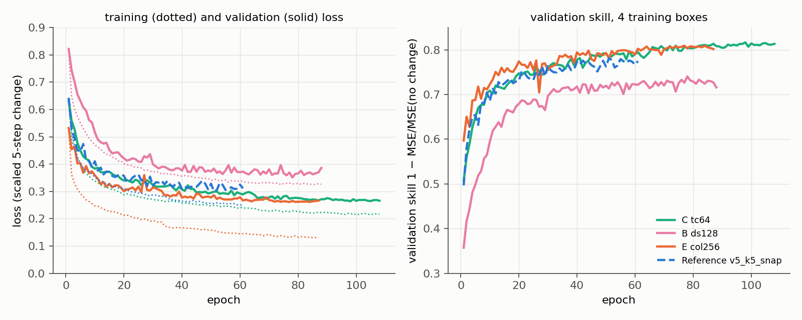
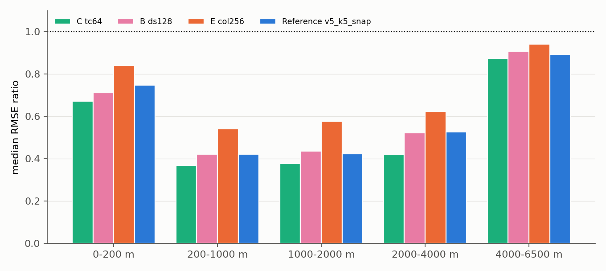
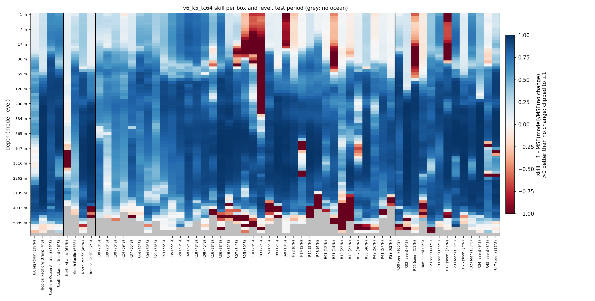
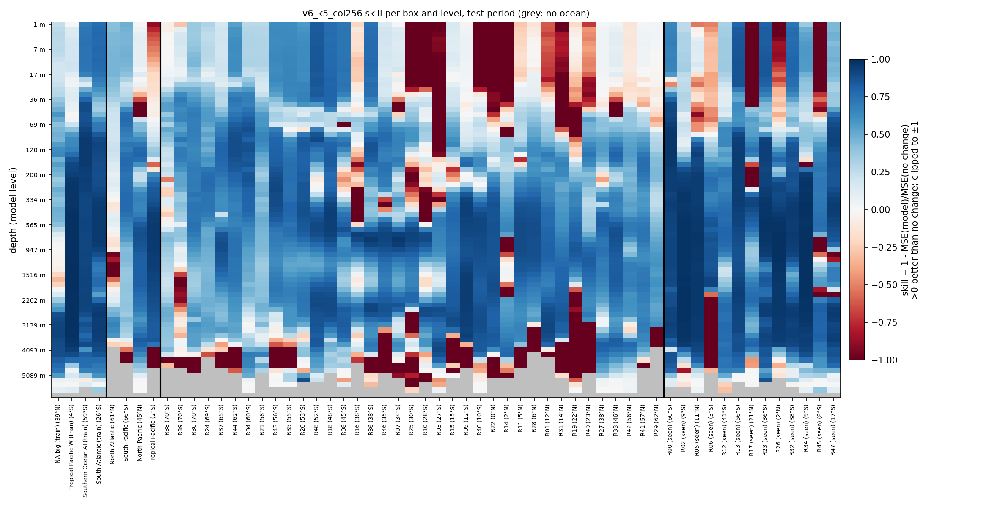
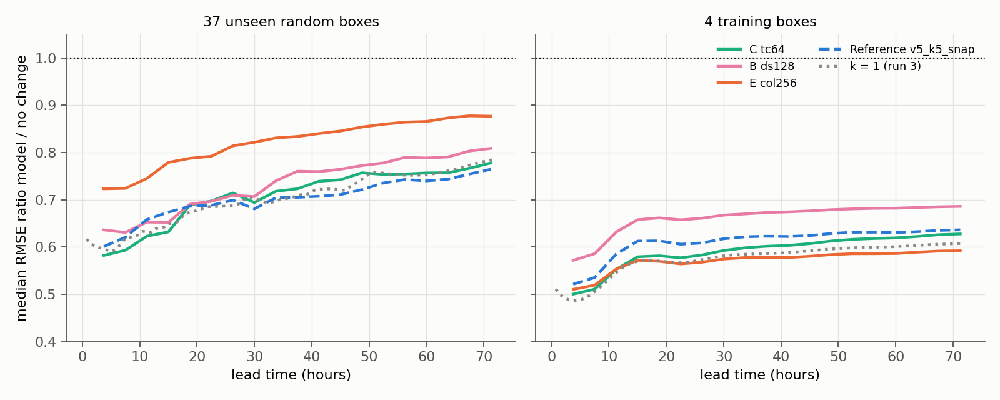
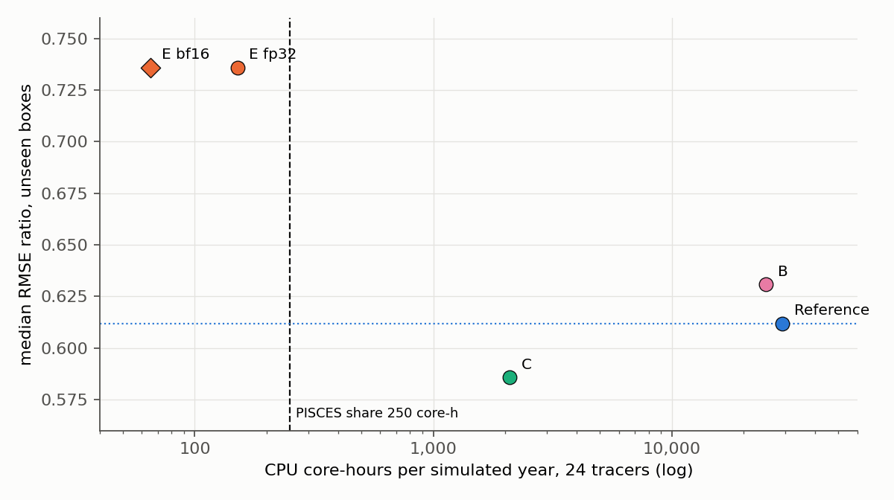

# NAUTILUS v6 (interim): accuracy of the light models B, C and E against their CPU cost

**Run time tag: 2 November 2026 14:43 – 3 November 2026 00:48 (MareNostrum 5).** Three full trainings, each on one H100 (`acc_bsces`):

- B `v6_k5_ds128`: job 48068035, 2 Nov 14:43 – 3 Nov 00:48;
- C `v6_k5_tc64`: job 48068036, 2 Nov 15:20 – 19:05;
- E `v6_k5_col256`: job 48068037, 2 Nov 18:39 – 21:30.

Report written 3 November 2026, 10:30.

This is an **interim** report. It covers the three v6 light models whose trainings have finished and sets their accuracy against their CPU cost. The cost is compared with the PISCES share of **250 core-hours per simulated year**. Still in the queue, and not covered here:

- A `v6_k5_h64` (resubmitted as 48410455, since the first run 48068034 failed on a GPFS read error);
- the GNNs G128 (48200859) and G64 (48200938);
- the Flower models 2-D (48140224) and 3-D (48140225).

The final comparison of all models will follow when they have run.

Code in `~/NAUTILUS/ACC_NAUTILUS/ACC_FULL_COLUMN_v2` on MN5. B and C ran at commit `7287bc2` and E at commit `2ee7677`, which changes only the evaluation output folder, so all three ran the same code.

## Summary

- **C (time-stacked inputs, no ConvLSTM) is the first light model that beats the reference.**
    - Median RMSE ratio model / "no change" over the 37 unseen random boxes: **0.586 against 0.612**. C is better than the reference in 27 of the 37 boxes.
    - It is better at every depth, most of all between 200 and 4000 m (0.37–0.42 against 0.42–0.53).
    - In the 3-day roll-out it is as good as the reference (0.767 against 0.755 at 67.5 h) and better below 200 m.
    - It has 9 times fewer parameters and 35 times less compute than the reference.
- **But C costs about 2 100 CPU core-hours per simulated year, 8 times the 250 budget.** It fits only on the GPU (about 24 core-hour equivalents).
- **E is within the budget (151 core-hours in fp32, 65 in bf16) but does not generalize.**
    - In the training boxes E is the best of all models: validation skill 0.809 and roll-out 0.592 at 67.5 h, against 0.635 for the reference.
    - In the unseen boxes it is clearly the worst: **0.736 against 0.612**, worse than the reference in 30 of 37 boxes, and 0.878 in the roll-out. The gap is largest between 200 and 4000 m.
    - E's training loss ends at half of its validation loss (0.13 against 0.26). It learns the four training regions rather than the transport.
- **B confirms the benchmark: it is neither cheap nor better** (0.631, about 24 900 core-hours). It can be dropped.
- **All three conserve the tracer well in the roll-out** (median change of the total −0.01 %, at most 0.10 %).
- **No model is yet both accurate and within the CPU budget.** The question is now whether a smaller C, a regularized E, or one of the queued GNNs closes the gap.

## 1. What is implemented

### 1.1 The models

*Table 1: The reference and the three light models of this report. All take the same inputs (tracer, u, v, w, diffusivity and distance to the mixed-layer depth; 75 levels; 4 snapshots 5 steps apart) and give the change of one tracer at all 75 levels after k = 5 steps (3.75 h). Compute is per call, global ORCA1 domain, 1 tracer. CPU cost: 24 tracers, one simulated year (2 336 calls).*

| Model | Config | Architecture (`model.arch`) | Parameters | Compute per call | CPU core-hours per year |
|---|---|---|---|---|---|
| Reference | `nautilus_v5_k5_snap` | `conv2dlstm`: per level, ±2-level window, ConvLSTM over the 4 input times, 128 channels | 1 553 793 | 94 934 GFLOP | ~29 000 |
| B | `nautilus_v6_k5_ds128` | `conv2dlstm_sep`: as the reference, depthwise-separable 3 × 3 convolutions | 183 937 | 11 076 GFLOP | ~24 900 |
| C | `nautilus_v6_k5_tc64` | `timestack`: per level, ±2-level window, input times stacked as channels (16 per time after a 1 × 1 reduction), 2 residual blocks of 64 channels | 171 505 | 2 726 GFLOP | ~2 100 |
| E | `nautilus_v6_k5_col256` | `column`: the whole column (all levels, variables and times) as channels of one 2-D network, 3 residual blocks of 256 channels | 4 024 395 | 850 GFLOP | **151** (bf16: 65) |

The CPU costs of the reference, B and C come from the v6 benchmark (26 October: one GPP node, best of 1 × 112 threads or 8 × 14 ranks on 64-cell tiles). For E the cost comes from the v7 coupling benchmark (28 October: 8 ranks on whole subdomains with TorchScript, as NEMO would run the model). That benchmark showed the v6 tiles do about 1.7 times more work than needed. The reference, B and C were not measured again that way, so their costs here are on the pessimistic side.

### 1.2 Training and evaluation

*Table 2: Settings shared by the three trainings and the reference. Only the model block and the names differ between the configs.*

| | |
|---|---|
| Training regions | North Atlantic (big), Tropical Pacific W, Southern Ocean (Atlantic–Indian sector), South Atlantic. One model, pooled normalization |
| Target | Change of the tracer 5 steps (3.75 h) after the last input, scaled per level |
| Ocean mask | Only in the data: land and cells below the sea floor are 0 in inputs and target; the loss counts ocean cells only (with a gradient term, `lambda_grad` 0.3) |
| Training | Random 48 × 48 patches (at least 30 % ocean), batch 4, Adam, learning rate 1e-4 halved after 6 epochs without improvement (minimum 1e-6), gradient clipping at 1.0, fp16 with `GradScaler`, at most 120 epochs, stop after 10 epochs without a better validation loss |
| Validation | The last 10 % of the training period, whole 78 × 78 training boxes |
| Evaluation | Test period (last 15 % of the year). The same 50 random boxes as v2–v7: 37 unseen and 13 overlapping a training box ("seen"), plus 4 named boxes. Roll-out of 19 calls (95 steps, 71 h) from 13 starts |
| References | `v5_k5_snap` (k = 5, the same setup with the reference model; 61 epochs, best 51). For the roll-out also k = 1 (run 3, `v4_multi4_long`, 96 calls) |

*Figure 1: 3-D ocean masks of the four training boxes (North Atlantic and Tropical Pacific W on top, Southern Ocean and South Atlantic below). In each pair, left: surface ocean (white) and land (black); right: depth of the deepest ocean level, deeper water darker.*

*Figure 2: Training boxes (black), named evaluation boxes (blue), unseen random boxes (orange) and random boxes overlapping a training box (grey, hatched) on the ORCA1 grid.*

## 2. Runs

*Table 3: The three trainings of this report. Each job ran training, global evaluation, roll-out and prediction on one H100. Results were copied to `/gpfs/scratch/bsc32/bsc032196/nautilus/ACC_FULL_COLUMN_v2/<experiment>/`, because these jobs were submitted before the switch to `/gpfs/projects`.*

| Model | Job | Start | Duration | Epochs (best) | Training time | Minutes per epoch | Steps skipped by AMP | State |
|---|---|---|---|---|---|---|---|---|
| B | 48068035 | 2 Nov 14:43 | 10 h 06 min | 88 (78) | 563 min | 6.4 | 64 | completed |
| C | 48068036 | 2 Nov 15:20 | 3 h 45 min | 108 (98) | 198 min | 1.8 | 78 | completed |
| E | 48068037 | 2 Nov 18:39 | 2 h 51 min | 87 (77) | 147 min | 1.7 | 62 | completed |
| Reference | (v5) | – | – | 61 (51) | 502 min | 8.2 | 44 | – |

- **All three trainings stopped on the patience rule,** well before the 120-epoch limit.
- **The first A training (48068034) failed after 14 minutes** with `No module named 'colorsys'`. That is a standard-library module, so this was a GPFS read error and not a code problem. A was resubmitted as 48410455 and is waiting in the queue.
- **E and C train 3–5 times faster per epoch than the reference,** so a light model makes new experiments cheap too.

*Figure 3: Left: training loss (dotted, random patches in train mode) and validation loss (solid; reference dashed) per epoch. Right: validation skill 1 − MSE/MSE(no change), mean over the four training boxes. Units of the loss: scaled 5-step change.*

*Table 4: Losses and validation skill at the best epoch. The gap is validation over training loss.*

| Model | Training loss | Validation loss | Gap | Validation skill | NA big | Trop. Pac. W | Southern Ocean | South Atlantic |
|---|---|---|---|---|---|---|---|---|
| B | 0.328 | 0.351 | 1.07 | 0.740 | 0.34 | 0.94 | 0.70 | 0.72 |
| C | 0.220 | 0.264 | 1.20 | **0.817** | 0.41 | **0.97** | **0.79** | 0.79 |
| E | **0.132** | **0.261** | **1.97** | 0.809 | **0.45** | **0.97** | 0.78 | **0.80** |
| Reference | 0.256 | 0.301 | 1.17 | 0.781 | 0.37 | 0.95 | 0.75 | 0.78 |

- **On the training boxes C and E are both better than the reference,** and E learns fastest (Figure 3).
- **E's training loss is half its validation loss.** For C and the reference the ratio is about 1.2. E fits its training patches far more closely than the patches it is validated on.

## 3. Results

### 3.1 Accuracy at the lead time

*Table 5: Accuracy at the models' lead time (5 steps), test period. Per model: median RMSE ratio model / "no change", normalized (in brackets, the same in physical units), number of boxes better than "no change", and median SSIM of the change field. k = 1 at its own lead time (1 step), for reference only.*

| Boxes | C | better | SSIM | B | better | SSIM | E | better | SSIM | Reference | better | SSIM | k = 1 |
|---|---|---|---|---|---|---|---|---|---|---|---|---|---|
| 37 unseen random | **0.586 (0.536)** | 37 | **0.51** | 0.631 (0.578) | 37 | 0.49 | 0.736 (0.666) | 36 | 0.42 | 0.612 (0.566) | 37 | 0.50 | 0.615 |
| 13 seen random | 0.525 (0.412) | 13 | 0.60 | 0.571 (0.485) | 13 | 0.56 | **0.493** (0.444) | 13 | 0.59 | 0.553 (0.446) | 13 | 0.60 | 0.553 |
| 4 named | **0.531 (0.476)** | 4 | **0.49** | 0.598 (0.547) | 4 | 0.46 | 0.691 (0.645) | 4 | 0.41 | 0.604 (0.553) | 4 | 0.48 | 0.604 |
| 4 training | **0.514 (0.428)** | 4 | 0.71 | 0.586 (0.500) | 4 | 0.68 | 0.528 (0.452) | 4 | **0.74** | 0.540 (0.456) | 4 | 0.72 | 0.526 |

*Table 6: Median RMSE ratio (normalized) per depth band, 37 unseen random boxes; in brackets the boxes better than "no change".*

| Depth band | C | B | E | Reference |
|---|---|---|---|---|
| 0–200 m | **0.671 (35)** | 0.712 (36) | 0.841 (31) | 0.749 (35) |
| 200–1000 m | **0.368 (37)** | 0.421 (37) | 0.541 (36) | 0.421 (37) |
| 1000–2000 m | **0.378 (36)** | 0.435 (35) | 0.578 (35) | 0.423 (35) |
| 2000–4000 m | **0.420 (37)** | 0.523 (37) | 0.624 (35) | 0.527 (37) |
| 4000–6500 m | **0.854 (25)** | 0.906 (25) | 0.942 (20) | 0.889 (24) |

*Figure 4: Median RMSE ratio model / "no change" per depth band, 37 unseen random boxes, test period. Below 1 is better than "no change" (dotted line).*

*Table 7: RMSE ratio model / "no change" (normalized) per training and named box.*

| Box | Kind | C | B | E | Reference |
|---|---|---|---|---|---|
| North Atlantic (big) | training | 0.818 | 0.850 | **0.789** | 0.837 |
| Tropical Pacific W | training | **0.206** | 0.264 | 0.235 | 0.256 |
| Southern Ocean AI | training | **0.511** | 0.592 | 0.571 | 0.556 |
| South Atlantic | training | 0.518 | 0.580 | **0.486** | 0.523 |
| North Atlantic | named | 0.961 | 0.982 | **0.793** | 0.963 |
| South Pacific | named | **0.689** | 0.753 | 0.710 | 0.712 |
| North Pacific | named | **0.374** | 0.444 | 0.672 | 0.497 |
| Tropical Pacific | named | **0.352** | 0.421 | 0.555 | 0.424 |

*Figure 5: Model C: skill 1 − MSE(model)/MSE(no change) per box and model level, test period. Blue is better than "no change", red worse, grey no ocean. Columns from left: training boxes, named boxes, unseen random boxes, seen random boxes.*

*Figure 6: Model E: skill per box and model level, as Figure 5.*

- **C is the most accurate model in the unseen, named and training boxes.** It beats the reference in 27 of 37 unseen boxes; its worst unseen box is at 0.82 (reference 0.86).
- **E is good where it has seen the water and poor elsewhere:**
    - it is the best model in the seen random boxes (0.493) and in two of the training boxes;
    - it is the worst in the unseen boxes. It beats the reference in only 7 of 37, its worst box is at 1.15, and it is worse than "no change" in one box;
    - it does best in the named North Atlantic box (0.793), which is close to its North Atlantic training box, and worst in the North and Tropical Pacific.
- **E's loss in unseen boxes grows with depth from 200 m down.** That is where water masses carry the signature of their region, which a network taking the whole column as input can recognize.

### 3.2 Roll-out

*Table 8: Auto-regressive roll-out (the model is fed its own predictions; forcing from NEMO): median RMSE ratio model / "no change" (normalized) at 22.5 h and 67.5 h. k = 5 models: 30 and 90 steps (6 and 18 calls); k = 1: 30 and 90 calls.*

| Boxes | Depth | C | B | E | Reference | k = 1 |
|---|---|---|---|---|---|---|
| 37 unseen random | all | 0.698 / 0.767 | 0.697 / 0.803 | 0.792 / 0.878 | 0.688 / **0.755** | **0.686** / 0.773 |
| 37 unseen random | 0–200 m | **0.766 / 0.828** | 0.803 / 0.884 | 0.859 / 0.945 | 0.781 / 0.872 | 0.783 / 0.847 |
| 37 unseen random | 200–2000 m | **0.497 / 0.634** | 0.547 / 0.676 | 0.731 / 0.869 | 0.565 / 0.656 | 0.528 / 0.633 |
| 37 unseen random | below 2000 m | **0.508 / 0.547** | 0.569 / 0.582 | 0.669 / 0.723 | 0.566 / 0.646 | 0.546 / 0.607 |
| 4 training | all | 0.577 / 0.626 | 0.658 / 0.685 | **0.564 / 0.592** | 0.606 / 0.635 | 0.567 / 0.606 |

*Figure 7: Roll-out over the test period: median RMSE ratio model / "no change" against lead time, all levels. Left: 37 unseen random boxes; right: 4 training boxes. Above the dotted line the model is worse than "no change".*

*Table 9: Change of the tracer total over the 67.5 h roll-out, unseen and other non-training boxes.*

| | C | B | E | Reference |
|---|---|---|---|---|
| Median change | −0.010 % | −0.009 % | −0.009 % | −0.012 % |
| Largest change | 0.057 % | 0.101 % | 0.061 % | 0.078 % |

- **All models stay stable and below "no change" for 3 days.**
- **C's roll-out matches the reference over all depths and beats it at every depth band.** Over all depths it is slightly behind (0.767 against 0.755) because its error grows a little faster in the upper 200 m, where the variance is largest.
- **E's roll-out in the unseen boxes starts high (0.72) and stays the worst.** In the training boxes it is the best of all models, the same pattern as at the lead time.

### 3.3 Accuracy against CPU cost

*Figure 8: Median RMSE ratio in the 37 unseen random boxes against CPU core-hours per simulated year (24 tracers, k = 5, log scale). The dashed line is the PISCES share of 250 core-hours; the dotted line the reference's accuracy. Lower left is best. E bf16: speed measured with random weights; its accuracy in bf16 is not yet measured and is shown at the fp32 value.*

*Table 10: Accuracy against CPU cost.*

| Model | Unseen ratio | Roll-out 67.5 h | CPU core-hours per year | Against the 250 budget |
|---|---|---|---|---|
| C | **0.586** | 0.767 | ~2 100 | 8.4× over |
| Reference | 0.612 | **0.755** | ~29 000 | 117× over |
| B | 0.631 | 0.803 | ~24 900 | 100× over |
| E | 0.736 | 0.878 | **151** (bf16: 65) | 0.6× (bf16: 0.26×) |

## 4. Interpretation

- **Dropping the ConvLSTM costs nothing; C even gains.** C stacks the four snapshots as channels instead of running a recurrence over them. With only four input times 5 steps apart, a recurrent cell adds parameters and cost but no useful memory. C's advantage at depth (200–4000 m) suggests the plainer model is also easier to train: it ran 108 epochs at a lower learning rate before stopping, against 61 for the reference.
- **The per-level depth window is what makes C generalize.** C and the reference see a ±2-level window and share their weights over all levels and positions, so they have to learn a local transport rule. E sees all 75 levels with 6 variables and 4 times (1 800 channels) at once and gives a separate output per level. That lets it recognize a region by its vertical profile and learn a regional answer:
    - its training loss is half its validation loss;
    - it does best on seen and nearby water (seen random boxes, the North Atlantic named box) and worst on the Pacific;
    - its loss in unseen boxes is largest at 200–4000 m, where water masses differ most between basins.

    With four training regions, E has too few distinct ocean columns to learn a rule that transfers.

- **E's problem is generalization, not capacity.** On the training boxes it is as good as C. This points to fixes in the data and regularization, not a bigger network:
    - more and more varied training regions;
    - weight decay or more dropout;
    - noise on the input profiles, or random vertical shifts.

    A narrower E (128 channels) would also be cheaper.

- **C is too expensive for CPU coupling as it is,** but it is the model the budget should be reached from:
    - The ~2 100 core-hours come from the v6 tiled benchmark. With whole subdomains and TorchScript, as for E in v7, the cost would probably be about 1 200.
    - bf16 gained 2.3 times for E and would probably bring C to about 500.
    - With 32 instead of 64 channels C would need about 4 times less compute.

    Together these could bring C near the 250 budget. Any such change has to be checked against C's accuracy margin over the reference (0.586 against 0.612).

- **On the GPU, C is already about 10 times below the budget** (about 24 core-hour equivalents per year). If coupling can use the ACC nodes, C is the model to choose now.
- **The roll-out confirms that a light model does not drift.** The tracer total changes by at most 0.1 % over 3 days for all models, the same as the reference.

## 5. Suggested next steps

1. **Wait for A (48410455), the GNNs (48200859, 48200938) and Flower (48140224/5),** and write the final comparison. The GNNs are the main open question: G64 costs 77 core-hours and led both Flower models in the unseen boxes after 2 epochs.
2. **Make C cheaper on the CPU:**
    - benchmark it as E was benchmarked in v7 (whole subdomains, TorchScript, 8 × 14 ranks, fp32 and bf16);
    - train a C with 32 channels (`tc32`) to see how much accuracy it keeps.
3. **Regularize E:** a training with weight decay and input noise, and with more training boxes if the data allow. Check the effect in the unseen boxes, not on the validation loss, since E's validation loss was already as good as C's.
4. **Measure bf16 accuracy with the trained weights** of C and E.
5. **GPU FTorch pipeline** (plan of 26 October): FTorch built against a CUDA libtorch, the device as a setting, a CPU against GPU check, and a benchmark including the transfer between CPU and GPU. This would make C usable now.
6. **Drop B.**

## 6. Files

*Table 11: Files of this report's runs on MN5 (relative to `~/NAUTILUS/ACC_NAUTILUS/ACC_FULL_COLUMN_v2`).*

| What | Where |
|---|---|
| Configs | `config/nautilus_v6_k5_ds128.yaml`, `config/nautilus_v6_k5_tc64.yaml`, `config/nautilus_v6_k5_col256.yaml`. `out_dir` of ds128 and tc64 moved to `eval/` after their jobs, commit `b9e5997` |
| Model code | `src/model_light.py` (`conv2dlstm_sep`, `timestack`, `column` in `build_model`) |
| Evaluations | `eval/eval_global_v6_k5_{ds128,tc64,col256}/` (metrics, maps, heat maps, `rollout/`) |
| Training logs | `logs/v6_k5_{ds128,tc64,col256}/` (`training_log_multi4.csv`, `val_metrics_multi4.csv`, `training_summary_multi4.json`); job logs `logs/{train,eval,rollout,predict}_v2_<job>.log` |
| Job outputs (checkpoints, predictions, dashboards) | `/gpfs/scratch/bsc32/bsc032196/nautilus/ACC_FULL_COLUMN_v2/v6_k5_ds128/output_2026_11_02_144320_48068035/`, `.../v6_k5_tc64/output_2026_11_02_152053_48068036/`, `.../v6_k5_col256/output_2026_11_02_183945_48068037/` |
| References | `eval/eval_global_v5_k5_snap/`, `eval/eval_global_v4_multi4_long/` (k = 1) |
| Speed | v6 benchmark report `docs/NAUTILUS_v6_benchmark_report_2026-10-26_1140`, v7 report `docs/NAUTILUS_v7_gnn_report_2026-10-28_1640` |

Locally: this report (`.md` and `.pdf`) and its figures in `~/ClaudeX/03-Nov-2026/Reports/`. The comparison and figure scripts are in `~/ClaudeX/work_v6/` (`figs_v6acc.py`, with `../work_v7/compare_eval.py` for the tables).
