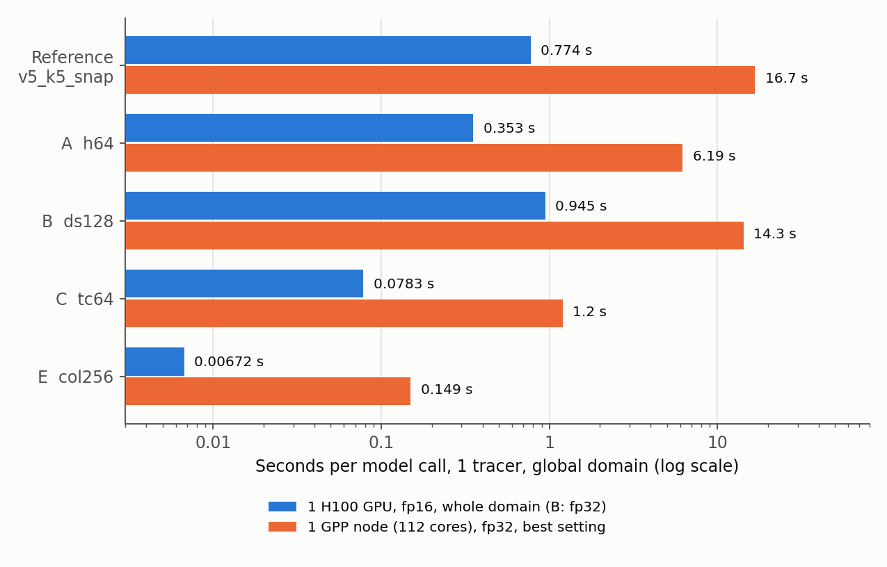
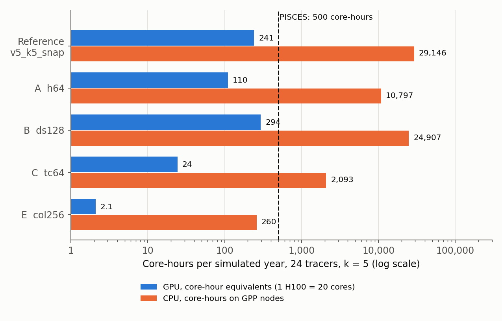

# NAUTILUS v6: inference speed of the light models on GPU and CPU

**Run time tag: 26 October 2026 11:03 – 11:40 (MareNostrum 5).** CPU benchmark job 48068013 (one full GPP node, `gp_debug`, 11:03–11:17), GPU benchmark job 48068033 (one H100, `acc_debug`, 11:04–11:40). Report written 26 October 2026.

This report covers only the **speed** of the four light models of v6 against the reference `v5_k5_snap`. Their **accuracy** comes from the four trainings (jobs 48068034–48068037), which are still in the queue; it will be the subject of the next report. Speed does not depend on the trained weights, so the benchmark used random weights.

Code in `~/NAUTILUS/ACC_NAUTILUS/ACC_FULL_COLUMN_v2` on MN5, commit `9527bf8`.

## Summary

- **Model E (whole column as channels) is the only model below the PISCES budget on the CPU.** For 24 tracers and one simulated year with k = 5 it needs about **260 core-hours**, against **500 for PISCES**. The reference needs about 29 000.
- **On one H100 GPU, E needs 6 minutes per simulated year** for 24 tracers (0.1 GPU hours, about 2 core-hour equivalents), about 250 times below the PISCES budget. C needs 1.2 GPU hours (about 24 core-hour equivalents), the reference 12 GPU hours (about 240).
- **The measured speed-up follows the compute reduction for A, C and E**, on both GPU and CPU: E is 112 times faster than the reference on the CPU and 108 times on the GPU, as predicted by its 112 times smaller compute.
- **B (depthwise-separable convolutions) gains almost nothing.** It needs 8.6 times less compute but is only 1.2 times faster on the CPU and 1.25 times on the GPU (fp32, 128-cell tiles). Its fp16 GPU runs failed.
- **Splitting the domain over 8 processes works well on the CPU.** For E, 8 processes with 14 threads each are faster than one process with all 112 threads, also when that one process gets the whole domain.
- **The GPU is 15–22 times faster than a full 112-core GPP node** for the same model.

## 1. What is implemented

### 1.1 The models

*Table 1: The reference model and the four light models of v6. Compute per call is for the global domain and 1 tracer. All models take the same inputs (6 channels × 75 levels × 4 input times) and give the change of one tracer at all 75 levels after k = 5 steps.*

| Model | Config | Architecture (`model.arch`) | Parameters | Compute per call | Reduction |
|---|---|---|---|---|---|
| Reference | `nautilus_v5_k5_snap` | `conv2dlstm`: per level, ±2-level window, ConvLSTM over the 4 input times, 128 hidden channels | 1 553 793 | 94 934 GFLOP | 1× |
| A | `nautilus_v6_k5_h64` | as the reference, 64 hidden channels | 389 825 | 23 795 GFLOP | 4.0× |
| B | `nautilus_v6_k5_ds128` | `conv2dlstm_sep`: as the reference, with depthwise-separable 3 × 3 convolutions | 183 937 | 11 076 GFLOP | 8.6× |
| C | `nautilus_v6_k5_tc64` | `timestack`: per level, ±2-level window, input times stacked as channels, 2 residual blocks of 64 channels, no recurrence | 171 505 | 2 726 GFLOP | 35× |
| E | `nautilus_v6_k5_col256` | `column`: the whole column (all levels, variables and input times) as channels of one 2-D network, 3 residual blocks of 256 channels, one output channel per level | 4 024 395 | 850 GFLOP | 112× |

- **All models share the same interface,** (batch, times, channels, levels, y, x) in and (batch, 1, levels, y, x) out. Training, evaluation, prediction, roll-out and the benchmark pick the model through `build_model` in `src/model_light.py`.
- **E has the most parameters but the least compute.** The reference runs its network once per level and input time (75 × 4 = 300 times per column); E runs once per column.

### 1.2 The benchmark

- `src/benchmark_inference.py`: one model call over the global ORCA1 domain (292 × 362 × 75), random weights, median of repeated calls after a warm-up.
- The domain in one piece, or in tiles of 128 or 64 cells with an 8-cell halo on every side (9 or 30 tiles), as a coupled run would split it.
- **GPU:** one H100 (64 GB) of an ACC node, fp32 and fp16 (autocast), 1 and 24 tracers.
- **CPU:** one full GPP node (2 × 56 cores, 256 GB), fp32, 1 tracer, in three settings:
    - 1 process with 112 threads (whole node);
    - 1 process with 56 threads (one socket), to see how the time changes with the number of cores;
    - 8 processes with 14 threads each, each with its own eighth of the 64-cell tiles, like MPI ranks. The node time is that of the slowest process.
- Each measurement is its own `srun` step, so one failure only skips that measurement.

The cost per simulated year uses k = 5 (2 336 calls per year) and 24 tracers. For the CPU, 24 tracers cost 24 times 1 tracer, as measured in v5. One H100 is counted as 20 cores (a quarter of an ACC node with 80 cores and 4 GPUs).

This report has no training, so no loss curves and no box map. The training boxes, the map of training, named and random boxes, and the loss curves will be in the report on the trainings.

## 2. Runs

*Table 2: The two benchmark jobs.*

| Job | Node | Queue | Start | Duration | State |
|---|---|---|---|---|---|
| 48068013 | 1 GPP node, 112 cores | `gp_debug` | 26 Oct 11:03 | 13 min | completed |
| 48068033 | 1 H100 of an ACC node | `acc_debug` | 26 Oct 11:04 | 36 min | completed |

- **All CPU measurements ran.** Slurm warned that the 112- and 56-thread steps asked for more CPUs per task than the job's default of 14, but the steps ran with all requested threads: the 56-thread runs are 1.4–1.8 times slower than the 112-thread runs (Table 5).
- **On the GPU, B failed after its first two settings.** The depthwise convolution of the tiled batch in fp32 stopped with a PyTorch indexing error (`canUse32BitIndexMath`), so B has no fp16 and no tiled 24-tracer GPU times, and no result file. Its two fp32 times are taken from the job log.
- **The reference does not fit on the GPU in fp32 over the whole domain** (as in v5). It runs in fp16 or with tiles.
- In the 8-process runs every process computed 4 tiles of 64 cells, 32 in total for the 30 tiles of the domain, so these times are slightly pessimistic.

## 3. Results

### 3.1 Time per call

*Table 3: Seconds per model call, 1 tracer, global domain. GPU: one H100; CPU: one full GPP node (112 cores). The speed-up is against the reference in the same setting.*

| Model | GPU fp16, whole domain | GPU fp16, 128-cell tiles | GPU fp32, whole domain | CPU, 1 × 112, whole domain | CPU, 8 × 14, 64-cell tiles | Best CPU | Speed-up, GPU fp16 | Speed-up, best CPU |
|---|---|---|---|---|---|---|---|---|
| Reference | 0.774 | 1.298 | does not fit | 16.71 | 19.22 | 16.71 | 1× | 1× |
| A | 0.353 | 0.606 | 0.536 | 6.19 | 7.43 | 6.19 | 2.2× | 2.7× |
| B | failed | failed | 0.945 | 15.51 | 14.28 | 14.28 | – | 1.2× |
| C | 0.076 | 0.130 | 0.128 | 1.20 | 1.54 | 1.20 | 10× | 14× |
| **E** | **0.0071** | **0.0098** | 0.0095 | 0.164 | **0.149** | **0.149** | **108×** | **112×** |

*Figure 1: Seconds per model call, 1 tracer, global domain (log scale). Blue: one H100 GPU in fp16 over the whole domain (B in fp32, its fp16 run failed). Orange: one full GPP node, best of the three CPU settings.*

- **A, C and E get the speed-up their compute reduction predicts.** On the CPU, A is 2.7 times faster for 4.0 times less compute, C 14 times for 35 times, E 112 times for 112 times.
- **B is the exception.** Depthwise convolutions do little arithmetic per byte of data moved, so memory traffic and not arithmetic sets the time. On the CPU, B gets 0.78 TFLOP/s, against 5.7 for the reference (Table 6).
- **E with 24 tracers runs as one batch** on the GPU (0.161 s per call for all 24, 31 GB in fp16), 0.0067 s per tracer. For the other models, 24 tracers take 24 times one tracer.
- **Tiles cost more than the whole domain:** 1.4–1.7 times on the GPU, and 1.2–2.2 times for one CPU process. With their halos, the tiles cover about 1.8 times as many cells as the domain.

### 3.2 Cost per simulated year against the PISCES budget

*Table 4: Cost of one simulated year for 24 tracers with k = 5 (2 336 calls), from the best setting of Table 3 (GPU: fp16, whole domain, 24 tracers; B: fp32). Core-hours on the CPU count all 112 cores of the GPP node. GPU core-hour equivalents count one H100 as 20 cores. PISCES needs 500 core-hours per simulated year.*

| Model | CPU core-hours per year | CPU wall time on 1 GPP node | GPU hours per year | GPU core-hour equivalents | Against PISCES (500), CPU | Against PISCES (500), GPU |
|---|---|---|---|---|---|---|
| Reference | 29 146 | 10.8 days | 12.1 | 241 | 58× more | 2.1× less |
| A | 10 797 | 4.0 days | 5.5 | 110 | 22× more | 4.5× less |
| B | 24 907 | 9.3 days | 14.7 | 294 | 50× more | 1.7× less |
| C | 2 093 | 19 h | 1.2 | 24 | 4.2× more | 21× less |
| **E** | **260** | **2.3 h** | **0.10 (6 min)** | **2.1** | **1.9× less** | **240× less** |

*Figure 2: Core-hours per simulated year, 24 tracers, k = 5 (log scale). Blue: GPU, as core-hour equivalents (one H100 = 20 cores). Orange: CPU core-hours on GPP nodes. The dashed line is the PISCES budget of 500 core-hours.*

- **On the CPU, only E is below the PISCES budget,** at about half of it. C is 4 times above; it would need k = 20, or CPU optimizations, to reach the budget.
- **On the GPU, every model is below the budget,** even the reference. C and E are one and two orders of magnitude below.
- **Core-hours stay about the same with more nodes,** as long as each node gets enough work. On the CPU the domain splits well over processes (section 3.3), so 10 GPP nodes would bring E to about 14 minutes of wall time per simulated year at the same core-hours.

### 3.3 CPU scaling within one node

*Table 5: CPU seconds per call, 1 tracer. Left: one process with 56 threads (one socket) against 112 threads (both sockets), whole domain. Right: 8 processes with 14 threads each on their own 64-cell tiles (slowest process) against one process with 112 threads on the same tiles.*

| Model | 56 threads | 112 threads | Gain from 56 to 112 | 1 × 112, 64-cell tiles | 8 × 14, 64-cell tiles | Gain from 8 processes |
|---|---|---|---|---|---|---|
| Reference | 29.77 | 16.71 | 1.78× | 24.98 | 19.22 | 1.30× |
| A | 10.61 | 6.19 | 1.72× | 10.88 | 7.43 | 1.46× |
| B | 26.13 | 15.51 | 1.69× | 20.75 | 14.28 | 1.45× |
| C | 1.85 | 1.20 | 1.54× | 2.55 | 1.54 | 1.66× |
| E | 0.224 | 0.164 | 1.37× | 0.346 | 0.149 | 2.32× |

- **Doubling the threads in one process gains 1.4–1.8 times, less for the smaller models.** E has too little work per call to keep 112 threads busy.
- **8 processes with their own tiles beat one process on the same tiles** by 1.3–2.3 times, most for E. For E, they are even faster than one process on the whole domain (0.149 against 0.164 s).
- This is how NEMO would run the model, with each MPI rank on its own subdomain. With 112 ranks per node and 1 thread each, E would probably gain further.

*Table 6: Achieved compute rate, TFLOP/s (compute per call / time per call). CPU: one GPP node, best setting. GPU: one H100, fp16, whole domain (B: fp32).*

| Model | CPU | GPU |
|---|---|---|
| Reference | 5.7 | 123 |
| A | 3.8 | 67 |
| B | 0.8 | 12 (fp32) |
| C | 2.3 | 36 |
| E | 5.7 | 119 |

- **E uses the hardware as well as the reference does,** on both CPU and GPU: its single 2-D network on 256 channels is large dense convolutions, which run efficiently everywhere.
- **The GPU is 15–22 times faster than a full GPP node** for the same model. Per core equivalent (one H100 = 20 cores against 112 cores), that is 85–120 times.

## 4. Interpretation

- **The light models deliver the speed. E reaches the PISCES budget even on the CPU,** and on the GPU it is two orders of magnitude below it. Whether these models are worth anything depends on their accuracy, which the trainings will show.
- **Compute per call is a good predictor of speed,** except for depthwise-separable convolutions (B). B is no longer a useful candidate for speed and can be dropped.
- **E is the model to watch,** because it is cheap on both CPU and GPU and uses the hardware efficiently. Its risk is accuracy: it sees all levels at once and no longer has the per-level depth window of the reference, so it may generalize differently to unseen regions and depths.
- **C is the fallback.** It keeps the per-level structure of the reference and is still 21 times below the budget on the GPU, but 4 times above it on the CPU.
- **A coupled run on the GPU is clearly feasible** for C and E, and also for the reference. On the CPU only E fits the budget.
- **These numbers are for the model alone.** A coupled run adds copying the fields between NEMO and the model, the halo exchange, and on the GPU the transfer between CPU and GPU memory. For E on the GPU the model itself is so fast (7 ms per tracer) that the transfer may become the main cost.

## 5. Suggested next steps

1. **Wait for the four trainings** (48068034–48068037) and write the report on accuracy against speed, with `v5_k5_snap` and k = 1 as references.
2. **If E is accurate enough, benchmark it as NEMO would run it:** 112 processes with 1 thread each on a GPP node, and through FTorch instead of Python.
3. **GPU FTorch pipeline** (plan saved earlier): FTorch built against a CUDA libtorch, the device as a setting in the interface, a CPU against GPU check, and a benchmark including the data transfer between CPU and GPU.
4. **Drop B** from further work.
5. **Fix the B GPU benchmark only if B is still needed** (split the batch of tiles into smaller calls to avoid the 32-bit index limit).

## 6. Files

*Table 7: Files of this report's runs on MN5, in `~/NAUTILUS/ACC_NAUTILUS/ACC_FULL_COLUMN_v2`.*

| What | Where |
|---|---|
| Configs | `config/nautilus_v6_k5_h64.yaml`, `nautilus_v6_k5_ds128.yaml`, `nautilus_v6_k5_tc64.yaml`, `nautilus_v6_k5_col256.yaml` (reference: `nautilus_v5_k5_snap.yaml`) |
| Model code | `src/model_light.py` (A, B, C, E and `build_model`) |
| Benchmark code | `src/benchmark_inference.py`, `sbatch_bench_cpu.job`, `sbatch_bench_gpu.job` |
| GPU results | `logs/bench_gpu_<model>_48068033.json`, log `server/benchgpu_48068033.out` (B only in the log) |
| CPU results | `logs/bench_cpu112_<model>_48068013.json`, `logs/bench_cpu56_<model>_48068013.json`, `logs/bench_cpu8x14_<model>_48068013_rank<r>.json`, log `server/benchcpu_48068013.out` |

Locally: this report (`.md` and `.pdf`) and its figures in `~/ClaudeX/26-Oct-2026/Reports/`.
