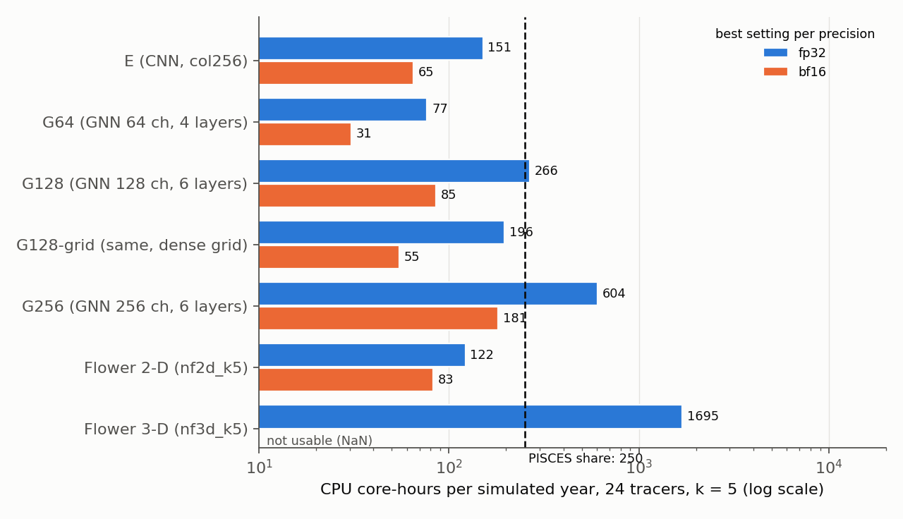
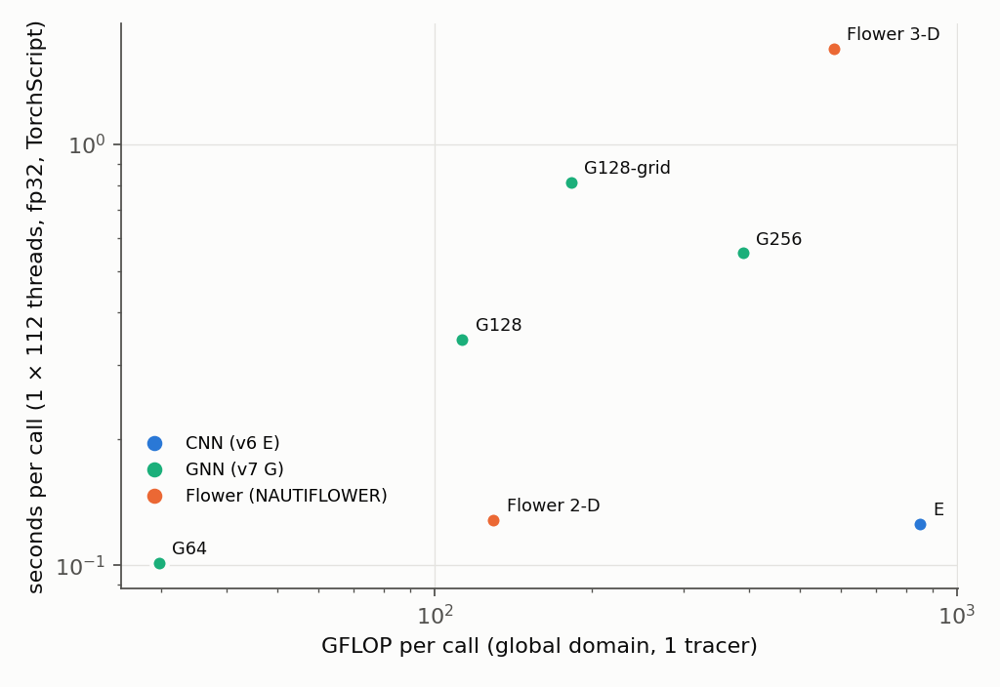

# NAUTILUS v7: a graph neural network instead of the convolutional model, CPU coupling cost against the PISCES share of 250 core-hours

**Run time tag: 28 October 2026 15:47 – 15:57 (MareNostrum 5).** CPU benchmark job 48198055 (E and the GNNs, 15:47–15:52) and job 48198089 (the two Flower models, 15:52–15:56), both on the same full GPP node (`gs03r3b69`, `gp_debug`). Report written 28 October 2026, 16:00.

This report covers the **speed on the CPU** of a graph neural network (GNN) against v6 model E and the two NAUTIFLOWER Flower models, measured the way a coupled NEMO run would call them on the CPU. Their **accuracy** is not measured yet. The GNN smoke training (job 48197955, `acc_debug`) is waiting for a GPU node, and the full trainings of E and Flower (48068037, 48140224, 48140225) are still in the queue. Section 4.2 gives what can be said about accuracy before those runs.

The budget is now **250 core-hours per simulated year**, the PISCES share, not the 500 used in the v6 report.

Code: NAUTILUS `~/NAUTILUS/ACC_NAUTILUS/ACC_FULL_COLUMN_v2` on MN5, commit `87198ec`; NAUTIFLOWER `~/NAUTILUS/NAUTIFLOWER`, branch `nautiflower`, commit `ddbe277`.

## Summary

- **A GNN is not faster than E on the CPU at a comparable size.** The GNN with 128 channels and 6 layers (G128) needs 7.5 times less compute than E (113 against 850 GFLOP per call), but in fp32 it costs **266 core-hours per simulated year against 151 for E**. Gathering the neighbours is limited by memory traffic, not arithmetic, and the land makes the work per rank uneven.
- **Only a smaller GNN is cheaper.** G64 (64 channels, 4 layers) costs 77 core-hours in fp32 and 31 in bf16. Its accuracy is unknown; it has 17 times fewer parameters than E.
- **E already fits the 250 budget on the CPU in fp32** when it runs as NEMO would run it: **151 core-hours** with 8 ranks, about 220 with 112 single-thread ranks. The 260 of the v6 report came from 64-cell tiles with an 8-cell halo, which do about twice the necessary work.
- **bf16 is the biggest CPU gain, more than any change of architecture.** The GPP cores (Sapphire Rapids, AMX) run E in bf16 at **65 core-hours**, 2.3 times faster than fp32, with outputs within 0.5 % of fp32 (random weights).
- **Flower 2-D: 122 core-hours (fp32), within budget. Flower 3-D: about 1 700 core-hours, 7 times over the budget**, and its bf16 output is NaN. Both use `grid_sample`, which has no bf16 version on the CPU.
- **Accuracy: a GNN is not expected to be more accurate by itself on this grid.** A 3 × 3 convolution on ORCA1 is already message passing over the same 8 neighbours. A GNN could gain where it adds physics a CNN lacks: face transports and cell sizes on the edges, and a flux form that conserves tracer mass. That would need a real test, not this benchmark.

## 1. What is implemented

### 1.1 The GNN (v7, G)

*Table 1: The models of this benchmark. Compute per call is for the global ORCA1 domain (292 × 362 × 75) and 1 tracer, counted by PyTorch (gathers and scatters do not count as FLOPs). All take the NAUTILUS input (6 variables × 75 levels × 4 input times) and give the change of one tracer at all 75 levels after k = 5 steps.*

| Model | Config | Architecture | Parameters | Compute per call | Reach (halo) |
|---|---|---|---|---|---|
| E (v6) | `nautilus_v6_k5_col256` | CNN: whole column as channels, 3 residual blocks of 256 channels, 3 × 3 convolutions | 4 024 395 | 850 GFLOP | 6 cells |
| G64 | `nautilus_v7_k5_gnn64` | GNN, 64 channels, 4 message-passing layers | 230 219 | 30 GFLOP | 4 cells |
| G128 | `nautilus_v7_k5_gnn128` | GNN, 128 channels, 6 layers | 873 291 | 113 GFLOP | 6 cells |
| G128-grid | `nautilus_v7_k5_gnn128grid` | G128, neighbours by shifting the dense grid | 873 291 | 182 GFLOP | 6 cells |
| G256 | `nautilus_v7_k5_gnn256` | GNN, 256 channels, 6 layers | 2 991 691 | 389 GFLOP | 6 cells |
| Flower 2-D | `nautiflower_2d_k5` | Flower U-Net over (y, x), column as channels, masked warps | 2 967 947 | 130 GFLOP | no fixed reach (halo 8) |
| Flower 3-D | `nautiflower_3d_k5` | Flower U-Net over (z, y, x), masked warps | 536 593 | 581 GFLOP | no fixed reach (halo 8) |

- **Nodes are the ocean columns, with the whole column as features, as in E.** ORCA1 has 65 544 ocean columns out of 105 704 (62 %). Land columns are not nodes, so they cost nothing.
- **Edges link the 8 horizontal neighbours** (the 3 × 3 stencil of E), east-west periodic on the global domain. No edges cross the coast.
- **Encoder, message passing, decoder** (MeshGraphNet style). Each layer computes a message from both ends of every edge plus a learned feature per direction, sums the messages at each node, and updates the node with a residual MLP and layer norm.
- **All matrix products are done per node, not per edge.** The first linear layer of the edge MLP splits into one part per end, and its second layer is applied after the sum. The network is the same, but per edge only a gather, an add and the activation remain.
- **Plain PyTorch** (`index_select`, `index_add_`), no PyTorch Geometric (not installed on MN5). TorchScript traces it, so FTorch can run it.
- **Two implementations of the same network:**
    - `gnn`: index lists over the ocean columns;
    - `gnn_grid`: shifted copies of the dense grid, with land masked. It computes the land columns too, but its memory access is contiguous.
    - The two give the same output to within 6 × 10⁻⁷.
- **The same interface as all NAUTILUS models**, (B, T, C, Z, H, W) in and (B, 1, Z, H, W) out, through `build_model`, so training, evaluation, roll-out and prediction run unchanged.
    - In a coupled run the ocean mask is fixed once per subdomain (`set_mask`).
    - In training it is taken from the input on every call and for every sample, because the 48 × 48 patches all have different coasts.
- **Tests before the runs** (CPU, small domain):
    - batched output equals sample-by-sample output;
    - a fixed mask gives the same output as an inferred one;
    - land output is 0;
    - a change in one column reaches exactly 6 cells (G128), across the east-west seam;
    - a training step with autocast works.

### 1.2 The benchmark: CPU as a coupled NEMO run

`src/benchmark_cpu_coupling.py`, jobs `sbatch_bench_cpu_coupling.job` (NAUTILUS) and `sbatch_bench_cpu_coupling_nautiflower.job` (NAUTIFLOWER).

- **Every process is one MPI rank with its own subdomain**, as NEMO would split the domain. The ranks form a py × px grid with the most square subdomains, and each rank adds a halo equal to the model's reach (Table 1). The node time of a call is that of the slowest rank.
- **The real ORCA1 land mask** (from the tracer fill values) sets the ocean columns. A land-heavy subdomain is cheap for a GNN and costs the same as any other for a CNN.
- **Three layouts on one GPP node (112 cores):**
    - 1 process with 112 threads on the whole domain;
    - 8 ranks with 14 threads each (2 × 4 subdomains of about 146 × 90);
    - 112 ranks with 1 thread each (8 × 14 subdomains of about 37 × 25; 6 of them are all land).
- **Four settings per rank:**
    - fp32 or bf16 (model and input in bfloat16, as a model exported in bf16 would run);
    - eager PyTorch or TorchScript (`torch.jit.trace` + `freeze` + `optimize_for_inference`, as FTorch runs a model).
- **Random weights, 1 tracer.** The cost per simulated year uses k = 5 (2 336 calls), 24 tracers (24 times 1 tracer on the CPU, as measured in v5) and all 112 cores of the node, as in the v6 report.

No training ran, so this report has no loss curves and no box map. The training boxes and the map of training, named and random boxes are those of the NAUTIFLOWER smoke-test report of 27 October (its Figures 1 and 2) and will be in the report on the GNN training.

## 2. Runs

*Table 2: The two benchmark jobs (earlier attempts 48197516 and 48197875 failed before any measurement: the module `netcdf4-python` is built with OpenMPI and aborts when started by `srun`, so the land mask was not written; it is now made without `srun`).*

| Job | What | Node | Queue | Start | Duration | State |
|---|---|---|---|---|---|---|
| 48198055 | E, G64, G128, G128-grid, G256 | 1 GPP node, 112 cores | `gp_debug` | 28 Oct 15:47 | 5 min | completed |
| 48198089 | Flower 2-D, Flower 3-D | same node | `gp_debug` | 28 Oct 15:52 | 4 min | completed |

- **All fp32 and all E and GNN measurements ran.**
- **The Flower models have no bf16 TorchScript times.** `grid_sample` has no bf16 version on the CPU (`grid_sampler_2d_cpu not implemented for BFloat16`). The bf16 eager runs work, because the masked warp runs in float32, but for Flower 3-D the bf16 output is NaN, so it is not usable.

## 3. Results

### 3.1 Cost per simulated year

*Table 3: CPU core-hours per simulated year, 24 tracers, k = 5, for the best layout and mode in each precision (in brackets: ranks × threads, eager or TorchScript). The ratio is to the PISCES share of 250 core-hours. Relative difference: ‖bf16 − fp32‖ / ‖fp32‖ of the output, random weights, whole domain.*

| Model | fp32, core-hours | Against 250 | bf16, core-hours | Against 250 | bf16 relative difference |
|---|---|---|---|---|---|
| **E (CNN)** | **151** (8 × 14, TorchScript) | **0.60** | **65** (112 × 1, TorchScript) | **0.26** | 0.5 % |
| G64 | 77 (8 × 14, TorchScript) | 0.31 | 31 (8 × 14, eager) | 0.12 | 0.8 % |
| G128 | 266 (8 × 14, TorchScript) | 1.06 | 85 (8 × 14, TorchScript) | 0.34 | 1.0 % |
| G128-grid | 196 (8 × 14, eager) | 0.78 | 55 (8 × 14, eager) | 0.22 | 1.0 % |
| G256 | 604 (8 × 14, TorchScript) | 2.4 | 181 (8 × 14, TorchScript) | 0.72 | 0.9 % |
| Flower 2-D | 122 (8 × 14, eager) | 0.49 | 83 (8 × 14, eager) | 0.33 | 5.0 % |
| Flower 3-D | 1 695 (8 × 14, TorchScript) | 6.8 | not usable (NaN) | – | – |

*Figure 1: CPU core-hours per simulated year, 24 tracers, k = 5 (log scale), best setting per precision on one GPP node. Blue: fp32; orange: bf16. The dashed line is the PISCES share of 250 core-hours.*

- **E, G64, G128-grid and Flower 2-D are below 250 in fp32.** G128 sits at the budget, G256 and Flower 3-D are above it.
- **In bf16 every model except Flower 3-D is at most three quarters of the budget,** and E, G64 and G128-grid are at a quarter or less.

### 3.2 Compute is not time for the GNN

*Table 4: Seconds per call, 1 tracer, slowest rank, fp32 TorchScript, and the achieved compute rate on the whole node (1 × 112 threads, whole domain).*

| Model | GFLOP per call | 1 × 112 | 8 × 14 | 112 × 1 | TFLOP/s (1 × 112) |
|---|---|---|---|---|---|
| E | 850 | 0.126 | 0.087 | 0.126 | 6.8 |
| G64 | 30 | 0.101 | 0.044 | 0.046 | 0.3 |
| G128 | 113 | 0.344 | 0.153 | 0.177 | 0.3 |
| G128-grid | 182 | 0.812 | 0.141 | 0.173 | 0.2 |
| G256 | 389 | 0.551 | 0.346 | 0.451 | 0.7 |
| Flower 2-D | 130 | 0.128 | 0.079 | 0.108 | 1.0 |
| Flower 3-D | 581 | 1.682 | 0.972 | 1.557 | 0.3 |

*Figure 2: Compute per call against seconds per call on the whole node (1 × 112 threads, fp32, TorchScript), log scales. A model on the line through E would run as efficiently as E; the GNNs and Flower 3-D are far above it.*

- **E runs at 6.8 TFLOP/s, the GNNs at 0.2–0.7.** E's large dense convolutions keep the cores busy. A GNN moves every node's features to every neighbour, 8 times per layer, and waits for memory.
- **So 7.5 times less compute (G128) ends up about 1.8 times slower** than E in fp32.
- **bf16 helps the GNN more than E** (G128-grid: 196 → 55, 3.6 times), because it halves the memory traffic as well as the arithmetic.

### 3.3 Land makes the GNN's work uneven

*Table 5: Load imbalance (slowest rank / mean rank) in fp32 TorchScript, and ocean columns per rank (G128 layout).*

| Layout | Ocean columns per rank (min / mean / max) | E | G128 | G128-grid | Flower 2-D |
|---|---|---|---|---|---|
| 8 × 14 | 5 785 / 9 903 / 14 345 | 1.03 | 1.39 | 1.08 | 1.17 |
| 112 × 1 | 0 / 1 118 / 1 862 (6 ranks all land) | 1.09 | 2.01 | 1.35 | 1.37 |

- **The GNN on index lists only works on ocean,** so a coastal rank finishes early and waits for an open-ocean rank. With 112 ranks the slowest rank takes twice the mean. A decomposition balanced by ocean columns would recover most of this; NEMO does not do this by default.
- **The CNN and the dense-grid GNN do the same work on every rank,** land or not.

### 3.4 Layout, TorchScript and E against the v6 benchmark

- **8 ranks × 14 threads is the best layout for every model.** 112 single-thread ranks lose because each 37 × 25 subdomain carries a halo of 6 cells (about twice the cells), and because of the land imbalance.
- **TorchScript (as FTorch runs the model) gains 10–25 % for E, G64 and G128 with 8 ranks,** but is not always faster: in other layouts it loses up to 9 % for G128 and 20 % for Flower 2-D, and for G128-grid on the whole domain it is 1.6 times slower.
- **E: 0.087 s per call (8 × 14, fp32 TorchScript) against 0.149 s in the v6 benchmark** (8 × 14, eager, 64-cell tiles with an 8-cell halo, 32 tiles of 80 × 80 for a 30-tile domain). The v6 layout covered about 1.8 times the domain; here each rank has one subdomain with a 6-cell halo.

## 4. Interpretation

### 4.1 Speed on the CPU

- **A GNN does not make the model cheaper on the CPU at the same size.** Its FLOP savings are real but do not become time, because message passing is memory-bound and uneven over land. Only shrinking the model (G64) makes it cheaper, and a narrower CNN would get cheaper too.
- **E fits the 250 budget on the CPU even in fp32 (151 core-hours),** if it runs on whole subdomains with TorchScript. With bf16 it uses a quarter of the budget.
- **bf16 on Sapphire Rapids is the largest single gain (2–3.6 times)** for every model except Flower. Two things to check before relying on it:
    - the accuracy with trained weights (here only random weights, 0.5 % difference for E);
    - whether FTorch passes bf16 tensors (its data types must include `torch_kBFloat16`).
- **Flower 3-D is out for CPU coupling** (7 times the budget in fp32, NaN in bf16). Flower 2-D is affordable (122 core-hours), but has no bf16 TorchScript path, and its warps reach arbitrarily far, so a halo of 8 cells only approximates the whole-domain result.
- **These numbers are for the model alone.** A coupled run adds the halo exchange (6 cells for E and G128, only 4 for G64), the copy between NEMO and the model, and NEMO's own layout of ranks, which this benchmark does not reproduce.

### 4.2 What can be said about accuracy before training

- **On ORCA1 a CNN is already a graph network on a fixed graph.** A 3 × 3 convolution sends messages along the same 8 edges as the GNN, with linear messages whose weights depend on the direction. The GNN adds:
    - nonlinear messages that depend on both ends;
    - no messages across the coast (E sees land as zeros, which already does much of this);
    - exact east-west periodicity and, if built in, the north fold.
- **The usual reason GNNs win does not apply here.** GraphCast-type and SeaCast-type models use GNNs on hierarchical meshes to reach far in few steps. With k = 5 steps (3.75 h) a tracer moves far less than one ORCA1 cell (about 100 km), so a reach of 4–6 cells is ample.
- **Published evidence does not favour either type on a regular ocean grid.**
    - SeaCast, a hierarchical GNN for the Mediterranean (Holmberg et al. 2024/2025), beats the operational physics forecast over 10 days, but it was not compared with a CNN.
    - Samudra, a global CNN (ConvNeXt U-Net) emulator of OM4 (Dheeshjith et al. 2025), runs stably for centuries.
    - No direct GNN-against-CNN comparison of tracer surrogates on ORCA was found.
- **Where a GNN could really be more accurate is physics on the edges:**
    - the face transports (`umo`, `vmo`) and cell widths (`e1`, `e2`, which shrink with latitude) as edge features, where E applies the same weights everywhere;
    - a flux form, change of column i = Σ_j F_ij with F_ij = −F_ji, which conserves tracer mass exactly and should help the roll-outs, where the 2-D models drift.

    Both need new inputs and a new output head. They are not in the G models benchmarked here.

## 5. Suggested next steps

1. **GNN smoke test (job 48197955, G128, 2 epochs)** when `acc_debug` runs it: compare with the Flower smoke tests at epoch 2.
2. **Full trainings E (48068037) and Flower (48140224/5):** add the accuracy to Table 3 and decide.
3. **bf16 for E with the trained weights:** skill against fp32, and a check that FTorch accepts bf16.
4. **If a GNN is to continue, only as a physics GNN:** edge transports and cell widths, flux-form output (conservative), G64 or G128-grid size. A plain GNN brings no CPU gain.
5. **Drop Flower 3-D for CPU coupling;** keep it only for a GPU coupling.
6. **Benchmark with NEMO's real layout of ranks** for ORCA1 and through FTorch, including the halo exchange.

## 6. Files

*Table 6: Files of this report's runs on MN5.*

| What | Where |
|---|---|
| GNN code | `src/model_gnn.py`, `src/model_light.py` (`gnn`, `gnn_grid` in `build_model`) |
| GNN configs | `config/nautilus_v7_k5_gnn64.yaml`, `gnn128`, `gnn128grid`, `gnn256`, `gnn128_smoketest` |
| Benchmark code | `src/benchmark_cpu_coupling.py`, `sbatch_bench_cpu_coupling.job` (NAUTILUS); `sbatch_bench_cpu_coupling_nautiflower.job` (NAUTIFLOWER) |
| Land mask | `logs/orca1_surface_ocean_mask.npy` (NAUTILUS) |
| Results | `logs/benchcc_<config>_<ranks>_<rank>_48198055.json` (NAUTILUS), `logs/benchcc_nautiflower_*_48198089.json` (NAUTIFLOWER); logs `server/benchcc_48198055.out`, `server/benchcc_48198089.out` |

Locally: this report (`.md` and `.pdf`) and its figures in `~/ClaudeX/28-Oct-2026/Reports/`.

References: Holmberg, Clementi, Roos, *Regional ocean forecasting with hierarchical graph neural networks*, arXiv:2410.11807 (2024), and *Accurate Mediterranean Sea forecasting via graph-based deep learning*, Scientific Reports (2025). Dheeshjith et al., *Samudra: An AI global ocean emulator for climate*, Geophysical Research Letters (2025), arXiv:2412.03795.
