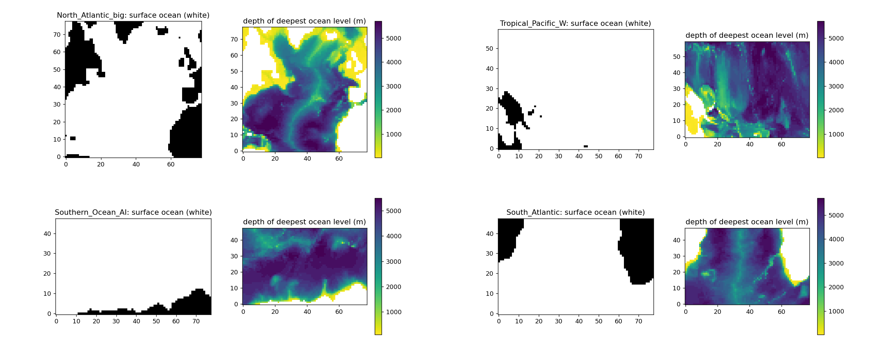
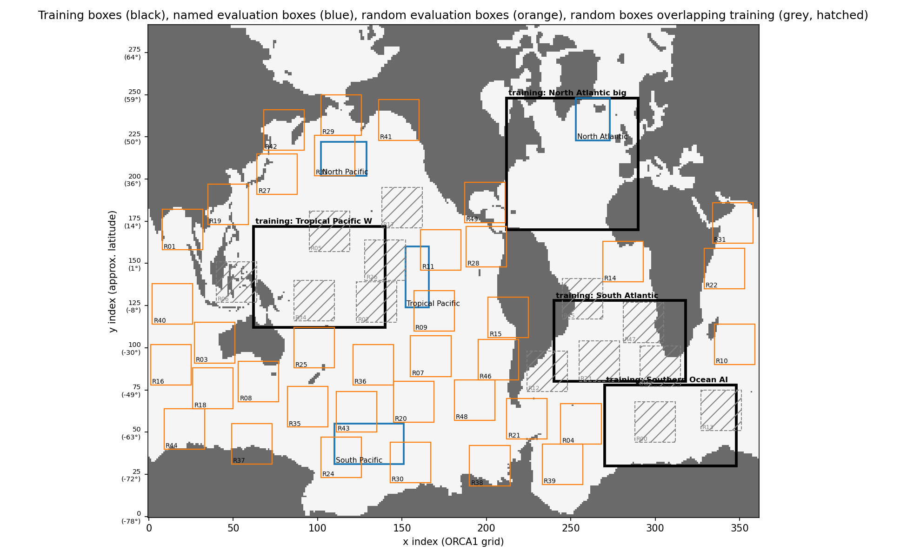
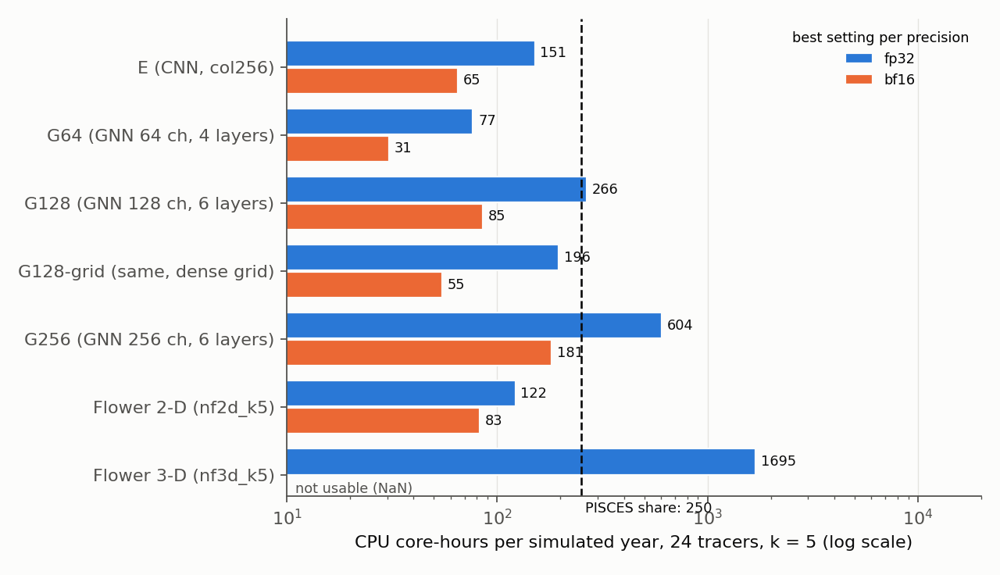
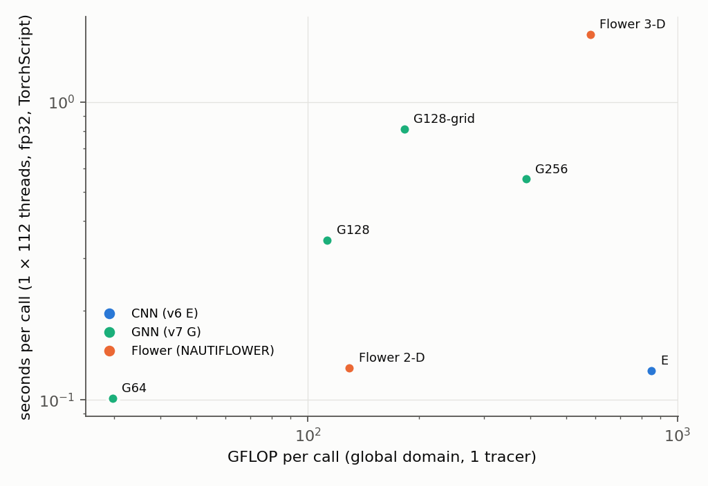
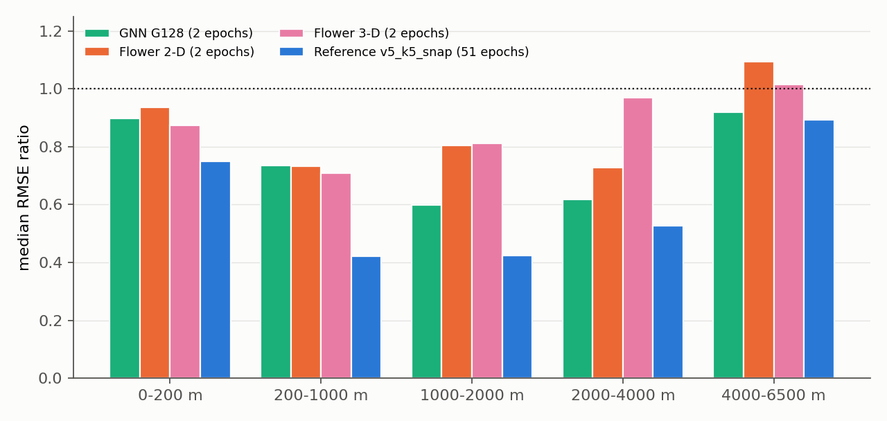
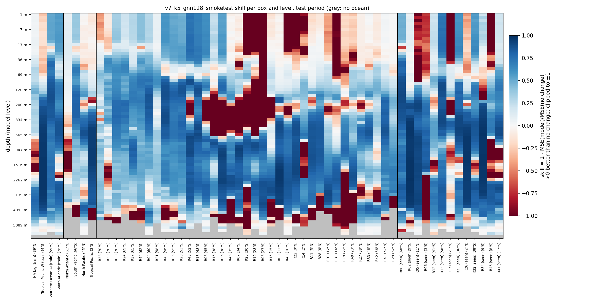

# NAUTILUS v7: a graph neural network instead of the convolutional model — CPU coupling cost against the PISCES share of 250 core-hours, and first accuracy

**Run time tag: 28 October 2026 15:47 – 16:39 (MareNostrum 5).**
- CPU benchmark jobs, both on the same full GPP node (`gs03r3b69`, `gp_debug`):
    - 48198055: E and the GNNs, 15:47–15:52;
    - 48198089: the two Flower models, 15:52–15:56.
- GNN smoke test 48197955 (one H100, `acc_debug`, 15:58–16:39).

Report written 28 October 2026, 16:40.

This report covers a graph neural network (GNN) as an alternative to v6 model E, and compares both with the two NAUTIFLOWER Flower models:
- the **speed on the CPU**, measured the way a coupled NEMO run would call the models;
- a **first accuracy**, from a 2-epoch smoke test of the GNN, set against the 2-epoch smoke tests of the masked Flower models (27 October) and the fully trained reference `v5_k5_snap`.

The full trainings of E and Flower (jobs 48068037, 48140224, 48140225) are still in the queue.

The budget is now **250 core-hours per simulated year**, the PISCES share, not the 500 used in the v6 report.

Code: NAUTILUS `~/NAUTILUS/ACC_NAUTILUS/ACC_FULL_COLUMN_v2` on MN5, commit `87198ec` (benchmark and smoke test); NAUTIFLOWER `~/NAUTILUS/NAUTIFLOWER`, branch `nautiflower`, commit `ddbe277`.

## Summary

**Speed on the CPU**
- **A GNN is not faster than E on the CPU at a comparable size.** The GNN with 128 channels and 6 layers (G128) needs 7.5 times less compute than E (113 against 850 GFLOP per call). In fp32 it still costs **266 core-hours per simulated year, against 151 for E**. Gathering the neighbours is limited by memory traffic, not arithmetic, and the land makes the work per rank uneven.
- **E already fits the 250 budget on the CPU in fp32** when it runs as NEMO would run it: **151 core-hours** with 8 ranks, about 220 with 112 single-thread ranks. The 260 of the v6 report came from 64-cell tiles with an 8-cell halo, which do about twice the necessary work.
- **bf16 is the biggest CPU gain, more than any change of architecture.** The GPP cores (Sapphire Rapids, with AMX units) run E in bf16 at **65 core-hours**, 2.3 times faster than fp32, with outputs within 0.5 % of fp32 (random weights). G128 in bf16: 85; its dense-grid version: 55.
- **Flower 2-D: 122 core-hours (fp32), within the budget.** Flower 3-D: about 1 700, 7 times over it, and its bf16 output is NaN.

**Accuracy after 2 epochs (smoke tests)**
- **The GNN is ahead of both Flower models in unseen regions:**
    - it beats "no change" in **33 of 37 unseen random boxes** (Flower 2-D: 26, Flower 3-D: 28);
    - median RMSE ratio **0.826**, against 0.906 and 0.869.
- **The GNN's 3-day roll-out stays below "no change" in the unseen boxes** (0.933 at 67.5 h). Flower 3-D reaches 0.957; Flower 2-D drifts above "no change" after about 15 h.
- **The GNN is clearly best at depth (1000–4000 m) and close to Flower at the surface.** In the training boxes all three are close.
- **All three are still far from the fully trained reference** (0.612 in the unseen boxes, 0.755 in the roll-out). Two epochs say which model learns faster and generalizes earlier, not how good it will be.
- **One GNN training pass takes 1.5 minutes per epoch,** against 6–7 minutes per epoch for Flower.

**Overall:** a GNN is not a way to make the model cheaper on the CPU. It is, however, a competitive architecture for accuracy, so a full training is worth considering.

## 1. What is implemented

### 1.1 The GNN (v7, G)

*Table 1: The models of this report. Compute per call is for the global ORCA1 domain (292 × 362 × 75) and 1 tracer, counted by PyTorch (gathers and scatters do not count as FLOPs). All take the NAUTILUS input (6 variables × 75 levels × 4 input times) and give the change of one tracer at all 75 levels after k = 5 steps.*

| Model | Config | Architecture | Parameters | Compute per call | Reach (halo) |
|---|---|---|---|---|---|
| E (v6) | `nautilus_v6_k5_col256` | CNN: whole column as channels, 3 residual blocks of 256 channels, 3 × 3 convolutions | 4 024 395 | 850 GFLOP | 6 cells |
| G64 | `nautilus_v7_k5_gnn64` | GNN, 64 channels, 4 message-passing layers | 230 219 | 30 GFLOP | 4 cells |
| **G128** | `nautilus_v7_k5_gnn128` | GNN, 128 channels, 6 layers (smoke test) | 873 291 | 113 GFLOP | 6 cells |
| G128-grid | `nautilus_v7_k5_gnn128grid` | G128, neighbours by shifting the dense grid | 873 291 | 182 GFLOP | 6 cells |
| G256 | `nautilus_v7_k5_gnn256` | GNN, 256 channels, 6 layers | 2 991 691 | 389 GFLOP | 6 cells |
| Flower 2-D | `nautiflower_2d_k5` | Flower U-Net over (y, x), column as channels, masked warps | 2 967 947 | 130 GFLOP | no fixed reach (halo 8) |
| Flower 3-D | `nautiflower_3d_k5` | Flower U-Net over (z, y, x), masked warps | 536 593 | 581 GFLOP | no fixed reach (halo 8) |

- **Nodes are the ocean columns, with the whole column as features, as in E.** ORCA1 has 65 544 ocean columns out of 105 704 (62 %). Land columns are not nodes, so they cost nothing.
- **Edges link the 8 horizontal neighbours** (the 3 × 3 stencil of E), east-west periodic on the global domain. No edges cross the coast.
- **Encoder, message passing, decoder** (MeshGraphNet style). Each layer computes a message from both ends of every edge plus a learned feature per direction, sums the messages at each node, and updates the node with a residual MLP and layer norm.
- **All matrix products are done per node, not per edge.** The first linear layer of the edge MLP splits into one part per end, and its second layer is applied after the sum. The network is the same, but per edge only a gather, an add and the activation remain.
- **Plain PyTorch** (`index_select`, `index_add_`), no PyTorch Geometric (not installed on MN5). TorchScript traces it, so FTorch can run it.
- **Two implementations of the same network:**
    - `gnn`: index lists over the ocean columns;
    - `gnn_grid`: shifted copies of the dense grid, with land masked. It computes the land columns too, but its memory access is contiguous.
    - The two give the same output to within 6 × 10⁻⁷.
- **The same interface as all NAUTILUS models**, (B, T, C, Z, H, W) in and (B, 1, Z, H, W) out, through `build_model`, so training, evaluation, roll-out and prediction run unchanged.
    - In a coupled run the ocean mask is fixed once per subdomain (`set_mask`).
    - In training it is taken from the input on every call and for every sample, because the 48 × 48 patches all have different coasts. The samples of a batch form one graph with no edges between them.
- **Tests before the runs** (CPU, small domain):
    - batched output equals sample-by-sample output;
    - a fixed mask gives the same output as an inferred one;
    - land output is 0;
    - a change in one column reaches exactly 6 cells (G128), across the east-west seam;
    - a training step with autocast works.

### 1.2 The CPU benchmark: as a coupled NEMO run

`src/benchmark_cpu_coupling.py`, jobs `sbatch_bench_cpu_coupling.job` (NAUTILUS) and `sbatch_bench_cpu_coupling_nautiflower.job` (NAUTIFLOWER).

- **Every process is one MPI rank with its own subdomain**, as NEMO would split the domain. The ranks form a py × px grid with the most square subdomains, and each rank adds a halo equal to the model's reach (Table 1). The node time of a call is that of the slowest rank.
- **The real ORCA1 land mask** (from the tracer fill values) sets the ocean columns. A land-heavy subdomain is cheap for a GNN and costs the same as any other for a CNN.
- **Three layouts on one GPP node (112 cores):**
    - 1 process with 112 threads on the whole domain;
    - 8 ranks with 14 threads each (2 × 4 subdomains of about 146 × 90);
    - 112 ranks with 1 thread each (8 × 14 subdomains of about 37 × 25; 6 of them are all land).
- **Four settings per rank:**
    - fp32 or bf16 (model and input in bfloat16, as a model exported in bf16 would run);
    - eager PyTorch or TorchScript (`torch.jit.trace` + `freeze` + `optimize_for_inference`, as FTorch runs a model).
- **Random weights, 1 tracer.** The cost per simulated year uses k = 5 (2 336 calls), 24 tracers (24 times 1 tracer on the CPU, as measured in v5) and all 112 cores of the node, as in the v6 report.

### 1.3 The GNN smoke test

*Table 2: Settings of the GNN smoke test. They are those of v6 model E and of the Flower smoke tests; only the model block and the names differ.*

| | |
|---|---|
| Config | `config/nautilus_v7_k5_gnn128_smoketest.yaml` (model G128) |
| Training regions | North Atlantic (big), Tropical Pacific W, Southern Ocean (Atlantic–Indian sector), South Atlantic. One model, pooled normalization |
| Inputs and target | Tracer, u, v, w, diffusivity, distance to the MLD; 75 levels; 4 input snapshots 5 steps apart. Target: the change 5 steps (3.75 h) after the last input, scaled per level |
| Ocean mask | Only in the data: land and cells below the sea floor are 0 in inputs and target; the loss counts ocean cells only. The GNN takes its graph from the non-zero columns |
| Training | 2 epochs, random 48 × 48 patches, batch 4, Adam, learning rate 1e-4, fp16 with `GradScaler` |
| Evaluation | Test period (last 15 % of the year). The same 50 random boxes as v2–v6: 37 unseen, 13 overlapping a training box ("seen"). 4 named boxes. Roll-out of 19 calls (95 steps, 71 h) from 13 starts |
| Comparison | Smoke tests of the masked Flower models, 27 October (`flower2d` job 48136647, `flower3d` job 48137783, same settings); fully trained reference `v5_k5_snap` (61 epochs, best epoch 51) |

*Figure 1: 3-D ocean masks of the four training boxes (North Atlantic and Tropical Pacific W on top, Southern Ocean and South Atlantic below). In each pair, left: surface ocean (white) and land (black); right: depth of the deepest ocean level, deeper water darker.*

*Figure 2: Training boxes (black), named evaluation boxes (blue), unseen random boxes (orange) and random boxes overlapping a training box (grey, hatched) on the ORCA1 grid.*

## 2. Runs

*Table 3: The runs of this report. Earlier attempts of the CPU benchmark (48197516, 48197875) stopped before any measurement. The module `netcdf4-python` is built with OpenMPI and aborts when started by `srun`, so the land mask was not written; it is now made without `srun`.*

| Job | What | Node | Queue | Start | Duration | State |
|---|---|---|---|---|---|---|
| 48198055 | CPU benchmark: E, G64, G128, G128-grid, G256 | 1 GPP node, 112 cores | `gp_debug` | 28 Oct 15:47 | 5 min | completed |
| 48198089 | CPU benchmark: Flower 2-D, Flower 3-D | same node | `gp_debug` | 28 Oct 15:52 | 4 min | completed |
| 48197955 | GNN smoke test: training, global evaluation, roll-out, prediction | 1 H100 | `acc_debug` | 28 Oct 15:58 | 41 min | completed |

- **All fp32 and all E and GNN CPU measurements ran.**
- **The Flower models have no bf16 TorchScript times.** `grid_sample` has no bf16 version on the CPU (`grid_sampler_2d_cpu not implemented for BFloat16`). The bf16 eager runs work, because the masked warp runs in float32, but for Flower 3-D the bf16 output is NaN, so it is not usable.
- **The GNN smoke test ran through all four steps without errors.**
    - Each epoch's training pass took 1 min 33 s (1 776 batches, about 19 per second), against about 6–7 min per epoch for Flower.
    - AMP skipped 1 step in epoch 2.
    - Gradient norm before clipping: mean 3.1–3.3, maximum 36.

*Table 4: Losses of the GNN smoke test per epoch. Training: train mode on random patches; fixed patches: the same 16 patches per box in evaluation mode; validation: mean over the four training boxes, whole boxes. Units: scaled 5-step change. Validation skill: 1 − MSE/MSE(no change). For comparison, the masked Flower smoke tests reached a validation skill of +0.652 (2-D) and +0.656 (3-D) at epoch 2.*

| Epoch | Training | Fixed patches | Validation | Validation skill | Steps skipped by AMP |
|---|---|---|---|---|---|
| 1 | 0.589 | 0.475 | 0.587 | +0.567 | 0 |
| 2 | 0.402 | 0.377 | 0.489 | +0.630 | 1 |

- **The validation skill per box at epoch 2:**
    - Tropical Pacific W +0.90;
    - South Atlantic +0.63;
    - Southern Ocean +0.56;
    - North Atlantic (big) +0.23.
- **On the training boxes the GNN is slightly behind Flower** (validation skill +0.630 against +0.65). In the unseen boxes it is ahead (section 3.5).

## 3. Results

### 3.1 CPU cost per simulated year

*Table 5: CPU core-hours per simulated year, 24 tracers, k = 5, for the best layout and mode in each precision (in brackets: ranks × threads, eager or TorchScript). The ratio is to the PISCES share of 250 core-hours. Relative difference: ‖bf16 − fp32‖ / ‖fp32‖ of the output, random weights, whole domain.*

| Model | fp32, core-hours | Against 250 | bf16, core-hours | Against 250 | bf16 relative difference |
|---|---|---|---|---|---|
| **E (CNN)** | **151** (8 × 14, TorchScript) | **0.60** | **65** (112 × 1, TorchScript) | **0.26** | 0.5 % |
| G64 | 77 (8 × 14, TorchScript) | 0.31 | 31 (8 × 14, eager) | 0.12 | 0.8 % |
| G128 | 266 (8 × 14, TorchScript) | 1.06 | 85 (8 × 14, TorchScript) | 0.34 | 1.0 % |
| G128-grid | 196 (8 × 14, eager) | 0.78 | 55 (8 × 14, eager) | 0.22 | 0.9 % |
| G256 | 604 (8 × 14, TorchScript) | 2.4 | 181 (8 × 14, TorchScript) | 0.72 | 0.9 % |
| Flower 2-D | 122 (8 × 14, eager) | 0.49 | 83 (8 × 14, eager) | 0.33 | 5.0 % |
| Flower 3-D | 1 695 (8 × 14, TorchScript) | 6.8 | not usable (NaN) | – | – |

*Figure 3: CPU core-hours per simulated year, 24 tracers, k = 5 (log scale), best setting per precision on one GPP node. Blue: fp32; orange: bf16. The dashed line is the PISCES share of 250 core-hours.*

- **E, G64, G128-grid and Flower 2-D are below 250 in fp32.** G128 sits at the budget; G256 and Flower 3-D are above it.
- **In bf16 every model except Flower 3-D is at most three quarters of the budget.** E, G64 and G128-grid are at a quarter or less.

### 3.2 Compute is not time for the GNN

*Table 6: Seconds per call, 1 tracer, slowest rank, fp32 TorchScript, and the compute rate achieved on the whole node (1 × 112 threads, whole domain).*

| Model | GFLOP per call | 1 × 112 | 8 × 14 | 112 × 1 | TFLOP/s (1 × 112) |
|---|---|---|---|---|---|
| E | 850 | 0.126 | 0.087 | 0.126 | 6.8 |
| G64 | 30 | 0.101 | 0.044 | 0.046 | 0.3 |
| G128 | 113 | 0.344 | 0.153 | 0.177 | 0.3 |
| G128-grid | 182 | 0.812 | 0.141 | 0.173 | 0.2 |
| G256 | 389 | 0.551 | 0.346 | 0.451 | 0.7 |
| Flower 2-D | 130 | 0.128 | 0.079 | 0.108 | 1.0 |
| Flower 3-D | 581 | 1.682 | 0.972 | 1.557 | 0.3 |

*Figure 4: Compute per call against seconds per call on the whole node (1 × 112 threads, fp32, TorchScript), log scales. Models that use the hardware as well as E would lie to its left at proportionally lower time; the GNNs and Flower 3-D lie far above that.*

- **E runs at 6.8 TFLOP/s, the GNNs at 0.2–0.7.** E's large dense convolutions keep the cores busy. A GNN moves every node's features to every neighbour, 8 times per layer, and waits for memory.
- **So 7.5 times less compute (G128) ends up about 1.8 times slower** than E in fp32.
- **bf16 helps the GNN more than E** (G128-grid: 196 → 55 core-hours, 3.6 times), because it halves the memory traffic as well as the arithmetic.

### 3.3 Land makes the GNN's work uneven

*Table 7: Load imbalance (slowest rank / mean rank) in fp32 TorchScript, and ocean columns per rank (G128 layout).*

| Layout | Ocean columns per rank (min / mean / max) | E | G128 | G128-grid | Flower 2-D |
|---|---|---|---|---|---|
| 8 × 14 | 5 785 / 9 903 / 14 345 | 1.03 | 1.39 | 1.08 | 1.17 |
| 112 × 1 | 0 / 1 118 / 1 862 (6 ranks all land) | 1.09 | 2.01 | 1.35 | 1.37 |

- **The GNN on index lists only works on ocean,** so a coastal rank finishes early and waits for an open-ocean rank. With 112 ranks the slowest rank takes twice the mean. A decomposition balanced by ocean columns would recover most of this; NEMO does not do this by default.
- **The CNN and the dense-grid GNN do the same work on every rank,** land or not.

### 3.4 Layout, TorchScript and E against the v6 benchmark

- **8 ranks × 14 threads is the best layout for every model.** 112 single-thread ranks lose for two reasons: each 37 × 25 subdomain carries a halo of 6 cells (about twice the cells), and the land makes the work uneven.
- **TorchScript (as FTorch runs the model) gains 10–25 % for E, G64 and G128 with 8 ranks,** but it is not always faster. In other layouts it loses up to 9 % for G128 and 20 % for Flower 2-D, and for G128-grid on the whole domain it is 1.6 times slower.
- **E: 0.087 s per call (8 × 14, fp32 TorchScript), against 0.149 s in the v6 benchmark.** The v6 run used 8 × 14 eager with 64-cell tiles and an 8-cell halo: 32 tiles of 80 × 80 for a 30-tile domain, about 1.8 times the domain. Here each rank has one subdomain with a 6-cell halo.

### 3.5 Accuracy after 2 epochs

*Table 8: Accuracy at the models' lead time (5 steps), test period. Columns per model: median RMSE ratio model / "no change" (in brackets, the same in physical units), number of boxes better than "no change", and median SSIM of the change field. GNN and Flower: smoke tests, 2 epochs; reference `v5_k5_snap`: 61 epochs. Flower: the masked smoke tests of 27 October.*

| Boxes | GNN G128 | better | SSIM | Flower 2-D | better | SSIM | Flower 3-D | better | SSIM | Reference | better | SSIM |
|---|---|---|---|---|---|---|---|---|---|---|---|---|
| 37 unseen random | **0.826 (0.762)** | **33** | **0.37** | 0.906 (0.854) | 26 | 0.30 | 0.869 (0.829) | 28 | 0.36 | 0.612 (0.566) | 37 | 0.50 |
| 13 seen random | **0.651 (0.577)** | 12 | **0.49** | 0.753 (0.681) | 10 | 0.45 | 0.736 (0.634) | 12 | 0.43 | 0.553 (0.446) | 13 | 0.60 |
| 4 named | 0.785 (0.735) | 4 | 0.37 | 0.780 (0.722) | 3 | 0.36 | **0.719 (0.663)** | 4 | **0.41** | 0.604 (0.553) | 4 | 0.48 |
| 4 training | 0.678 (0.614) | 4 | 0.59 | **0.667 (0.619)** | 4 | 0.58 | 0.703 (0.602) | 4 | **0.62** | 0.540 (0.456) | 4 | 0.72 |

*Table 9: Median RMSE ratio (normalized) per depth band, 37 unseen random boxes; in brackets the boxes better than "no change".*

| Depth band | GNN G128 | Flower 2-D | Flower 3-D | Reference |
|---|---|---|---|---|
| 0–200 m | 0.897 (30) | 0.936 (23) | **0.874 (33)** | 0.749 (35) |
| 200–1000 m | 0.735 (30) | 0.732 (27) | **0.708 (30)** | 0.421 (37) |
| 1000–2000 m | **0.598 (34)** | 0.804 (33) | 0.811 (22) | 0.423 (35) |
| 2000–4000 m | **0.617 (33)** | 0.727 (33) | 0.969 (19) | 0.527 (37) |
| 4000–6500 m | **0.908 (21)** | 1.048 (17) | 1.003 (18) | 0.889 (24) |

*Figure 5: Median RMSE ratio model / "no change" per depth band, 37 unseen random boxes, test period. Below 1 is better than "no change" (dotted line). GNN and Flower after 2 epochs, reference after 61.*

*Table 10: RMSE ratio model / "no change" (normalized) per training and named box.*

| Box | Kind | GNN G128 | Flower 2-D | Flower 3-D | Reference |
|---|---|---|---|---|---|
| North Atlantic (big) | training | 0.907 | 0.963 | 0.898 | 0.837 |
| Tropical Pacific W | training | 0.373 | 0.375 | 0.302 | 0.256 |
| Southern Ocean AI | training | 0.698 | 0.676 | 0.682 | 0.556 |
| South Atlantic | training | 0.659 | 0.659 | 0.724 | 0.523 |
| North Atlantic | named | 0.960 | 1.012 | 0.977 | 0.963 |
| South Pacific | named | 0.774 | 0.782 | 0.750 | 0.712 |
| North Pacific | named | 0.796 | 0.779 | 0.688 | 0.497 |
| Tropical Pacific | named | 0.588 | 0.568 | 0.465 | 0.424 |

*Figure 6: GNN G128 after 2 epochs: skill 1 − MSE(model)/MSE(no change) per box and model level, test period. Blue is better than "no change", red worse, grey no ocean. Columns from left: training boxes, named boxes, unseen random boxes, seen random boxes.*

*Table 11: Auto-regressive roll-out (the model is fed its own predictions; forcing from NEMO): median RMSE ratio model / "no change" (normalized) at 30 steps (22.5 h) and 90 steps (67.5 h).*

| Boxes | Depth | GNN G128 30 / 90 | Flower 2-D 30 / 90 | Flower 3-D 30 / 90 | Reference 30 / 90 |
|---|---|---|---|---|---|
| 37 unseen random | all | **0.865 / 0.933** | 1.028 / 1.140 | 0.918 / 0.957 | 0.688 / 0.755 |
| 37 unseen random | 0–200 m | 0.931 / 0.994 | 1.031 / 1.127 | **0.885 / 0.928** | 0.781 / 0.872 |
| 37 unseen random | 200–2000 m | **0.792 / 0.872** | 0.947 / 1.127 | 0.907 / 1.065 | 0.565 / 0.656 |
| 37 unseen random | below 2000 m | **0.654 / 0.705** | 0.724 / 0.809 | 0.941 / 1.027 | 0.566 / 0.646 |
| 4 training | all | 0.758 / 0.799 | **0.723 / 0.765** | 0.778 / 0.829 | 0.606 / 0.635 |

*Figure 7: Roll-out over the test period: median RMSE ratio model / "no change" against lead time, all levels. Left: 37 unseen random boxes; right: 4 training boxes. Above the dotted line the model is worse than "no change".*

- **In unseen regions the GNN is the best of the three after 2 epochs,** at 5 steps and over 3 days.
- **Its lead comes from depth.**
    - Between 1000 and 4000 m the GNN's ratio is 0.60–0.62, against 0.73–0.97 for Flower. Below 2000 m its roll-out is close to the reference (0.705 against 0.646 at 67.5 h).
    - In the upper 1000 m Flower 3-D is slightly better.
- **In the training boxes all three are close,** and Flower 2-D's roll-out is the best of the three there. As in the Flower smoke tests, the training boxes do not show the differences that the unseen boxes do.
- **The GNN's roll-out drifts slowly** (from 0.81 at 3.75 h to 0.93 at 71 h) and stays below "no change" throughout. In the upper 200 m it only just does (0.998 at 71 h), so that is where it would fail first over longer roll-outs.

## 4. Interpretation

### 4.1 Speed on the CPU

- **A GNN does not make the model cheaper on the CPU at the same size.** Its FLOP savings are real but do not turn into time, because message passing is memory-bound and uneven over land. Only shrinking the model (G64) makes it cheaper, and a narrower CNN would get cheaper too.
- **E fits the 250 budget on the CPU even in fp32 (151 core-hours),** if it runs on whole subdomains with TorchScript. With bf16 it uses a quarter of the budget.
- **bf16 on Sapphire Rapids is the largest single gain (2–3.6 times)** for every model except Flower. Two things to check before relying on it:
    - the accuracy with trained weights (here only random weights, 0.5 % difference for E);
    - whether FTorch passes bf16 tensors (its data types must include `torch_kBFloat16`).
- **Flower 3-D is out for CPU coupling** (7 times the budget in fp32, NaN in bf16).
- **Flower 2-D is affordable (122 core-hours), with two limits:**
    - it has no bf16 TorchScript path;
    - its warps reach arbitrarily far, so a halo of 8 cells only approximates the whole-domain result.
- **These numbers are for the model alone.** A coupled run adds three costs the benchmark leaves out:
    - the halo exchange (6 cells for E and G128, only 4 for G64);
    - the copy between NEMO and the model;
    - NEMO's own layout of ranks, which this benchmark does not reproduce.

### 4.2 Accuracy

- **On ORCA1 a CNN is already a graph network on a fixed graph.** A 3 × 3 convolution sends messages along the same 8 edges as the GNN, with linear messages whose weights depend on the direction. The GNN adds:
    - nonlinear messages that depend on both ends;
    - no messages across the coast (E sees land as zeros, which already does much of this);
    - exact east-west periodicity.
- **The usual reason GNNs win does not apply here.** GraphCast-type and SeaCast-type models use GNNs on hierarchical meshes to reach far in few steps. With k = 5 steps (3.75 h) a tracer moves far less than one ORCA1 cell (about 100 km), so a reach of 4–6 cells is ample.
- **Even so, after 2 epochs the GNN generalizes better than both Flower models,** mostly below 1000 m. A plausible reason is that it sees the whole column of each neighbour separately. Interior water masses vary smoothly in the horizontal and are dominated by the column's own history, and the GNN's per-column messages fit that well, while a 2-D convolution over 1800 channels has to learn the same structure through many more weights.
- **The smoke tests do not show how the GNN compares with E,** because the E training has not run. E and the GNN differ in the same ways as E and Flower 2-D (all three take the column as channels), so the E training is the comparison that matters.
- **Published evidence does not favour either type on a regular ocean grid.**
    - SeaCast, a hierarchical GNN for the Mediterranean (Holmberg et al. 2024/2025), beats the operational physics forecast over 10 days, but it was not compared with a CNN.
    - Samudra, a global CNN (ConvNeXt U-Net) emulator of OM4 (Dheeshjith et al. 2025), runs stably for centuries.
    - No direct GNN-against-CNN comparison of tracer surrogates on ORCA was found.
- **Physics on the edges could make the GNN better still:**
    - the face transports (`umo`, `vmo`) and cell widths (`e1`, `e2`, which shrink with latitude) as edge features, where a CNN applies the same weights everywhere;
    - a flux form, change of column i = Σ_j F_ij with F_ij = −F_ji, which conserves tracer mass exactly and should help the roll-outs further.

## 5. Suggested next steps

1. **Full training of the GNN G128** (`config/nautilus_v7_k5_gnn128.yaml`, same stopping rule as v6), to compare with E (48068037), Flower (48140224/5) and the reference once all have run.
2. **Full trainings of E and Flower** (queued; v6 estimated to start on 31 October): add their accuracy to Tables 5 and 8 and choose the model.
3. **bf16 with the trained weights** for the chosen model: skill against fp32, and a check that FTorch accepts bf16. For a GNN in bf16, use the dense-grid version (55 core-hours).
4. **If the GNN stays ahead: a physics GNN.** Add the face transports and cell widths as edge features and a flux-form, mass-conserving output.
5. **Drop Flower 3-D for CPU coupling;** keep it only for a GPU coupling.
6. **Benchmark with NEMO's real layout of ranks** for ORCA1 and through FTorch, including the halo exchange.

## 6. Files

*Table 12: Files of this report's runs on MN5.*

| What | Where |
|---|---|
| GNN code | `src/model_gnn.py`, `src/model_light.py` (`gnn`, `gnn_grid` in `build_model`) |
| GNN configs | `config/nautilus_v7_k5_gnn64.yaml`, `gnn128`, `gnn128grid`, `gnn256`, `gnn128_smoketest` |
| Benchmark code | `src/benchmark_cpu_coupling.py`, `sbatch_bench_cpu_coupling.job` (NAUTILUS); `sbatch_bench_cpu_coupling_nautiflower.job` (NAUTIFLOWER) |
| Land mask | `logs/orca1_surface_ocean_mask.npy` (NAUTILUS) |
| Benchmark results | `logs/benchcc_<config>_<ranks>_<rank>_48198055.json` (NAUTILUS), `logs/benchcc_nautiflower_*_48198089.json` (NAUTIFLOWER); logs `server/benchcc_48198055.out`, `server/benchcc_48198089.out` |
| GNN smoke test | logs `logs/{train,eval,rollout,predict}_v2_48197955.log`; evaluation `eval_global_v7_k5_gnn128_smoketest/` (metrics, maps, heat maps, `rollout/`); copy on scratch `/gpfs/scratch/bsc32/bsc032196/nautilus/ACC_FULL_COLUMN_v2/v7_k5_gnn128_smoketest/output_2026_10_28_155916_48197955/` |
| Flower smoke tests (masked) | `~/NAUTILUS/NAUTIFLOWER/eval_global_nf{2d,3d}_k5_smoketest/` |
| Reference | `eval_global_v5_k5_snap/` (NAUTILUS) |

Locally: this report (`.md` and `.pdf`) and its figures in `~/ClaudeX/28-Oct-2026/Reports/`; it replaces the speed-only version `NAUTILUS_v7_gnn_cpu_report_2026-10-28_1600`. The comparison scripts are in `~/ClaudeX/work_v7/`.

References: Holmberg, Clementi, Roos, *Regional ocean forecasting with hierarchical graph neural networks*, arXiv:2410.11807 (2024), and *Accurate Mediterranean Sea forecasting via graph-based deep learning*, Scientific Reports (2025). Dheeshjith et al., *Samudra: An AI global ocean emulator for climate*, Geophysical Research Letters (2025), arXiv:2412.03795.
