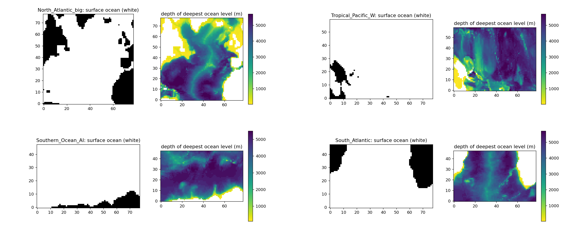
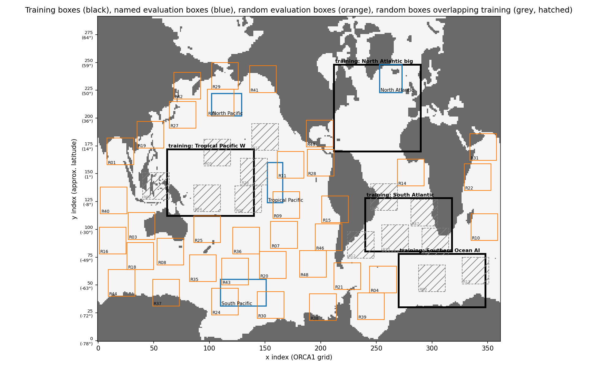
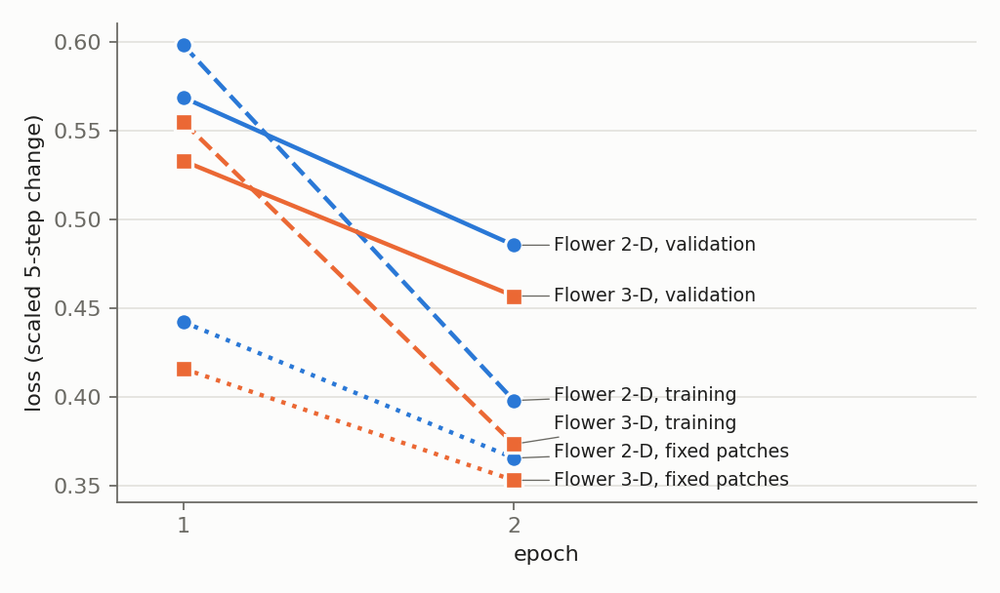
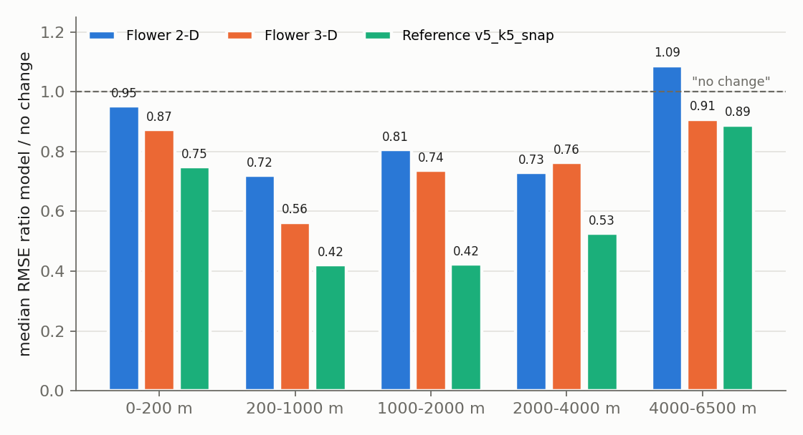
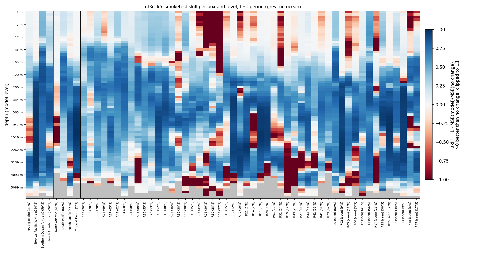
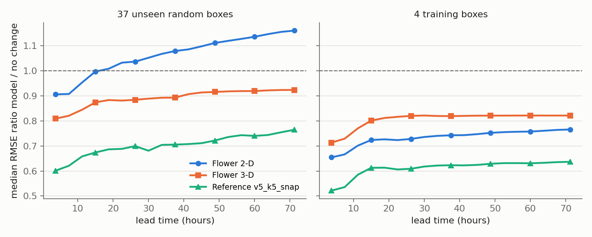

# NAUTIFLOWER: first smoke tests of the Flower models on the NAUTILUS problem

**Run time tag: 27 October 2026 09:08 – 10:29 (MareNostrum 5, `acc_debug`, one H100 each).** Job 48124056 (`flower2d`, 09:08–09:47) and job 48125652 (`flower3d`, 09:48–10:29), run one after the other. Report written 27 October 2026, 11:10.

Code in `~/NAUTILUS/NAUTIFLOWER` on MN5, branch `nautiflower`, commit `0c03d22`.

**These two runs used the Flower models without the ocean mask in the warps.** The masked version (commit `fd1f3a9`) was added after these runs. Its two smoke tests were running or queued when this report was written (masked 2-D: job 48128683, started 11:02). The full trainings will follow once both pass.

**A smoke test trains for only 2 epochs.** It checks that training, global evaluation, roll-out and prediction all work with a new model. Its accuracy numbers show whether the model learns, not how good it will be. The reference model in the tables (`v5_k5_snap`) trained for 61 epochs (best epoch 51) and serves only for orientation.

## Summary

- **The whole NAUTILUS pipeline works with both Flower models.** Training, the global evaluation (4 training, 4 named and 50 random boxes), the 3-day roll-out and the prediction dashboards all ran to the end without errors.
- **Both models learn.** The validation loss fell from 0.569 to 0.486 (2-D) and from 0.533 to 0.457 (3-D) between epoch 1 and 2. The 3-D model had 1 step per epoch skipped by AMP (fp16 overflow); the 2-D model none.
- **After 2 epochs the 3-D model is clearly ahead of the 2-D model, with a fifth of the parameters (0.54 M against 2.97 M).**
    - It beats "no change" in **all 37 unseen random boxes** (2-D: 27). Median RMSE ratio 0.82, against 0.90 for 2-D.
    - It is better in every depth band except 2000–4000 m. The largest difference is at 200–1000 m (0.56 against 0.72) and below 4000 m (0.91 against 1.09).
    - **Its roll-out stays below "no change" for 3 days** in the unseen boxes (0.92 at 67.5 h). The 2-D model rises above "no change" after about 15 h and reaches 1.16.
- **Both are still well behind the fully trained reference** (median 0.61 in the unseen boxes, 0.75 in the 3-day roll-out). With 2 epochs against 51, this is expected and says nothing about the final accuracy.
- **One epoch took about 6–7 min**, against about 8.2 min for the reference.

## 1. What is implemented

### 1.1 NAUTIFLOWER

- **A separate directory.** `~/NAUTILUS/NAUTIFLOWER` is a git clone of `ACC_FULL_COLUMN_v2` (the NAUTILUS repository), on its own branch `nautiflower`. The NAUTILUS directory, its jobs and results are not touched.
- **Only the model differs.** Data, training boxes, time split, normalization, masked loss, increment target, training loop, `evaluate_global.py`, roll-out and `predict.py` are the NAUTILUS code. NAUTILUS fixes are taken over with `git pull origin master`.
- **Flower** (Muser et al. 2026, *Flowers: A Warp Drive for Neural PDE Solvers*, arXiv:2603.04430) is a U-Net whose blocks *warp* their features: each block predicts a displacement field Δ(x) from the features and samples them at x + Δ(x). This acts like a learned semi-Lagrangian advection step. The code (`src/flower_standalone.py`) is copied unchanged from `~/Codex/flowers`; `src/model_flower.py` adapts it to NAUTILUS.

*Table 1: The two Flower models. Both take the NAUTILUS input (6 variables × 75 levels × 4 input times) and give the scaled change of the tracer at all 75 levels after k = 5 steps.*

| `model.arch` | Model | Warp moves values | Width (channels per U-Net level) | Parameters |
|---|---|---|---|---|
| `flower2d` | 2-D U-Net. The whole column (75 levels × 6 variables × 4 times = 1800 channels) is the input, as in v6 model E; 75 output channels, one per level | horizontally (y, x) | 128, 256, 512; 32 warp heads | 2 967 947 |
| `flower3d` | 3-D U-Net over (z, y, x); 24 input channels (6 variables × 4 times), 1 output channel | horizontally and vertically (z, y, x) | 48, 96, 192; 16 warp heads | 536 593 |

- **Three changes to the original Flower,** needed because NAUTILUS trains on 48 × 48 patches but evaluates on 78 × 78, 24 × 24 and global boxes:
    - **Any grid size.** The input is padded with zeros (as land) to a multiple of 4 (75 levels → 76) and the output is cropped back.
    - **The displacement is in grid cells.** In the original it is in units of the domain size, which would make the same learned flow mean a different distance on every box size.
    - **No coordinate channels**, as in the other NAUTILUS models. A position inside a patch carries no meaning.
- **`torch.compile` is off** for the warp's `grid_sample`. It fails with the Intel compiler on MN5.

### 1.2 Common settings

*Table 2: Settings common to both smoke tests. They are those of v6 model E (`nautilus_v6_k5_col256.yaml`); only the model block and the names differ.*

| Item | Setting |
|---|---|
| Configs | `config/nautiflower_2d_k5_smoketest.yaml`, `config/nautiflower_3d_k5_smoketest.yaml` |
| Training regions | North Atlantic (big), Tropical Pacific W, Southern Ocean (Atlantic–Indian sector), South Atlantic. One model, pooled normalization |
| Inputs and target | Tracer, u, v, w, diffusivity, distance to the MLD; 75 levels; 4 input snapshots 5 steps apart. Target: the change 5 steps (3.75 h) after the last input, scaled per level |
| Ocean mask | Only in the data: cells on land and below the sea floor are 0 in inputs and target, and the loss counts ocean cells only (no mask in the warps, see above) |
| Training | 2 epochs, random 48 × 48 patches, batch 4, Adam, learning rate 1e-4, fp16 with `GradScaler` |
| Evaluation | Test period (last 15 % of the year). The same 50 random boxes as v2–v6: 37 unseen, 13 overlapping a training box ("seen"). 4 named boxes. Roll-out of 19 calls (95 steps, 71 h) from 13 starts |

*Figure 1: 3-D ocean masks of the four training boxes (North Atlantic and Tropical Pacific W on top, Southern Ocean and South Atlantic below). In each pair, left: surface ocean (white) and land (black); right: depth of the deepest ocean level, deeper water darker.*

*Figure 2: Training boxes (black), named evaluation boxes (blue), unseen random boxes (orange) and random boxes overlapping a training box (grey, hatched) on the ORCA1 grid.*

## 2. Runs

*Table 3: The two smoke tests. Both ran train, global evaluation, roll-out and prediction in one job.*

| Job | Model | Start | Duration of the job | Training (2 epochs) | State |
|---|---|---|---|---|---|
| 48124056 | `flower2d` | 27 Oct 09:08 | 38.7 min | 12.4 min | completed |
| 48125652 | `flower3d` | 27 Oct 09:48 | 41.9 min | 13.4 min | completed |

*Table 4: Losses per epoch. Training: train mode on random patches; fixed patches: the same 16 patches per box in evaluation mode; validation: mean over the four training boxes, whole boxes. Units: scaled 5-step change.*

| Model | Epoch | Training | Fixed patches | Validation | Validation skill 1 − MSE/MSE(no change) | Steps skipped by AMP |
|---|---|---|---|---|---|---|
| `flower2d` | 1 | 0.598 | 0.442 | 0.569 | 0.593 | 0 |
| `flower2d` | 2 | 0.398 | 0.366 | 0.486 | 0.649 | 0 |
| `flower3d` | 1 | 0.555 | 0.416 | 0.533 | 0.601 | 1 |
| `flower3d` | 2 | 0.373 | 0.353 | 0.457 | 0.658 | 1 |

*Figure 3: Loss curves of the two smoke tests: training loss (dashed), loss on fixed patches in evaluation mode (dotted) and validation loss (solid). Both models are still far from converged.*

- **Gradients:** mean norm 1.1 (2-D) and 2.3–2.5 (3-D) before clipping at 1.0; maximum 6.7 and 15.7. The 3-D model's larger gradients go with its one skipped AMP step per epoch. Neither is a problem at this stage, but worth watching in the full training.
- **Warnings in the logs:** `All-NaN slice` from the SSIM of `evaluate_global.py` (levels without ocean in a box; the values are correct, now fixed in NAUTILUS commit `5c5769b`), and `Mean of empty slice` from `np.nanmean` in `predict.py`. Neither changes a result.

## 3. Results

### 3.1 Accuracy at 5 steps (3.75 h)

*Table 5: Accuracy at the models' lead time (5 steps), test period: median RMSE ratio model / "no change" (normalized and physical units), boxes better than "no change", and median SSIM of the change field. Reference: `v5_k5_snap`, fully trained (61 epochs).*

| Boxes | `flower2d` ratio (phys.) | better | SSIM | `flower3d` ratio (phys.) | better | SSIM | Reference ratio (phys.) | better | SSIM |
|---|---|---|---|---|---|---|---|---|---|
| 37 unseen random | 0.899 (0.854) | 27 | 0.29 | **0.819 (0.742)** | **37** | 0.39 | 0.612 (0.566) | 37 | 0.50 |
| 13 seen random | 0.759 (0.669) | 9 | 0.42 | 0.675 (0.617) | 13 | 0.47 | 0.553 (0.446) | 13 | 0.60 |
| 4 named | 0.779 (0.723) | 4 | 0.35 | 0.713 (0.651) | 4 | 0.41 | 0.604 (0.553) | 4 | 0.48 |
| 4 training | 0.668 (0.619) | 4 | 0.58 | 0.715 (0.606) | 4 | 0.63 | 0.540 (0.456) | 4 | 0.72 |

*Table 6: Median RMSE ratio (normalized) per depth band, 37 unseen random boxes; boxes better than "no change" in brackets (36 boxes reach below 4000 m).*

| Depth band | `flower2d` | `flower3d` | Reference |
|---|---|---|---|
| 0–200 m | 0.952 (24) | 0.873 (32) | 0.749 (35) |
| 200–1000 m | 0.720 (29) | 0.564 (37) | 0.421 (37) |
| 1000–2000 m | 0.807 (33) | 0.737 (31) | 0.423 (35) |
| 2000–4000 m | 0.731 (33) | 0.763 (32) | 0.527 (37) |
| 4000–6500 m | 1.088 (15) | 0.908 (24) | 0.889 (24) |

*Figure 4: Median RMSE ratio model / "no change" per depth band, 37 unseen random boxes, test period. Below 1 is better than "no change" (dashed line).*

*Table 7: RMSE ratio model / "no change" (normalized) per training and named box.*

| Box | Kind | `flower2d` | `flower3d` | Reference |
|---|---|---|---|---|
| North Atlantic (big) | training | 0.948 | 0.895 | 0.837 |
| Tropical Pacific W | training | 0.376 | 0.288 | 0.256 |
| Southern Ocean AI | training | 0.678 | 0.675 | 0.556 |
| South Atlantic | training | 0.657 | 0.755 | 0.523 |
| North Atlantic | named | 0.999 | 0.999 | 0.963 |
| South Pacific | named | 0.780 | 0.751 | 0.712 |
| North Pacific | named | 0.779 | 0.674 | 0.497 |
| Tropical Pacific | named | 0.568 | 0.475 | 0.424 |

*Figure 5: `flower3d`, skill 1 − MSE(model)/MSE(no change) per box and model level, test period. Blue is better than "no change", red worse, grey no ocean. Columns from left: training boxes, named boxes, unseen random boxes, seen random boxes.*

- **Where the 3-D model is weak after 2 epochs:** the upper 50 m of several unseen boxes in the tropics and subtropics (R03, R07, R10, R25, R31), and some deep levels (below about 2000 m) in a few boxes. The reference model is also weakest at the surface.

### 3.2 Roll-out over 3 days

*Table 8: Auto-regressive roll-out (the model is fed its own predictions; forcing from NEMO): median RMSE ratio model / "no change" (from the start time, normalized) at 30 steps (22.5 h) and 90 steps (67.5 h).*

| Boxes | Depth | `flower2d` 30 / 90 | `flower3d` 30 / 90 | Reference 30 / 90 |
|---|---|---|---|---|
| 37 unseen random | all | 1.033 / 1.156 | **0.881 / 0.924** | 0.688 / 0.755 |
| 37 unseen random | 0–200 m | 1.028 / 1.129 | 0.897 / 0.952 | 0.781 / 0.872 |
| 37 unseen random | 200–2000 m | 0.921 / 1.086 | 0.736 / 0.855 | 0.565 / 0.656 |
| 37 unseen random | below 2000 m | 0.756 / 0.812 | 0.699 / 0.743 | 0.566 / 0.646 |
| 4 training | all | 0.723 / 0.764 | 0.816 / 0.821 | 0.606 / 0.635 |

*Figure 6: Roll-out over the test period: median RMSE ratio model / "no change" against lead time, all levels. Left: 37 unseen random boxes; right: 4 training boxes. Above the dashed line the model is worse than "no change".*

## 4. Interpretation

- **The setup is ready for full trainings.** Both models run through every step of the NAUTILUS job, and the results come out in the same files and formats as v5/v6, so they can be compared directly.
- **The 3-D warp generalizes better early on.** In the training boxes the two models are close (the 2-D model is even better in the roll-out). But in unseen boxes the 3-D model beats "no change" everywhere, and its roll-out stays stable while the 2-D model drifts. A plausible reason is that a 3-D warp moves water and tracer along a physical direction, which transfers to new regions. The 2-D model instead has to learn the vertical structure through 1800 input channels, which fits the training boxes more easily.
- **The 3-D model is also smaller.** It has 0.54 M parameters, against 2.97 M for the 2-D model and 1.55 M for the reference.
- **Nothing can be said yet about Flower against the reference or against v6 E.** Two epochs against 51 is not a comparison. The v6 E training (job 48068037) has not run yet either.
- **Masking the warp may help the 3-D model most near coasts and the sea floor,** where an unmasked warp pulls in land zeros. The masked smoke tests will show if anything changes already after 2 epochs.

## 5. Suggested next steps

1. **Masked smoke tests** (running): check that the masked warp runs through all steps, and compare with these unmasked runs.
2. **Full trainings** of `flower2d` and `flower3d` with the masked warp (`nautiflower_{2d,3d}_k5.yaml`, up to 120 epochs, same stopping rule as v6). They are submitted automatically once both masked smoke tests pass.
3. **Speed benchmark** of both models with `src/benchmark_inference.py` (global domain and tiles, GPU and CPU), to place them against the PISCES budget of 500 core-hours per simulated year and against v6 E.
4. **Compare with v6 E and the reference** once the full trainings and the v6 trainings (jobs 48068034–37) are done: accuracy at 5 steps, per depth band, and in the roll-out.
5. **If the 3-D model stays ahead:** try a wider 3-D model (lifting 64) and more warp heads, and check the AMP overflow steps.

## 6. Files

*Table 9: Files of this report's runs on MN5, in `~/NAUTILUS/NAUTIFLOWER`. The local copies of these smoke tests will be overwritten by the masked smoke tests, which use the same experiment names; the copies on scratch stay.*

| What | Where |
|---|---|
| Configs | `config/nautiflower_2d_k5_smoketest.yaml`, `config/nautiflower_3d_k5_smoketest.yaml` (full trainings: without `_smoketest`) |
| Code | `src/model_flower.py` (adapter), `src/flower_standalone.py` (Flower, unchanged), `src/model_light.py` (`build_model`), `NAUTIFLOWER.md` |
| Copy on scratch, 2-D | `/gpfs/scratch/bsc32/bsc032196/nautilus/NAUTIFLOWER/nf2d_k5_smoketest/output_2026_10_27_090912_48124056/` |
| Copy on scratch, 3-D | `/gpfs/scratch/bsc32/bsc032196/nautilus/NAUTIFLOWER/nf3d_k5_smoketest/output_2026_10_27_094851_48125652/` |
| In each copy | `logs/` (training log, diagnostics, validation per box), `eval_global_<experiment>/` (metrics, maps, heat maps, `rollout/`), `checkpoints/`, `predictions/`, `artifacts/dashboard/` |
| Reference | `~/NAUTILUS/ACC_NAUTILUS/ACC_FULL_COLUMN_v2/eval_global_v5_k5_snap/` |

Locally: this report (`.md` and `.pdf`) and its figures in `~/ClaudeX/27-Oct-2026/Reports/`.
